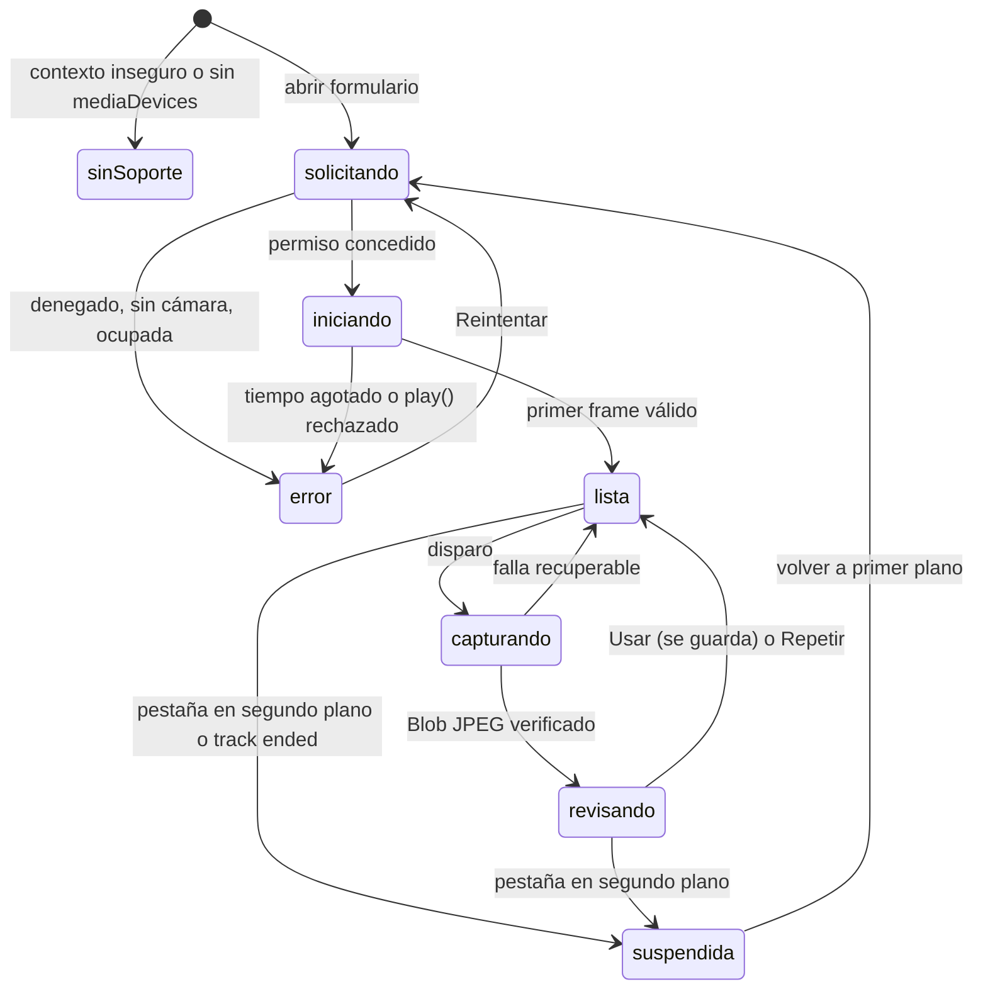
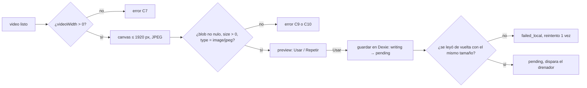

# Traslado web — patrón de arquitectura del front

**Para quién:** quien construya el front de Traslado en este proyecto.
**Fecha:** 2026-10-09.
**Convención:** *confirmado* sale del código revisado; *recomendación* es propuesta de diseño; *no verificado* queda abierto.
**Documentos hermanos:** [patron-traslado-web.md](patron-traslado-web.md) (contrato y estados), [BACKLOG.md](BACKLOG.md) (pendientes).

---

## 1. Objetivo rector

> **Una foto aceptada por el operario es una foto verificada y guardada en el dispositivo. Nunca se sube una foto vacía o ilegible, y nunca se pierde una foto aceptada.**

Todo el diseño se ordena alrededor de esa frase. Se mide con tres indicadores (§9).

Restricciones ya decididas (ver BACKLOG.md): captura con `getUserMedia` dentro de la página, Android e iPhone, sin PWA, endpoints existentes, `strict` en TypeScript.

---

## 2. Qué puede fallar al tomar la imagen

Este catálogo es el núcleo del diseño. Cada fila es un caso de prueba y una pantalla o mensaje.

| # | Falla | Cómo se detecta | Respuesta del sistema |
|---|---|---|---|
| C1 | **Contexto inseguro** (HTTP en la LAN) | `!window.isSecureContext` o `navigator.mediaDevices` indefinido | Pantalla bloqueante: «La cámara solo funciona con HTTPS». No se intenta abrir la cámara. |
| C2 | **Permiso denegado** | `NotAllowedError` | Instrucciones por plataforma (iPhone: Ajustes › Safari › Cámara; Android: candado de la barra). Botón «Reintentar». |
| C3 | **Sin cámara** | `NotFoundError` | Mensaje claro. No hay fallback de captura posible en el MVP. |
| C4 | **Cámara ocupada** | `NotReadableError` | «Otra app usa la cámara. Ciérrala y reintenta». |
| C5 | **Restricciones imposibles** | `OverconstrainedError` | Reintentar con `{ video: true }`. Registrar el evento. |
| C6 | **Stream que muere solo** (bloqueo de pantalla, llamada, pestaña en segundo plano) | Evento `ended` o `mute` en el track; `visibilitychange`; `track.readyState === 'ended'` | Estado `suspended`. Al volver, reabrir el stream. Si el navegador exige gesto, botón «Tocar para reactivar la cámara». |
| C7 | **Video no listo** (negro, 0×0) | `videoWidth === 0` o `readyState < 2` | Botón de disparo deshabilitado hasta tener el primer frame. Tiempo límite con mensaje. |
| C8 | **`play()` rechazado** | La promesa de `video.play()` falla | Mostrar botón de inicio con gesto del usuario. |
| C9 | **Blob nulo o vacío** | `toBlob` devuelve `null` o `size === 0` | Rechazar con «La foto llegó vacía. Vuelve a tomarla». Mismo criterio que la app. |
| C10 | **Formato equivocado** | `blob.type !== 'image/jpeg'` | Pedir siempre JPEG y verificar el tipo del resultado. La especificación hace que `toBlob` caiga a PNG si no soporta el tipo pedido, así que no confiar en WebP. El portal usa WebP, pero Traslado sube `image/jpeg` ([traslado_foto_service.dart:181](../sum-app/lib/features/traslado/data/traslado_foto_service.dart#L181)). |
| C11 | **Memoria agotada en el canvas** | Excepción en `drawImage` o `toBlob` | `try/catch`, lado largo máximo de 1920 px (el portal ya usa 1920), liberar el canvas (`width = 0`) tras cada captura. |
| C12 | **Doble disparo** | Segundo toque durante `capturando` | El botón se bloquea. Cada foto lleva `crypto.randomUUID()`. |
| C13 | **No se pudo guardar** (`QuotaExceededError`, modo privado) | Excepción de Dexie | Fila `failed_local`, un reintento, aviso «Espacio insuficiente». Consultar `navigator.storage.estimate()` al abrir el formulario. |
| C14 | **Pestaña descartada o recargada en plena escritura** | Al abrir, filas en `writing` | Marcarlas `failed_local` y pedir retomar solo esa zona. Las filas `pending` sobreviven. |
| C15 | **Reemplazar una foto buena por una mala** | Recaptura de una zona | La foto anterior no se borra hasta tener la nueva verificada en memoria. Es una diferencia consciente con la app, que borra primero ([traslado_foto_service.dart:49-53](../sum-app/lib/features/traslado/data/traslado_foto_service.dart#L49)). |
| C16 | **Subida fallida** | PUT con error de red, 403 o `TypeError` | 4 intentos con backoff, máximo 2 renovaciones de la URL firmada (403 = URL vencida). El `Content-Type` del PUT debe ser el mismo que se pidió en `upload-url`. |
| C17 | **CORS del bucket mal configurado** | `TypeError: Failed to fetch` sin código HTTP (indistinguible de falta de red) | Mensaje con diagnóstico. Se previene con la historia D3 del backlog. |
| C18 | **Sesión vencida con fotos pendientes** | 401 tras un refresh fallido | Las fotos no se tocan. Se bloquea el envío y se pide iniciar sesión. Al volver, se retoma. |
| C19 | **Conteo o zonas inválidos** | Distinto de 6 fotos / 6 zonas (salida) o 5 fotos (entrega) | Validar antes de enviar, para no provocar el 422. |

C1 a C8 salen de las tablas de errores del patrón; el catálogo de mensajes de permisos ya existe en el portal ([VinScannerModal.tsx:84-95](../sum-portal-front/src/components/VinScannerModal.tsx#L84)) y se puede reutilizar como texto.

---

## 3. Principios

1. **Disco antes que red.** Capturar no hace ninguna llamada. Es la regla de `patron-traslado-web.md` §3.
2. **Una sola sesión de cámara por formulario.** Se abre el stream una vez al entrar y se mantiene durante las zonas. Se detiene al salir o al pasar a segundo plano. Evita pedir permiso por cada foto y acorta la espera entre disparos. (El `VinScannerModal` del portal abre el stream dos veces, ahí se ve lo costoso.)
3. **Dexie es la fuente de verdad de las fotos.** La interfaz solo las lee.
4. **El dominio no conoce React ni el navegador.** Estados, zonas y reglas son funciones puras.
5. **Errores tipados, no excepciones sueltas.** Los límites entre capas devuelven un resultado con `code`, `retryable` y mensaje para el operario.
6. **Preview obligatorio.** Cada foto pasa por «Usar» o «Repetir» antes de guardarse. Sin esto, las fotos mal encuadradas llegan al supervisor.
7. **Dependencias hacia adentro.** `domain` no importa nada; `data` y `api` importan `domain`; la UI importa todo lo anterior. Se refuerza con la regla `no-restricted-imports` de ESLint.

---

## 4. Estructura propuesta

El portal organiza por tipo (`components`, `hooks`, `services`). Aquí propongo organizar por funcionalidad, para aislar el módulo de cámara y poder probarlo solo. *Recomendación.*

```
src/
  app/                    # arranque, router, providers, ErrorBoundary
  core/
    config/               # URL base relativa por defecto
    http/                 # apiClient: 401→refresh de un vuelo; política de 403; ApiError
    auth/                 # AuthPort + adaptador (cookie o mobile, ver D1) + sessionStore
    storage/              # db.ts (Dexie), persist.ts (storage.persist / estimate)
    diagnostico/          # DIFERIDO: bitácora de captura, fuera del alcance por ahora
    ui/                   # primitivas Tailwind con los tokens de la app
  features/traslado/
    domain/               # estadoFoto.ts, derivarEstadoOrden.ts, zonas.ts, reglas.ts
    api/                  # trasladoApi.ts, schemas.ts (zod), mapeo
    data/                 # fotoStore.ts, ordenCache.ts, catalogoCache.ts
    sync/                 # drenador.ts, locks.ts (Web Locks), igniciones.ts
    camera/               # ver §5
    pages/                # Home, Formulario, IdentificarVin
    components/           # TarjetaOrden, FichaZona, BannerConexion
  test/                   # fakes, MSW, fixtures
```

Alias `@/*` y Vitest, Playwright y MSW, igual que en el portal. Se activa `strict: true` (el portal lo tiene en `false`, [tsconfig.app.json](../sum-portal-front/tsconfig.app.json)) y `noUncheckedIndexedAccess`.

Puertos para poder probar con dobles: `CameraPort`, `FotoStorePort`, `TrasladoApiPort`, `AuthPort`.

---

## 5. Módulo de cámara

```
camera/
  capabilities.ts     # detectarSoporte(): contexto seguro, mediaDevices, plataforma
  cameraSession.ts    # máquina de estados; es dueña del MediaStream
  captureFrame.ts     # video → canvas → Blob JPEG verificado
  errors.ts           # CameraError: DOMException → código + mensaje en español
  useCameraSession.ts # hook de React
  CameraWidget.tsx    # <video playsInline muted autoPlay>, disparo, preview
```

### 5.1 Estados de la sesión



Reglas:
- Una transición no permitida lanza un error de programación (misma idea que `transicionarFoto` en la app). No se ignora en silencio.
- `suspendida → solicitando` intenta reabrir sin gesto. Si el navegador lo rechaza, muestra el botón de reactivar. No asumo cuál de los dos casos ocurre en iOS: el diseño soporta ambos. *No verificado en dispositivo.*
- El disparo solo se habilita en `lista`.
- La tabla implementada tiene cuatro transiciones más que el diagrama: `solicitando`, `iniciando` y `capturando` → `suspendida`, y `suspendida` / `error` → `iniciando`. Ver `src/features/traslado/camera/estadoCamara.ts` y PLAN-SPRINTS.md §2.2.

### 5.2 Restricciones de captura (recomendación)

- `video: { facingMode: { ideal: 'environment' }, width: { ideal: 1920 }, height: { ideal: 1080 } }, audio: false`.
- No fijar `deviceId: { exact }`: es frágil entre sesiones.
- Si falla por `OverconstrainedError`, reintentar con `{ video: true }`.
- Atributos de DOM: `playsInline`, `muted`, `autoPlay`. `playsInline` es obligatorio en iOS.
- Esperar `loadedmetadata` y un primer frame antes de habilitar el disparo (`requestVideoFrameCallback` si existe; si no, un tiempo máximo).

### 5.3 Captura de un frame



**Se valida en testeo (decidido):** capturar un frame del video da la resolución del *track* (por ejemplo 1920×1080), no la del sensor. `ImageCapture.takePhoto()` daría más resolución, pero Safari no lo soporta. Hasta el testeo se parte de 1920 px de lado largo, y esos valores van como constantes de configuración (`camera/config.ts`), no repartidos en el código, para poder cambiarlos sin tocar la lógica. Si el testeo muestra que no alcanza, se sube la resolución pedida al stream; subirla aumenta el uso de memoria y el peso de cada foto.

---

## 6. Datos locales (Dexie)

- Tabla `fotos`, clave única `[ordenId+momento+zona]` (igual que el índice de la app) y `clientId` único.
- Estados: `writing`, `pending`, `uploaded`, `failed_local`, `failed_upload`, según `patron-traslado-web.md` §2.1. La fila se inserta en `writing` antes de escribir el Blob.
- `navigator.storage.persist()` al entrar al formulario. En Safari puede devolver `false`: no se depende de ello, solo se informa.
- Al abrir la app: reconciliar filas `writing` (C14) y filas `pending` de sesiones anteriores.

## 7. Envío y sesión

- **Drenador** con candado `navigator.locks` para que dos pestañas no envíen a la vez. Orden fijo: tomas, salidas, entregas.
- **Subida temprana** (recomendación): iniciar la subida de cada foto apenas pasa a `pending` si hay red, sin esperar la sexta. Reduce el tiempo de exposición en iOS y es inocuo porque el enlace con la orden ocurre en `confirmar-*`.
- **Cliente HTTP:** 401 → un refresh compartido y un reintento; 403 del API → cierre de sesión; 403 del PUT firmado → URL vencida. Ver `core/http`.
- **Auth** detrás de `AuthPort`; el adaptador depende de la decisión D1 del backlog.

---

## 8. Prevención en la interfaz

- Contador `n/6` y `n/5` siempre visible y ficha por zona con la foto o el hueco.
- Guía visual de la zona activa sobre el video (FRONTAL, LATERAL IZQUIERDO, etc.).
- Banner de color arriba, nunca modal: ámbar sin conexión, verde listo, rojo error (patrón de la app, `patron-traslado-web.md` §5).
- Estado de cada foto visible: guardada, subiendo, falló (con botón de reintento).
- **Diferido (decidido):** la bitácora y el botón «Copiar diagnóstico» quedan fuera del alcance por ahora, junto con cualquier telemetría remota. Si se retoma, la idea era un registro local de códigos de error, tiempos y navegador, sin envío a la red. La app usa Firebase Crashlytics ([main.dart:25-33](../sum-app/lib/main.dart#L25)); el portal y el backend no tienen un equivalente para clientes web (ver §12). Un envío remoto se decide después del testeo.

---

## 9. Objetivos de error y cómo medirlos

| Indicador | Meta propuesta | Cómo se mide |
|---|---|---|
| Fotos vacías o ilegibles subidas | **0** | Prueba automática: ningún `uploaded` con `size = 0` o tipo distinto de JPEG. |
| Fotos aceptadas que se pierden | **0** | Prueba E2E: recarga forzada tras «Usar»; la foto sigue en Dexie. |
| Capturas que fallan por cámara (C2 a C8) | **A definir con el piloto** | Matriz de pruebas manuales en dispositivos (historia P-01). No fijo un número sin datos. |

---

## 10. Pruebas

| Nivel | Qué | Herramienta |
|---|---|---|
| Unidad | `domain/` completo: transiciones, `derivarEstadoOrden`, reglas de conteo | Vitest |
| Unidad | `captureFrame` con canvas y video simulados (C9, C10, C11) | Vitest + doble de `CameraPort` |
| Componente | `CameraWidget` con cada estado de la máquina | Testing Library |
| Contrato | `trasladoApi` contra las respuestas 404/409/422 | MSW |
| E2E | Flujo completo con cámara falsa | Playwright con `--use-fake-device-for-media-stream` y `--use-fake-ui-for-media-stream` (Chromium) |
| Aproximación a iOS | El mismo flujo en el proyecto WebKit de Playwright | Playwright WebKit (no es un iPhone real) |
| Dispositivo real | Lista manual: iPhone y Android, permiso denegado, bloqueo de pantalla, llamada entrante, recarga, modo avión | Manual, antes de cada demo |

Los casos C6, C13 y C14 solo se validan de verdad en dispositivo.

---

## 11. Historias derivadas (propuesta, sin estimar)

| ID | Historia | MoSCoW | Depende de |
|---|---|---|---|
| T1 | Detectar soporte de cámara y explicar bloqueos (C1 a C5) | Must | — |
| T2 | Sesión de cámara con máquina de estados y reanudación (C6 a C8) | Must | T1 |
| T3 | Capturar un frame JPEG verificado (C9 a C12) | Must | T2 |
| T4 | Guardar la foto en Dexie con verificación y recuperación (C13 a C15) | Must | T3 |
| T5 | Preview «Usar / Repetir» y contador por zona | Must | T3 |
| T6 | Subida con backoff y renovación de URL (C16, C17) | Must | T4, D3 |
| T7 | Confirmar salida y entrega con validación previa (C19) | Must | T6 |
| T8 | Drenador con candado entre pestañas y subida temprana | Should | T6 |
| T9 | Manejo de sesión vencida con fotos pendientes (C18) | Should | D1 |
| T10 | ~~Bitácora y «Copiar diagnóstico»~~ | Diferida | — |
| T11 | Aviso de foto oscura o tapada | Could | T3 |

### Historia detallada: T3 — Capturar un frame JPEG verificado

**Como** operario en el patio, **quiero** que la foto solo se acepte cuando salió bien, **para** no descubrir después que quedó vacía.

- **AC1.** Given la cámara en estado `lista`, When toco el disparo, Then se genera un Blob `image/jpeg` con `size > 0` y se muestra el preview.
- **AC2.** Given el video aún sin primer frame, When intento disparar, Then el botón está deshabilitado.
- **AC3.** Given `toBlob` devuelve `null`, `size 0` o un tipo distinto de JPEG, When termina la captura, Then no se guarda nada y veo «Vuelve a tomarla».
- **AC4.** Given toco el disparo dos veces seguidas, When la primera captura sigue en curso, Then solo se procesa una.
- **AC5.** Given una foto de 4000×3000 en el stream, When se captura, Then el lado largo del JPEG no supera 1920 px.
- **AC6.** Given una excepción por memoria en el canvas, When ocurre, Then veo un error recuperable y la cámara sigue en `lista`.

---

## 12. Preguntas abiertas

1. Resolución mínima de la evidencia: se define en el testeo (§5.3).
2. D1 del backlog: login A o B. Cambia el adaptador de `AuthPort`.
3. ¿Se acepta que en iOS pueda ser necesario un toque para reactivar la cámara tras volver de segundo plano? (§5.1)
4. Envío remoto de la bitácora: **fuera del testeo**. Hoy solo existe Crashlytics en la app móvil. Se revisa tras el piloto, con backend y seguridad de la información, y solo si «Copiar diagnóstico» resulta insuficiente.
