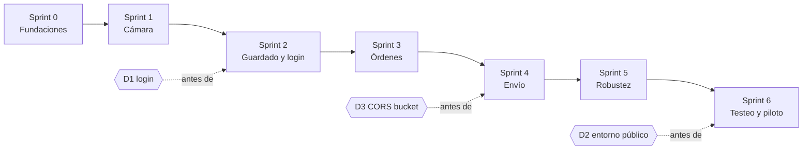

# Traslado web — plan de sprints

**Para quién:** el equipo que construye el front de Traslado y quien actúa como Product Owner.
**Fecha:** 2026-10-09.
**Convención:** *confirmado* sale del código revisado; *propuesta* es recomendación; *a definir* lo decide el equipo.
**Historias, criterios de aceptación y pruebas:** [BACKLOG.md](BACKLOG.md). **Fallas de captura C1–C19:** [ARQUITECTURA-FRONT.md](ARQUITECTURA-FRONT.md) §2.

---

## 1. Lo que este plan no decide

No conozco el tamaño del equipo, la duración del sprint ni la velocidad. Por eso:

- **Los sprints se definen por objetivo y por orden de dependencias**, no por una cantidad de puntos.
- **Los tamaños (S, M, L) son provisionales.** El equipo los convierte en puntos con Planning Poker.
- **La capacidad la calcula el equipo** en cada Planning, con la fórmula `miembros × días × horas × factor de foco`. El factor de foco de un equipo nuevo debe partir bajo; el primer sprint sirve para calibrarlo.
- **Un sprint es una propuesta de lo que cabe, no un compromiso.** El equipo se compromete en el Planning.

| Dato | Valor |
|---|---|
| Fecha de inicio | **2026-10-09** (Sprint 0) |
| Duración del sprint | **Sin duración fija.** Cada sprint cierra cuando se cumple su objetivo. |
| Miembros y dedicación | *a definir* |
| Factor de foco inicial | *a definir* |
| Dispositivos | iPhone y Android. Se prueba en ambos cuando haya algo que probar. Modelos y versiones: *a definir*. |

**Consecuencia de no fijar duración** (recomendación, no bloquea): sin un plazo fijo, la velocidad por tiempo y el gráfico de avance dejan de servir, y un sprint puede alargarse sin que nadie lo note. Para no perder esa señal, sugiero anotar la fecha de inicio y de cierre de cada sprint y fijar un aviso (por ejemplo, revisar el objetivo si pasan más de 4 semanas). El plazo exacto lo decide el equipo.

---

## 2. Secuencia propuesta

| Sprint | Objetivo | Historias | Entrada (debe estar listo) | Salida (se demuestra en la Review) |
|---|---|---|---|---|
| **0** | El proyecto compila, se prueba y corre por HTTPS en un iPhone y un Android. | F-01, F-02, F-03, A-01 | Dependencias aprobadas (ver §6.1). Un iPhone y un Android para probar cuando haya algo que probar. | La app abre en un iPhone con `isSecureContext = true`. Las reglas del dominio pasan sus pruebas. |
| **1** | Un operario abre la cámara en iPhone y Android y obtiene una foto JPEG verificada con preview. | S-01 (spike), T1, T2, T3, T5 | F-01 con HTTPS en el teléfono. | Demo en teléfonos reales: abrir cámara, tomar, usar o repetir; errores de permiso con sus mensajes. |
| **2** | Las fotos aceptadas sobreviven a una recarga y el operario inicia sesión. | T4a, T4b, A-02 | **D1 decidido: opción A** (2026-10-09). | Aceptar una foto, recargar con fuerza y verla. Login y restauración de sesión en Safari de iPhone. |
| **3** | El operario ve y toma una orden y elige placa y proveedor. | O-01, O-02, O-04, O-03 | Órdenes, placas y proveedores de prueba en el backend local `:8050`. | Home con las dos secciones; carrera de toma con dos usuarios; selector de placa. |
| **4** | La salida y la entrega se confirman de punta a punta contra el backend y GCS. | E4-01, E4-02 | **D3 hecho** para los orígenes de desarrollo. | Seis fotos de salida y cinco de entrega confirmadas; resultado `confirmada` y `descartada_por_supervisor`. |
| **5** | Lo pendiente se envía solo y la sesión vencida no pierde fotos. | E4-03, E4-04 | E4-02 aceptada. | Modo avión con fotos pendientes: al volver la señal se envían; dos pestañas no duplican. |
| **6** | Piloto con operarios en un entorno público. | P-01, D2 | **D2 listo.** Lista de dispositivos del piloto. | Matriz de pruebas completada y resolución aprobada o ajustada. |

**Fuera de la secuencia (Could):** O-05 (escanear VIN con la cámara) y T11 (aviso de foto oscura). Entran si sobra capacidad.

### Riesgos de la secuencia

- **Sprint 1 es el más cargado en incertidumbre.** T2 es L y T5 es M. Si el equipo no cree que quepa, el primero en bajar es T5; T1 a T3 son el núcleo.
- **Sprint 5 y 6 pueden ser demasiado grandes** (E4-03 es L). Si el equipo lo ve así, se parte en dos sprints.
- **Los sprints 2 y 4 dependen de decisiones de otros (D1 y D3).** Si no están cerradas al empezar el sprint, la historia no entra.

### Spike S-01 — Cámara de iOS al volver de segundo plano
- **Qué es:** prueba acotada en tiempo para resolver la pregunta abierta de ARQUITECTURA-FRONT.md §5.1: si Safari reabre la cámara sin un toque al volver al primer plano.
- **Cuándo:** primeros días del Sprint 1, con un prototipo mínimo (`getUserMedia` + `visibilitychange`) sobre el HTTPS de F-01.
- **Resultado esperado:** una nota con lo observado en cada dispositivo, que decide si T2-AC4 muestra o no el botón «Tocar para reactivar la cámara». No produce código de producción.
- **Duración máxima:** *a definir por el equipo*.

---

## 2.1 Avance del Sprint 0

Actualizado el 2026-10-09.

| Historia | Estado | Detalle |
|---|---|---|
| F-01 Esqueleto y HTTPS local | **Terminada** | Verificada en la PC, el iPhone y el Android por `https://<IP>:5173` con `npm run dev:https`. Se probó con certificado **autofirmado**, no con mkcert. Solo demuestra que el navegador ofrece cámara; que se abra el video lo prueba T2. |
| F-02 Tokens y componentes base | **Terminada, salvo el AC4** | 71 pruebas. AC1, AC2, AC3 y AC5 verificados. **AC4 (360 px sin desborde) sin verificar:** jsdom no calcula maquetación; solo se comprobó que los componentes no fijan anchos y permiten encoger. Falta mirarlo en un teléfono. |
| F-03 Dominio puro | **Terminada** | 82 pruebas. Zonas, estados de foto, estado derivado de la orden, validación de confirmación y fecha medida. |
| A-01 Cliente HTTP | **Terminada** | 32 pruebas, con un `fetch` simulado (no MSW; MSW se incorpora con O-01). Decisiones abajo. |

Evidencia: `lint`, `typecheck` estricto y `build` pasan; 198 pruebas pasan en 10 archivos. El proxy llega al backend en `:8050` (sin sesión devuelve 401, lo esperado).

**Decisiones tomadas al implementar F-02**
- `src/index.css` es la única fuente de los tokens y una prueba la compara con la tabla de `patron-traslado-web.md` §5. Se desactivó la paleta por defecto de Tailwind: un color fuera de la app no compila en silencio.
- El contraste se mide con una prueba propia sobre los valores reales, porque `vitest-axe` no puede medirlo en jsdom. Todos los pares que usan los componentes llegan a 4,5:1 (3:1 en los números grandes del contador). Los dos del banner pasan por poco: 4,51 y 4,57.
- **Hallazgo sobre los tokens de la app, que no cambié:** `ink-3` sobre `page` da 4,34:1 y no llega a 4,5. Sobre blanco sí llega (4,76). `ink-muted` da 2,56:1 sobre blanco, solo sirve para iconos y adornos. Queda anotado en el CSS.
- El alto del botón normal (44 px mínimo) lo elegí yo para tocarlo con el pulgar; el documento solo da el del compacto (32 px).
- El color de cada número del contador sale de `traslado_home_page.dart`: enviados `success`, por enviar `warning-ink`, sin empezar `ink-3`. Calcular los tres grupos queda para O-01.
- `vitest-axe` 0.1.0 declara sus tipos para un Vitest antiguo; se añadió `src/test/vitest-axe.d.ts` para Vitest 4.

**Decisiones tomadas al implementar F-03**
- No se implementó `transicionarOrden` ni el estado `confirmando` de la app. El estado de la orden es derivado y no se guarda, así que una tabla de transiciones no tiene qué proteger.
- `calcularAvance` (el contador «enviados · por enviar · sin empezar» de la app) queda para O-01, donde se usa.
- `fechaMedida` devuelve un `Date`; su `toISOString()` ya es UTC, que es lo que espera el backend.

**Decisiones tomadas al implementar A-01**
- `refreshSession` devuelve `ok`, `expirada` o `sin_conexion`, y no un simple verdadero o falso. **Sin red al renovar no se cierra la sesión** (igual que `api_client.dart`): el operario conserva su trabajo. Si la renovación lanza una excepción, se trata como falta de red.
- El cliente no sabe cómo se renueva la sesión: lo inyecta el módulo de autenticación (A-02). Así el esquema de login se puede cambiar sin tocarlo.
- El token nunca viaja a una URL absoluta (la firmada de GCS) ni a `/api/login|refresh|logout`.
- **Tensión entre A-01 y A-02: resuelta el 2026-10-09.** A-01 no cambia (un 403 cierra la sesión por defecto). Todas las llamadas de Traslado pasan `cerrarSesionEn403: false` desde un solo lugar, y la pantalla «Sin permiso para Traslado» la muestra la home (O-01 AC6). Se mantiene mínima a propósito: hoy no hay ningún usuario real confirmado con un rol fuera de la lista, así que el «Reintentar» y la distinción de 403 sin JSON quedaron como opcionales. Si backend confirma que ese caso no existe, el costo de lo dejado es una constante y una pantalla.

---

## 2.2 Avance del Sprint 1

Actualizado el 2026-10-09.

| Historia | Estado | Detalle |
|---|---|---|
| S-01 Spike de la cámara en iOS | **Preparado; falta ejecutarlo en un iPhone** | Pantalla provisional «Prueba de cámara» (botón «Probar la cámara»), con la lista en pantalla de los cambios de estado. Pasos abajo. |
| T1 Soporte y errores de la cámara | **Terminada, salvo la prueba manual** | AC1 a AC4 verificados con pruebas automáticas. Falta [M]: denegar el permiso en iPhone y Android y comprobar que las instrucciones son correctas (los pasos de cada sistema no están verificados en dispositivo). |
| T2 Sesión de cámara con máquina de estados | **Terminada, salvo la prueba manual** | AC1 a AC7 verificados con pruebas automáticas. Falta [M]: bloquear la pantalla, recibir una llamada y cambiar de app, en iPhone y Android. |
| T3 Capturar un frame JPEG verificado | **Terminada, salvo la prueba manual** | AC1 a AC5 verificados con pruebas automáticas. Falta [M]: tomar una foto real en iPhone y Android y comprobar que el archivo resultante abre y es JPEG. La pantalla de prueba muestra tamaño, peso y tipo de la última foto. |
| T5 Preview «Usar / Repetir» y contador por zona | **Terminada, salvo la prueba en teléfono** | AC1 a AC6 verificados con pruebas automáticas. Falta mirarla en el teléfono: la maquetación (360 px sin desborde) y que la guía de cada zona se entienda. Desde T4a las fotos se guardan en IndexedDB. |
| T4a Guardar la foto en Dexie con verificación | **Terminada, salvo la prueba en dispositivo** | AC1 a AC6 verificados con pruebas automáticas sobre IndexedDB simulado. Falta probarla en iPhone y Android: guardar una foto, recargar y cerrar la pestaña desde el selector de apps, y comprobar que la foto sigue ahí. **Es la prueba que confirma el riesgo R2** (Safari y IndexedDB). |
| T4b Reconciliar al abrir | **Terminada, salvo la prueba en dispositivo** | AC1 a AC4 verificados con pruebas automáticas. Falta [M]: cerrar la pestaña desde el selector de apps en iPhone y Android (es la misma comprobación de T4a). Lo que no se puede reproducir con pruebas es matar el navegador exactamente en mitad de una escritura: solo se simula con una escritura que nunca termina. |
| A-02 Login y sesión (opción A) | **Hecha en código; AC4 bloqueado en el navegador** | AC1, AC2, AC3, AC5 y AC6 verificados. **AC4 (recargar restaura la sesión) no se cumple en Chrome ni en Edge** con el backend de desarrollo actual, porque ese backend emite la cookie de refresh con `SameSite=None` y sin `Secure` y el navegador la rechaza. No es un error del código del cliente: con `SameSite=Lax` o con `SameSite=None; Secure` funciona. Requiere un cambio de configuración en el backend (ver abajo). |

Evidencia: ver el recuento actualizado al final de esta sección. Para comprobar que las pruebas detectan fallos se rompieron a propósito siete comportamientos (soltar la cámara que llega tarde, suspender en segundo plano, pedir el gesto al volver, la protección de «Repetir», las `key` de los botones, liberar el lienzo y comprobar el tipo del Blob) y todas las averías hicieron fallar al menos una prueba.

**Cómo ejecutar el spike S-01** (necesita `npm run dev:https` y un iPhone en la misma red)
1. Abrir `https://<IP de la PC>:5173`, tocar «Probar la cámara» y permitir el acceso. El estado debe llegar a `lista`.
2. Bloquear la pantalla unos 10 segundos y desbloquear. Mirar la lista de cambios: ¿vuelve a `lista` sola, o queda `suspendida (pide un toque)`?
3. Repetir cambiando a otra app y volviendo; y, si se puede, con una llamada o con Siri.
4. Anotar el resultado con el modelo y la versión de iOS. La sesión ya soporta las dos respuestas; el resultado solo confirma cuál ocurre.

**Decisiones tomadas al implementar T1 y T2**
- Se añadieron cuatro transiciones a la máquina de estados: pasar a segundo plano mientras se pide la cámara, se inicia o se captura (`solicitando`, `iniciando`, `capturando` → `suspendida`), y reiniciar solo el video sin pedir otro stream (`suspendida`, `error` → `iniciando`). Sin ellas un evento en mal momento dejaba la sesión sin salida.
- El primer frame se detecta por eventos del video (`videoWidth > 0` y `readyState ≥ 2`) con un tiempo límite de 8 s. No se usó `requestVideoFrameCallback`.
- Si el track termina solo con la página visible, la sesión se reabre sola; con la página oculta no. Una interrupción (`mute`) suspende sin soltar el stream y se reanuda al volver (`unmute`) sin pedir otra cámara.
- Al volver de segundo plano, un permiso rechazado se trata primero como «falta un toque» (`suspendida` con el botón «Tocar para reactivar la cámara»). Solo si el permiso sigue rechazado tras el toque se muestra el error con las instrucciones.
- La cámara se abre con un toque del operario, no al cargar la página, para que el permiso se pida con un gesto.
**Decisiones tomadas al implementar T3**
- **Error encontrado por las pruebas y corregido:** con un doble toque sobre «Tomar foto», React reutilizaba el mismo botón físico y lo convertía en «Repetir», así que el segundo toque descartaba la foto recién tomada. Se separaron los dos botones (`key` distintas) y además «Repetir» ignora toques durante los primeros 500 ms tras aparecer la foto, porque en un teléfono real el segundo toque cae justo encima del botón nuevo. Los 500 ms son una propuesta y se ajustan en P-01.
- Un segundo toque mientras la primera captura sigue en curso se ignora (`capturar()` devuelve `null`); no lanza.
- **Si la cámara se pausa en plena captura, el resultado se descarta** y no se pasa a `revisando`. Consecuencia conocida: si el operario cambia de app mientras mira la foto en revisión, esa foto se pierde (no se había guardado). Aceptable hasta T4a; T5 puede refinarlo.
- La URL de la vista previa la administra la sesión: se crea al entrar a `revisando` y se revoca al salir, sea por repetir, por pausa o por cierre.
- Todo fallo de captura vuelve como resultado con mensaje para el operario y nunca lanza; el lienzo se libera siempre. Un lienzo sin contexto se interpreta como falta de memoria (es una inferencia, no verificada en iOS).
- Si `toBlob` no responde en 10 s, la captura falla en vez de quedar colgada.
- Calidad JPEG 0,9 y lado largo de 1920 px son valores iniciales en `config.ts`, a validar en P-01 junto con la resolución.

**Decisiones tomadas al implementar T5**
- **El almacenamiento es un contrato (`FotoStorePort`).** T5 solo necesita `listar` y `guardar`. Empezó con una implementación en memoria, que ya solo se usa en pruebas; T4a la reemplazó por una con Dexie.
- **«Usar» guarda en la zona que estaba activa cuando se tomó la foto**, y las fichas se bloquean mientras hay una foto en captura o en revisión. Sin eso, un toque suelto en otra ficha mandaba la foto a la zona equivocada.
- **Una foto solo aparece en el formulario después de que el almacén confirmó haberla guardado.** Si guardar falla, el contador no cambia, la foto sigue en revisión con un aviso, y la foto anterior de esa zona queda intacta (falla C15).
- **La siguiente zona es la que viene después de la actual, dando la vuelta al final.** Si el operario empieza por una zona del medio, el hueco de antes se recupera al terminar la lista. Es mi lectura de «siguiente zona sin foto» (criterio AC3).
- **«Usar» tiene la misma protección de 500 ms contra el toque accidental que «Repetir»**, y mientras guarda ignora un segundo toque y bloquea «Repetir».
- **Si la cámara se pausa mientras se guarda, el guardado termina igual** y no se muestra un error falso.
- **Con todas las zonas tomadas el disparo se bloquea** y se avisa; para repetir una foto hay que tocar su ficha.
- **La «guía visual» es el nombre de la zona sobre el video, con un marco punteado.** No hay silueta ni dibujo por zona; si hace falta algo más explícito, es trabajo de diseño que no está definido.
- La pantalla de prueba ahora es el formulario completo, con selector de salida (6) y entrega (5).

**Recuento al terminar T5:** `lint`, `typecheck` estricto y `build` pasan; 463 pruebas pasan en 19 archivos. Para comprobar que las pruebas detectan fallos se rompieron a propósito cinco comportamientos de T5; **dos pasaron sin que ninguna prueba fallara** (la siguiente zona calculada desde el principio y el cierre de la revisión sin comprobar), se reforzaron las pruebas y ahora ambas averías se detectan.

**Decisiones tomadas al implementar T4a**
- **Dos tablas, no una.** El backlog pedía a la vez un índice único por `(orden, momento, zona)` y que la foto anterior no se borre hasta tener la nueva verificada; con ese índice las dos filas no pueden convivir. Solución: la foto nueva se escribe en una tabla de paso (`enEscritura`, sin índice único), se verifica leyéndola de vuelta y recién entonces, **en una sola transacción**, se borra la anterior y la nueva pasa a `fotos`. Si algo falla antes, la anterior no se toca (falla C15). Una prueba provoca un fallo a mitad de la transacción y comprueba que el borrado se deshace.
- **La fila `writing` se inserta sin el Blob**, antes de escribirlo, como pedía el criterio. Así, si el proceso muere a mitad, queda una fila `writing` detectable (T4b).
- **«Verificada» significa que al leerla de vuelta tiene el mismo tamaño.** No se comparan los bytes.
- **Dos intentos de escritura; un error de cuota no se reintenta**, porque reintentar no libera espacio.
- **Una foto que falló queda en `enEscritura` como `failed_local`, sin el Blob y con el motivo.** No cuenta como aceptada. T4b la mostrará para retomar esa zona.
- **El mensaje para el operario viaja en el error** (`mensajeParaElOperario`), y el widget lo muestra sin conocer de dónde viene. Así «Espacio insuficiente» llega a la pantalla sin acoplar la interfaz al almacén.
- **Al abrir el formulario** se pide `storage.persist()` y se mide el espacio. Por debajo de **50 MB** libres se avisa; el umbral es una propuesta mía. Nada de esto bloquea, y un `false` de `persist()` no muestra aviso.
- **`dexie-react-hooks` no se instaló todavía:** el controlador del formulario ya cubre la reactividad. Sigue aprobada si resulta útil.
- **La pantalla de prueba ahora usa el almacén real** (orden de prueba 0): las fotos sobreviven a una recarga y **se acumulan en el teléfono**, sin forma de borrarlas salvo limpiar los datos del sitio. La limpieza llega con la confirmación (E4-02). No se envían a ningún sitio.
- **En las pruebas con jsdom hay que usar el `Blob` de Node:** el de jsdom no sobrevive al clonado de `fake-indexeddb` y la verificación lo rechaza (es decir, la verificación hizo su trabajo). En un navegador real no ocurre.

**Recuento al terminar T4a:** `lint`, `typecheck` estricto y `build` pasan; 509 pruebas pasan en 21 archivos. Se rompieron a propósito ocho comportamientos del almacén (no verificar la lectura, no reintentar, reintentar ante cuota, borrar la anterior antes de verificar, escribir el Blob antes del estado `writing`, no marcar `failed_local`, no reconocer la cuota y el límite del aviso de espacio) y **las ocho averías hicieron fallar al menos una prueba**.

**Decisiones tomadas al implementar T4b**
- **Una fila `writing` es «huérfana» cuando lleva 30 segundos o más.** Guardar una foto tarda del orden de un segundo; el margen evita marcar como fallida la foto que **otra pestaña** está guardando en ese instante. Es una propuesta y no es exacto: no hay un candado entre pestañas. Consecuencia: si el operario cierra la página y la reabre en menos de 30 s, esa fila no se reconcilia hasta la siguiente apertura; mientras tanto la zona se ve «Sin foto» y la vuelve a tomar igual.
- **Solo se pide retomar las zonas que no tienen otra foto aceptada.** Si el intento fallido era una repetición, la foto anterior sigue intacta (falla C15) y no hay nada que pedir: esas filas se limpian sin avisar.
- **Una foto a medias no se recupera, se descarta.** Aunque la fila tuviera el Blob completo (el proceso murió justo antes de promoverla), se marca `failed_local` y se suelta el Blob, como pedía el criterio. Recuperarla habría sido posible pero obliga a decidir qué hacer si entretanto la zona se volvió a fotografiar.
- **Al guardar con éxito una zona se borran sus intentos fallidos**, para que el aviso no reaparezca. No se borran las filas `writing` ajenas.
- **Si la reconciliación falla, las fotos aceptadas se muestran igual** y no se marca un error de carga.
- **El aviso es rojo y nombra las zonas** («Hay fotos que no se guardaron al cerrarse la página y hay que volver a tomarlas: Lateral derecho, Posterior»), y cada ficha afectada dice «Vuelve a tomarla».
- La reconciliación es **idempotente** y nunca toca las fotos aceptadas.

**Recuento al terminar T4b:** `lint`, `typecheck` estricto y `build` pasan; 531 pruebas pasan en 21 archivos. Se rompieron a propósito ocho comportamientos nuevos (no marcar la fila abandonada, el límite de 30 s, ignorar la antigüedad, pedir retomar una zona que ya tiene foto, borrar escrituras ajenas, no limpiar los fallidos, no quitar la zona del controlador y ocultar el aviso) y **las ocho averías hicieron fallar al menos una prueba**.

**Hallazgo de A-02: el navegador rechaza la cookie de refresh del backend de desarrollo**
- **Qué pasa:** el backend emite `Set-Cookie: sum_refresh_token=…; HttpOnly; Path=/api; SameSite=none` **sin `Secure`**. Chrome y Edge la descartan; el login funciona (entra a la pantalla de Traslado) pero **al recargar la página se pide login otra vez**.
- **Cómo se comprobó (Playwright con los Chrome y Edge instalados, a través del servidor de Vite y contra el backend real):** la prueba `e2e/login.spec.ts` falla en los dos navegadores. Después se repitió el experimento con un proxy temporal que reescribía la cabecera, para que el navegador hiciera todo el camino él solo:

  | Cookie | ¿La guarda Chrome? | Recargas seguidas con sesión |
  |---|---|---|
  | Como la manda hoy el backend (`SameSite=None`, sin `Secure`) | **No** | **0** |
  | `SameSite=Lax` (el valor por defecto de `config.py`) | Sí | **3 de 3** |
  | `SameSite=None; Secure` | Sí | **3 de 3** |

  Solo se midió en Chrome; Edge se midió únicamente con la cookie original (también falla). Firefox y Safari no se verificaron. Se probó por `http://localhost` (no por HTTPS).
- **Por qué es configuración y no código:** `config.py` tiene por defecto `lax` y `Secure=true`; el proceso en `:8050` tiene un valor distinto puesto por variable de entorno (`REFRESH_COOKIE_SAMESITE=none` y `SECURE` apagado). Con nuestro diseño de mismo origen (proxy de Vite hoy, nginx en D2) basta `lax`.
- **Lo que hay que pedir al backend:** `REFRESH_COOKIE_SAMESITE=lax` en el proceso de `:8050`; o, si necesitan `none` para otro cliente, `REFRESH_COOKIE_SECURE=true`. **No cambié nada en el repositorio del backend.**
- **Consecuencia para el piloto:** esto cambia el requisito de la decisión D1. La opción A **solo funciona si la cookie llega con una combinación que el navegador acepte**. Hay que verificar el valor de producción (I-6), no solo el de desarrollo.
- **Mientras tanto,** la prueba E2E está marcada como **fallo esperado** y detecta sola la causa (mira la cabecera `Set-Cookie` del login). Cuando el backend corrija la cookie, la prueba se ejecutará normalmente y Playwright avisará de que ya se puede quitar la marca. No oculta fallos del código del cliente.

**Decisiones tomadas al implementar A-02**
- **Un login fallido llega con HTTP 200 y `success: false`** (es lo que hace `/api/login`; `/mobile/auth/login` en cambio lanza 401). Se muestra el mensaje del servidor tal cual; es el mismo para una contraseña mala que para un usuario inexistente.
- **El refresh rota la cookie y rechaza la anterior con 401.** Por eso hay un solo refresco en vuelo, y entre pestañas un candado (Web Locks). Dos refrescos simultáneos con la misma cookie harían caer la sesión. Esto afectaba incluso al modo estricto de React, que monta dos veces. Una prueba demuestra que **sin el candado la segunda pestaña pierde la sesión**.
- **Solo un 401 termina la sesión.** Un refresco que falla por red, por límite de peticiones (429) o por un error del servidor (5xx) la deja como está. Sin red al recargar, si se sabe quién es, se muestra «No se pudo comprobar tu sesión» con «Reintentar», no el login.
- **La respuesta del refresh no trae el nombre de usuario.** Se guarda en el navegador junto a rol, área y apps permitidas. **Nunca se guarda el token**: vive solo en memoria, y una prueba lo comprueba.
- **Un logout sin red se recuerda.** La cookie HttpOnly no se puede borrar desde JavaScript; si el logout no llegó al servidor, al abrir no se restaura la sesión y se reintenta el logout.
- **Al arrancar sin sesión la app hace un refresh que devuelve 401** (no puede saber si hay cookie, al ser HttpOnly). Cuenta en el límite de 20 por minuto; con el proxy de D2 compartiendo IP (riesgo R4) conviene tenerlo presente.
- **Las pantallas** son: «Comprobando tu sesión…», login, «Sin acceso a Traslado» (sin `traslado` en `allowed_apps`), y «Sin conexión». El 403 por rol no permitido lo trata la home (O-01 AC6), no el login.
- **La pantalla provisional de pruebas ahora está detrás del login** y saluda con el nombre.
- **El campo de texto mide 16 px** para que Safari en iPhone no amplíe la página al enfocar.
- **Pruebas contra el backend real:** 9, en una sola sesión encadenada, que hacen **2 logins por corrida** (el límite es 10 por minuto). Se omiten solas sin credenciales o sin backend. Las credenciales salen de `.env.local`.
- **Se eliminó el usuario real de los archivos de pruebas:** la contraseña de prueba es igual al usuario, así que ese texto publicaba la contraseña. Las pruebas usan un nombre inventado.

**Recuento al terminar A-02:** `lint`, `typecheck` estricto y `build` pasan; **601 pruebas de Vitest en 24 archivos** (9 contra el backend real) y 4 de Playwright en Chrome y Edge. Se rompieron a propósito diez comportamientos (refresh sin un solo vuelo, un 429/5xx que cierra la sesión, guardar el token en el navegador, ignorar el logout pendiente, restaurar sin un solo vuelo, login concurrente, acceso siempre permitido, mostrar el login mientras se comprueba la sesión, refresh sin candado y no borrar la contraseña): **nueve se detectaron a la primera y una no** (restaurar sin un solo vuelo, porque el refresh interno ya lo protegía); se añadió una prueba y ahora se detecta.

---

## 2.3 Avance del Sprint 3

Actualizado el 2026-10-09.

| Historia | Estado | Detalle |
|---|---|---|
| A-03 Una sola sesión en todas las pestañas *(añadida el 2026-10-09)* | **Hecha en código** | Ver abajo. La parte «pasar sola a otra persona» no se puede probar en navegador real hasta que se corrija la cookie del backend. |
| O-01 Home con «Mis traslados» y «Disponibles hoy» | **Hecha en código; faltan dos verificaciones** | AC1 a AC6 con pruebas automáticas. Falta mirarla en un teléfono (360 px) y probar el 403 con un usuario real de rol no permitido. |
| O-02 Tomar y soltar una orden | **Hecha en código; falta probarla en un teléfono** | AC1 a AC7 con pruebas. Ver abajo. |
| O-04 Catálogos y selector de placa y proveedor | **Hecha en código; falta probarla en un teléfono** | AC1 a AC3 con pruebas; AC4 depende de E4-02. Ver abajo. |
| O-03 Identificar un VIN | **Hecha en código; falta probarla en un teléfono** | AC1 a AC5 con pruebas. Pendiente: decidir la búsqueda parcial. Ver abajo. |

**Decisiones tomadas al implementar O-01**
- **Un solo endpoint para las dos secciones.** `mis-ordenes` devuelve las propias y las del pool. Una orden es «mía» si tiene conductor **o** si la toma está pendiente de registrarse (`tomaSync`); el resto es pool. Se conserva el orden en que las entrega el servidor.
- **Primero lo guardado, después el servidor.** La home pinta lo que hay en el teléfono y enseguida pide lo último, así no queda en blanco con mala señal. Sin red se sigue viendo lo guardado y aparece el banner ámbar. Un error del servidor (500, 502) se muestra aparte, en rojo: no se confunde con falta de conexión.
- **La mezcla con la caché sigue las reglas de la app:** se reemplaza por la lista del servidor salvo las órdenes con la toma pendiente; si el servidor trae placa o proveedor vacíos se conservan los anteriores; un conductor nulo significa «sin dueño» y no se conserva el anterior.
- **El filtro de VIN trabaja sobre lo ya cargado,** no consulta al servidor (funciona sin red). No distingue mayúsculas ni espacios en los extremos.
- **El 403 muestra «Sin permiso para Traslado»** con el mensaje del servidor y un botón para cerrar sesión; la sesión no se cierra sola. La política está en una constante (`OPCIONES_TRASLADO`) y una prueba de guarda obliga a que toda función nueva de `trasladoApi` la use.
- **La base local pasa a la versión 2** (se añade el almacén `ordenes`). Hay una prueba de migración: una base con fotos de la versión anterior las conserva intactas.
- **Se actualiza sola al volver la red** (evento `online`) y con el botón «Actualizar». No se actualiza por tiempo ni al volver a la pestaña: no estaba pedido y se puede añadir si hace falta.
- **Se vacía la caché de órdenes al cerrar o expirar la sesión,** para que otra cuenta no vea órdenes ajenas. Las fotos no se tocan.
- **La pantalla provisional se reemplazó por la home.** Sus comprobaciones (HTTPS, cámara) y la prueba de cámara quedaron plegadas al pie, en «Herramientas de prueba», hasta que exista el flujo real (E4).
- **Añadí un aviso que los AC no pedían:** si el servidor manda órdenes con datos inválidos, la home dice cuántas no se pudieron mostrar. Sin él, una orden desaparecería sin explicación. Se quita si no se quiere.
- **No se incorporó MSW** (A-01 lo había previsto para esta historia): las pruebas usan dobles del controlador y de la API, y las del contrato van contra el backend real.

**Correcciones tras la revisión de código (2026-10-09).** Ambas se reprodujeron con una prueba antes de corregirlas.
- **(d) Cerrar sesión mientras se guardaba la lista:** si el cierre caía entre leer la caché y guardarla, el guardado volvía a escribir las órdenes de la cuenta que acababa de salir. Se comprueba de nuevo la sesión justo antes de guardar, y `OrdenesCacheDexie` pone sus escrituras en fila. **Medido, no supuesto:** Dexie no garantiza el orden por sí solo; un `clear()` pedido justo después de un reemplazo corría antes, con la base recién creada y también ya abierta.
- **(e) Un borrado que falla ya no se oculta:** al cerrar sesión se pone primero una marca de «limpieza pendiente» (en `localStorage`, para que sobreviva a una recarga). Mientras esté puesta, lo guardado no se muestra y se reintenta borrar. La quita un borrado que funciona, o un guardado completo de la lista nueva, que reemplaza todo lo anterior.
- **Límite que queda:** con varias pestañas abiertas, una que siga con la sesión anterior todavía podría escribir en la caché compartida. No lo reproduje; se resolvería guardando el usuario junto a cada orden.

**Decisiones tomadas al implementar A-03 (2026-10-09)**
- **Decidido por el usuario:** cuando otra pestaña entra con otra persona, esta pasa a ella **sola**; no hay aviso en el login cuando ya hay otra sesión abierta.
- **La identidad sale del token** (`sub` y `user_id`, que firma el backend en `auth_service.py`). Se lee sin verificar la firma: el servidor la verifica en cada petición; aquí solo sirve para saber si la sesión sigue siendo de la misma persona. **Corrige un fallo que ya existía:** tras un refresh se conservaba el usuario anterior aunque la cookie fuera de otra persona.
- **Avisos entre pestañas:** `BroadcastChannel`, con el evento `storage` de respaldo. Se anuncian el login y el logout a propósito. **Una sesión que expira (401) no se anuncia:** si se anunciara, una pestaña que se abre sin cookie podría cerrar la sesión que otra acaba de iniciar.
- **«Épocas» de la sesión:** cada login, logout o aviso cambia la época de la pestaña, y un refresh que empezó en una época anterior se descarta en vez de pisar la sesión nueva. Se probó con una respuesta que llega tarde.
- **Mientras una pestaña cambia de persona muestra «Comprobando tu sesión…»,** nunca la sesión anterior. La home se vuelve a montar por persona (el filtro escrito no queda).
- **La caché de órdenes tiene dueño:** se guarda el id de quien trajo las órdenes; si la lista se abre con otra persona, lo guardado no se muestra y se borra, aunque no haya red. Es la segunda línea de defensa si un aviso no llega.
- **El canal se conecta en `composicion.ts`.** Por defecto `AuthCookie` no usa ninguno: así las pruebas no se hablan entre sí por un `BroadcastChannel` real.

**Qué no cubre:** cada navegador, perfil o ventana de incógnito tiene su propia sesión (es una por navegador, no una por persona). Las fotos no guardan a qué usuario pertenecen. La E2E con dos pestañas reales prueba el logout; «entra otra persona» necesita la cookie corregida y un segundo usuario de prueba.

**Decisiones tomadas al implementar O-02 (2026-10-10).** Las seis eran del usuario; se tomaron tras comparar con la app móvil y el backend.
- **Toma pendiente aparte, con su dueño.** Vive en una tabla propia (`tomas`, base v3), no en la caché de órdenes: cerrar sesión no la borra y solo la ve y la envía quien la hizo. Resuelve el hallazgo que dejó O-01. La copia de la orden que lleva la toma permite seguir mostrándola aunque el servidor ya no la devuelva.
- **Solo el botón «Comenzar despacho» toma.** Tocar la tarjeta no hace nada: un toque accidental asignaría un auto y lo quitaría del pool de todos. (La app móvil toma con el toque; se cambió AC1.)
- **Un 409 al enviar una toma pendiente no se reintenta.** La tarjeta pasa a rojo y dice «La tomó …»; las fotos se conservan porque, si igual hizo la salida, el backend decide con la evidencia. (La app móvil la reintenta para siempre; la revisión de código lo marcó como fila zombi.)
- **Soltar solo lo tomado en este navegador.** Es lo que hace la app. Una orden asignada por un supervisor no se ofrece. Tras cerrar sesión se pierde la marca «tomada aquí» de las ya confirmadas. **Pedido opcional al backend:** exponer `fecha_toma` en `mis-ordenes`; no requiere cambio de lógica: la columna existe y solo la escribe `tomar`. Son tres líneas aditivas (`_SELECT_ORDEN`, `TrasladoOrdenOut` y su mapeo) y la app móvil, que lee campo por campo, ignora uno nuevo.
- **Soltar con fotos las borra, tras confirmar.** Se comprobó antes que la app móvil avisa «se descartan» pero **no las borra** (quedan en el teléfono); aquí el aviso es cierto. Soltar una toma que nunca llegó al servidor se cancela sin red.
- **Cuándo se envía una toma pendiente:** en cada actualización con conexión, **antes** de pedir las órdenes, una por una en el orden en que se hicieron. Si la sesión cambia en medio, las que faltan no se envían (irían con el token de otra persona). Un 5xx, la falta de red, un 403 o el límite de peticiones cortan el envío y se reintenta en la siguiente. El resto de 4xx la marca perdida. No hay un proceso en segundo plano: E4-01 y E4-02 la registrarán también antes de subir fotos y de «Enviar».
- **Flujo de fotos pedido por el usuario (para E4-01):** cada foto se sube en cuanto se toma, con vista previa y posibilidad de cambiarla; al final, un botón «Enviar» que registra VIN, usuario, fotos y demás. Anotado en el backlog; por revisar al refinar E4: cambiar una foto ya subida deja la anterior sin referencia en el bucket.
- **Un doble toque es una sola toma** (una acción a la vez por orden) y los botones de esa tarjeta se deshabilitan mientras tanto.
- **Una toma perdida no cuenta en el avance:** ya no es trabajo del operario.

**Qué no cubre:** que la toma sin señal se registre al volver la red se probó con un servidor simulado y contra el backend real (tomar y soltar), pero no con un corte de red real en un teléfono. Los hallazgos de la revisión sobre el backend (`confirmar-salida` responde «confirmada» al que pierde, `confirmar-entrega` no comprueba quién entrega, y no hay bloqueo entre dos confirmaciones simultáneas) siguen sin pedirse: no se confirmó que se anoten.

**Recuento al terminar O-02:** `lint`, `typecheck` estricto y `build` pasan; **944 pruebas de Vitest en 40 archivos** (10 contra el backend real) y 2 E2E nuevas. Se rompieron a propósito 22 comportamientos: **21 se detectaron a la primera y 1 no** (el envío de tomas pendientes sin comprobar la sesión); se escribió la prueba y ahora se detectan las 22. Las pruebas contra el backend real modifican la base de desarrollo (toman una orden y la devuelven); su limpieza final suelta la orden aunque la prueba falle, y se comprobó que no quedó ninguna tomada.

**Decisiones tomadas al implementar O-04 (2026-10-10)**
- **Dónde se elige.** La web todavía no tiene la pantalla del formulario de salida (llega con E4), así que el selector vive **en la tarjeta de «Mis traslados»** de una orden propia que sale de la hoja. Cuando exista el formulario, el mismo componente se mueve allí.
- **Elegir no escribe en el servidor.** Queda en el teléfono, con su dueño, hasta que E4-02 lo mande al confirmar la salida; así lo hace la app móvil. Por eso hay un almacén propio (`elecciones`, base v5) y no se mezcla con la caché de órdenes, que se vacía al cambiar de persona.
- **El servidor pisa cuando trae dato, no cuando trae vacío** (la misma regla que `confirmar-salida` del backend y que la mezcla de la caché). Cuando el servidor ya trae la placa o el proveedor, la elección de ese campo se olvida y ya no se ofrece cambiarlo.
- **«Falta elegir» y «se elige aquí» son cosas distintas.** Después de elegir, la placa ya no «falta», pero sigue siendo editable (el operario puede cambiar de opinión hasta confirmar). Sin esa distinción el selector desaparecía al elegir.
- **El filtro compara solo el código** y con la misma regla que el backend (la migración 028 de la app móvil): `PR-045`, `pr 045` y `PR045` son la misma placa. El estado viaja para mostrarse, no para decidir: se ofrecen **todas** las placas, también las «afuera» (D-27).
- **El catálogo no es de nadie:** no se borra al cerrar sesión; sirve para elegir en el pañol sin señal. Una opción con datos inválidos se salta y se cuenta, no vacía la lista.
- **El selector es un combobox propio** (sin librería): campo de 16 px (Safari no amplía la página), lista de 224 px como máximo, estado como texto, teclado y lector de pantalla.
- **Una elección por orden y persona.** Se olvida al soltar la orden, cuando el servidor ya trae el dato, o cuando la orden desaparece y no hay una toma que la mantenga a la vista.

- **Corrección posterior (2026-10-10, reportada por el usuario): se podía elegir una sola vez.** `recalcular` volvía a pintar las órdenes con un respaldo (las ya mostradas) cuando no podía leer la caché; como esas llevan la placa elegida puesta, la placa pasaba por dato del servidor y el selector desaparecía. El respaldo ahora es la última base **sin** elecciones. Las pruebas de O-04 no lo habían visto porque nunca ejercitaban esa ruta; ahora hay cuatro que lo hacen (lectura fallando, limpieza pendiente, cambiar dos veces, proveedor).
- **Elegir no manda nada al servidor** (confirmado con una prueba unitaria que cuenta las llamadas a la API y con la E2E, que cuenta las peticiones del navegador).

- **O-04b: el lápiz (2026-10-10).** Pedido por el usuario tras comprobar que «no me permite cambiar por otra». Cada campo tiene dos modos: **sin elegir**, el selector filtrable; **elegido**, solo lectura con un lápiz a su costado (44 × 44 px, nombre accesible por campo y orden). Tocar el lápiz reabre el selector con el foco y la lista abiertos, y dice «Ahora: …»; salir sin elegir **conserva** lo anterior. El foco vuelve al lápiz al elegir y con Escape, **no** al tocar otro campo. El lápiz es un botón (`type="button"`) para que dentro del formulario de E4 no lo envíe. **No se ofrece «quitar la elección»** (dejar el campo vacío): corregir es cambiar por otra; queda como *Could* en el backlog.

**Qué no cubre:** que lo elegido llegue al servidor (E4-02). El selector se probó con el teclado de un navegador de escritorio; falta ver cómo se comporta con el teclado en pantalla de un teléfono (que puede tapar la lista).

**Recuento al terminar O-04 (con la corrección):** `lint`, `typecheck` estricto y `build` pasan; **1079 pruebas de Vitest en 49 archivos** (15 contra el backend real) y 1 E2E nueva. Se rompieron a propósito 24 comportamientos: 23 se detectaron a la primera y 1 es un mutante equivalente (no cambia nada visible).

**Decisiones tomadas al implementar O-03 (2026-10-10)**
- **Dónde está.** Un panel «¿No aparece en tu lista?» con el botón «Buscar en el sistema», que aparece cuando el filtro de VIN no encuentra nada en la lista del teléfono. La «lista del teléfono» es lo que devolvió `mis-ordenes` (más lo guardado de la vez anterior y las tomas). Es un botón explícito y no una búsqueda al teclear: no consulta al servidor en cada tecla.
- **Hallazgo del backend que condiciona todo:** la búsqueda parcial (`buscar`) cubre **lo mismo que `mis-ordenes`** (lo propio y el pool de hoy). Solo el VIN completo (`vin/{vin}`) encuentra órdenes que el teléfono no descargó: el pool de otros días y las de otra persona. Por eso la parcial solo aporta si la lista está atrasada; queda como está y **pendiente de decisión**.
- **17 caracteres con forma de VIN** se identifican directo; de **4 a 16** se buscan candidatos (un solo candidato se identifica sin pedir otro toque); **menos de 4 no llaman al servidor**. Un texto de 17 caracteres que no es un VIN (casi siempre una `O` por un `0`) avisa del formato sin llamar.
- **Un mensaje por caso**, porque mandan a hacer cosas distintas: 404 «VIN no conocido» (revisa el VIN), 200 con lista vacía «Sin orden pendiente» (espera al supervisor), 422 «Formato inválido», sin conexión, sin coincidencias, sin permiso.
- **Una orden de otra persona no se toma ni se mezcla con las propias.** «Mis traslados» se decide por tener conductor; si una orden ajena entrara, aparecería como mía. Solo se informa de quién es. «Continuar igual» (la app móvil lo permite) queda para E4.
- **Una orden del pool hallada se toma aunque el teléfono no la tuviera:** `tomar` acepta la copia hallada, que no se usa si ya viene con dueño.
- **El filtro de VIN se ofrece siempre** (antes se ocultaba con la lista vacía): quien no tiene órdenes hoy es quien más necesita buscar un VIN.
- **Es solo lectura:** no guarda nada en el teléfono; lo único que cambia es tomar, que ya existía. Un resultado que llega tarde (porque se cambió el texto o se cerró) se descarta.

**Decisión de producto del 2026-10-10 (el usuario): la web es con internet.** Sin internet no se llega a ella, así que no se diseña un modo sin señal; con señal se envía y, si falla, se muestra el error con «Reintentar». Lo que sí puede ocurrir es perder la señal con la página ya abierta, y entonces solo se muestra el aviso. Para E4: foto a foto al tomarlas, y un botón final «Confirmar salida / entrega» que **solo registra** (las fotos ya están arriba); E4-03 y E4-04 se descartan. **Lo ya construido que choca** es «tomar sin señal»: queda pendiente de decidir si se quita.

**Hallazgo para O-02 (resuelto el 2026-10-10 con «toma pendiente aparte, con su dueño»):** la toma pendiente (`tomaSync: 'pendiente'`) vive en la caché de órdenes, y esa caché se vacía cuando la sesión expira. Si un operario toma una orden sin señal y su sesión caduca antes de reconectar, esa toma se perdería, aunque sus fotos se conservan. O-02 y E4-04 («sesión vencida con fotos pendientes») deben decidir dónde se guarda la toma pendiente: lo más simple es un almacén aparte que **no** se vacíe al expirar la sesión (sí al cerrarla a propósito, previa advertencia si hay trabajo sin enviar). No lo resolví porque cambia el alcance de O-02.

**Datos reales de la base de desarrollo:** el 2026-10-09 había 39 órdenes en el pool y minutos después 37, así que el contenido cambia por la actividad de otras personas: las pruebas no suponen cantidades. **Ninguna orden es del usuario de prueba,** por lo que la sección «Mis traslados» no se probó con datos reales; se cubre con dobles hasta que backend genere órdenes propias (o O-02 permita tomar una).

**Qué no cubre cada prueba**
- Las 6 contra el backend real comprueban el contrato (ninguna orden se descarta por forma) y que la lista reparte bien lo que llega. No prueban el 403 (haría falta un usuario con un rol no permitido).
- Las E2E **no recargan la página:** con la cookie del backend de desarrollo una recarga perdería la sesión por la otra causa (§2.2). Que la caché sobreviva a una recarga se prueba con la base de datos en pruebas unitarias, no en el navegador. Sin PWA, abrir la página sin red no carga (aceptado).

**Recuento al terminar O-01:** `lint`, `typecheck` estricto y `build` pasan; **786 pruebas de Vitest en 31 archivos** (15 contra el backend real) y 12 de Playwright en Chrome y Edge. Se rompieron a propósito 11 comportamientos: **9 se detectaron con las pruebas que ya había y 2 no tenían prueba** (liberar la lista y quitar el aviso de red al salir de la home); se añadieron dos pruebas y ahora se detectan. Una de las mutaciones estaba mal armada (rompía la sintaxis y «fallaba» por eso); se repitió bien.

---

## 3. Definition of Ready

Una historia entra a un sprint solo si:

1. Tiene criterios de aceptación en Given/When/Then.
2. Tiene sus pruebas (U, C, I, E, M) identificadas.
3. Tiene tamaño estimado por el equipo.
4. Sus dependencias (D1, D2, D3, datos de prueba, dispositivos) están resueltas.
5. Los textos de error y de estado para el operario están escritos en español.
6. Si es una historia de cámara, hay un dispositivo real disponible para la prueba [M].

## 4. Definition of Done

Una historia está terminada cuando:

1. El código tiene revisión de otra persona.
2. Lint y typecheck estricto pasan, sin `any` nuevos.
3. Pasan todas las pruebas U, C, I y E listadas en la historia.
4. Los componentes de interfaz no tienen violaciones de accesibilidad (vitest-axe).
5. **Las historias de cámara y de guardado se probaron en al menos un iPhone y un Android reales** (las pruebas [M]). Playwright no basta.
6. Ninguna prueba E2E de «0 fotos vacías subidas» o «0 fotos aceptadas perdidas» falla.
7. Si el contrato con el backend difiere de `patron-traslado-web.md`, el documento se actualiza.
8. El Product Owner la acepta en la Review.

---

## 5. Indicadores del equipo

Se usan para mejorar el proceso, no para evaluar personas.

| Indicador | Para qué |
|---|---|
| Cumplimiento del objetivo del sprint | Ver si el objetivo era realista |
| Tiempo de ciclo por historia | Detectar historias demasiado grandes |
| Defectos que escapan a la Review | Medir la calidad de las pruebas |
| Tiempo de resolución de impedimentos | Ver si las dependencias externas frenan |
| **Fotos vacías subidas** (meta 0) | Específico del proyecto |
| **Fotos aceptadas perdidas** (meta 0) | Específico del proyecto |

La velocidad se registra desde el Sprint 0 y se usa para planificar con el promedio de los últimos 3 a 5 sprints. No se compara entre personas ni con otros equipos.

---

## 6. Registro de impedimentos inicial

| # | Impedimento | Nivel | Bloquea | Dueño | Escalar si |
|---|---|---|---|---|---|
| I-1 | ~~Decisión D1 sin cerrar~~ **Resuelto el 2026-10-09: opción A** | — | — | — | — |
| I-2 | CORS del bucket GCS sin configurar para los orígenes de desarrollo | Organizacional | E4-01 (Sprint 4) | Administración del proyecto GCP | No está hecho 48 h antes del Planning del Sprint 4 |
| I-3 | Casos de prueba del backend: **en curso**. Falta confirmar que cubren la lista de §6.1 y que se pueden **regenerar** (cada prueba que toma o confirma una orden la consume). Toda prueba va a la base de desarrollo. | Organizacional | O-01 (Sprint 3) | Equipo de backend | No están disponibles al empezar el Sprint 3 |
| I-4 | Modelos y versiones del iPhone y del Android sin definir. Se probará en ambos cuando haya algo que probar. | Equipo | S-01, T1 a T5, todo [M] | *a definir* | No hay un teléfono de cada tipo cuando termine el Sprint 0 |
| I-5 | ~~Dependencias nuevas sin aprobar~~ **Resuelto el 2026-10-09** (ver §6.1) | — | — | — | — |
| I-6 | Valores de cookie (`SameSite`, `Secure`) y `X-Forwarded-For` en producción sin verificar. **En desarrollo (comprobado el 2026-10-09) la cookie de refresh llega con `SameSite=None` y sin `Secure`, combinación que Chrome y Edge rechazan: **confirmado en navegadores reales, la recarga pierde la sesión.** Con `SameSite=Lax` o `SameSite=None; Secure` funciona (medido en Chrome). Pedir el cambio al backend; detalle en §2.2.** | Organizacional | D2 y el piloto (Sprint 6) | Equipo de backend | Sin respuesta al empezar el Sprint 4 |

Se revisan a diario. Lo que pasa de 48 h sin avance se escala con la plantilla de escalado (impacto, causa raíz, intentos, petición concreta, fecha límite).

---

## 6.1 Dependencias aprobadas y datos de prueba

### Dependencias nuevas

Aprobadas el 2026-10-09, con la condición que indicaste: se mantienen mientras resulten útiles.

| Dependencia | Para qué | Cómo se vería que no sirve |
|---|---|---|
| `zod` | Validar el JSON del backend en el borde. El código de la app ya sufrió un cast a `null` que tumbaba toda la lista de órdenes ([traslado_api_http.dart:169-173](../sum-app/lib/features/traslado/data/traslado_api_http.dart#L169)). | Si los esquemas se duplican con los tipos y nadie los mantiene. |
| `dexie-react-hooks` | `useLiveQuery`: que la pantalla se actualice sola cuando cambia Dexie. | Si se puede lograr lo mismo con un hook propio de pocas líneas. |
| `fake-indexeddb` | Probar T4a y T4b sin navegador (solo desarrollo). | Si las pruebas E2E con navegador ya cubren esos casos. |

Se revisan al final del Sprint 2, que es cuando las tres ya estarán en uso.

### Casos de prueba que debe generar el backend

Tu aviso de que el backend los generará me sirve para pedir lo que necesitan las historias. Esta es la lista mínima, con la historia que la usa:

| Caso | Lo usa |
|---|---|
| Usuario operario con `traslado` en `allowed_apps` | A-02 |
| Usuario sin `traslado` en `allowed_apps` | A-02 AC3 |
| Usuario con rol fuera de `admin`, `supervisor` y `operario` (devuelve 403) | A-02 AC6, A-01 AC4 |
| Un segundo operario, para la carrera de toma | O-02 AC2, E2E de la carrera |
| Orden `pendiente` sin dueño (pool del día) | O-01, O-02 |
| Orden `pendiente` asignada al usuario de prueba | O-01, E4-02 |
| Orden `pendiente` tomada por el otro operario (409 al tomar) | O-02 AC2 |
| Orden `pendiente` que luego se reasigna, para provocar `descartada_por_supervisor` / `orden_reasignada` | E4-02 AC4 |
| Orden `cancelada` y su desenlace al confirmar | E4-02 AC4 y AC7 |
| Orden `en_transito` del usuario, para la entrega | E4-02 AC6 |
| Orden que nunca salió, para el 422 de la entrega | E4-02 AC6 |
| VIN con orden pendiente | O-03 |
| VIN existente sin orden pendiente (200 con lista vacía) | O-03 AC3 |
| VIN desconocido (404) | O-03 AC2 |
| VIN con formato inválido (422) | O-03 AC4 |
| Placas en distintos estados («afuera», «en uso», etc.) y varios proveedores | O-04 |
| Credenciales de prueba, fuera del repositorio | Todas |

**Decidido el 2026-10-09: toda prueba contra el backend va a la base de desarrollo, a través del backend.** Esto reemplaza mi propuesta de usar MSW para las pruebas de confirmación: las pruebas de integración y de extremo a extremo usan el backend real.

Lo comprobado ese día, solo de lectura:
- **El contrato está desplegado en el backend local.** `http://localhost:8050/openapi.json` expone `mis-ordenes`, `vin/{vin}`, `buscar` (con `q` de mínimo 4 caracteres, que responde 422), `catalogos`, `tomar`, `soltar`, `confirmar-salida`, `confirmar-entrega`, `/mobile/storage/upload-url` y `/api/login|refresh|logout`. **Solo se comparó la lista de rutas y de códigos de respuesta**, no los campos de cada esquema.
- **La exportación a la hoja de Google se apaga sola** si `TRASLADO_EXPORT_SHEET_ID` está vacío (es su valor por defecto) y el `.env` del repositorio del backend no la define. **No verifiqué** si el proceso que escucha en `:8050` la tiene por variable de entorno, ni a qué base apunta (el `.env` tampoco define `DATABASE_URL`). La base de desarrollo la doy por cierta porque lo dijiste.

Consecuencias para las pruebas contra el backend real:
- **Cada prueba que toma o confirma una orden la consume** y cambia el estado de una placa. Los casos de prueba que genere el backend (lista de arriba) deben poder **regenerarse**; si no, una prueba pasa una vez y falla la siguiente.
- **Las situaciones raras** (orden tomada por otro, `descartada_por_supervisor`, rol sin permiso) hay que prepararlas en la base de desarrollo; no se pueden simular desde el cliente.
- **Las credenciales no van al repositorio.** Se leerían de `.env.local` (ya ignorado por git), y las pruebas que dependen del backend se omitirían solas si no están definidas.
- Las pruebas unitarias, de componente y las de la cámara y el almacén local **no cambian**: no tocan el backend.

**Datos que ya existen en la base de desarrollo** (comprobados el 2026-10-09 con el usuario de prueba, solo con lecturas: no se tomó ni se confirmó ninguna orden):
- Un usuario `operario` del área `secado` con `traslado` en `allowed_apps`. Sirve para A-02 y las pruebas de acceso. Sus credenciales están en `.env.local`, que git ignora; el modelo está en `.env.example`.
- 39 órdenes `pendiente`, todas del pool (sin dueño). Cubren O-01 y la toma de O-02.
- 55 placas (50 `en_uso`, 5 `disponible`) y 4 proveedores. Cubren O-04.
- Las rutas responden como el contrato: `buscar` con menos de 4 caracteres da 422, un VIN con formato inválido da 422 y sin token da 401. Los campos de una orden coinciden con los que lee la app (`id_orden`, `vin`, `estado`, `placa`, `proveedor`, `destino`, `conductor_asignado`, `fecha_creacion`).

**Lo que falta en la base de desarrollo y hay que pedir al backend:** órdenes que ya sean del usuario de prueba, una `en_transito` (para la entrega), una `cancelada`, una tomada por otro operario (para el 409), una reasignada (para `descartada_por_supervisor`), una que nunca salió (para el 422 de la entrega), un VIN existente sin orden pendiente, un VIN válido pero desconocido (para el 404: mi prueba usó uno con la letra O y dio 422 por formato), un segundo operario y un usuario con un rol no permitido. Como cada prueba consume una orden, hace falta además poder **regenerarlas**.

---

## 7. Riesgos del producto

| # | Riesgo | Evidencia | Mitigación |
|---|---|---|---|
| R1 | La cámara de iOS puede no reabrirse sola al volver de segundo plano | No verificado | Spike S-01 y botón de reactivar como respaldo (T2). |
| R2 | Safari puede expulsar IndexedDB y perder fotos pendientes | `patron-traslado-web.md` §6 | Subida temprana tras cada foto (E4-03-AC5), `storage.persist()` (T4a-AC6). Riesgo aceptado, se mide en P-01. |
| R3 | La cookie de refresh (`SameSite=lax`) puede fallar si front y API están en sitios distintos | Config del backend confirmada; producción no verificada | D1 = A; proxy bajo el mismo origen (D2). Falta confirmar la cookie en producción (I-6). |
| R4 | Compartir IP en el proxy agota el límite de 10 logins por minuto | `v1/auth.py` confirmado | Prueba en D2-AC2; pedir al backend la política de `X-Forwarded-For`. |
| R5 | El contrato leído viene de ramas `feature/*` y puede diferir de lo desplegado | Hallazgo 5 de `patron-traslado-web.md` | Probar contra el `:8050` real desde el Sprint 3; actualizar el patrón si hay diferencias. |
| R6 | Otro usuario del mismo teléfono podría ver o enviar fotos pendientes ajenas | Supuesto, no cubierto por el código revisado | Criterio E4-04-AC4; confirmar con negocio. |
| R7 | Las pruebas contra el backend cambian el estado de placas y podrían escribir en una hoja de Google | Decisión del 2026-10-09: toda prueba va a la base de desarrollo. La exportación a la hoja está apagada por defecto, pero no se verificó el entorno del proceso en `:8050` (§6.1) | Confirmar que el backend de desarrollo no tiene `TRASLADO_EXPORT_SHEET_ID` apuntando a la hoja de producción. |

---

## 8. Ceremonias

La duración y los horarios los fija el equipo. Propuesta de arranque:

- **Planning:** confirmar el objetivo, calcular capacidad, tomar historias desde la cima, partirlas en tareas de 2 a 8 horas y comprometerse como equipo. El Product Owner propone el objetivo; el equipo decide cuánto cabe.
- **Daily:** 15 minutos. Los bloqueos van al registro de impedimentos.
- **Refinamiento:** a mitad de sprint, para dejar listas (DoR) las historias de los dos sprints siguientes. Prioridad: las que dependen de D1, D3 y datos de prueba.
- **Review:** siempre con software funcionando **en teléfonos reales**, no con diapositivas.
- **Retrospectiva:** empezar con Start/Stop/Continue. Una mejora concreta por sprint, con dueño.

---

## 9. Qué necesito del equipo para cerrar el plan

Ya resueltos: fecha de inicio (2026-10-09), duración (sin plazo fijo), dependencias nuevas (aprobadas) y casos de prueba (los genera el backend).

Resuelto el 2026-10-09: D1 = opción A.

Sin definir a propósito, porque no frenan el avance: tamaño del equipo y dedicación, y modelos y versiones de los teléfonos. Se concretan sobre la marcha.

Sigue abierto:
1. Confirmar con el backend que los casos de prueba cubren §6.1 y que corren en un entorno aparte.
2. Confirmar con el backend los valores de cookie y `X-Forwarded-For` en producción (I-6), antes de D2.
