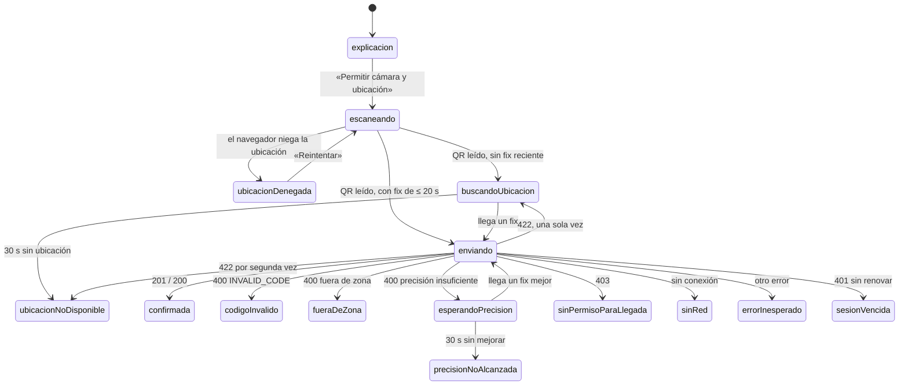

# Marcación de llegada por QR (lado del conductor)

Última actualización: 2026-10-15 | Fuente: src/features/llegada/, src/app/LlegadaPage.tsx, e2e/llegada.spec.ts; contrato y reglas contrastados con `sum-app` (`documentos/modulos/marcacion-qr-llegada.md`, `llegada_*.dart`) | Estado: vigente

> El backend (`POST /mobile/llegadas`) y el modo punto de la tablet **ya existen y están en producción** (según el documento del módulo de `sum-app`; no se verificó contra el backend desde esta web). Esta web trae solo lo que hace el **conductor**. Decisión: [ADR 0012](../06-decisiones/0012-marcacion-de-llegada-por-qr-solo-lado-conductor-y-solo-con-internet.md). Historia: [L-01](../07-planificacion/backlog.md).

## Qué hace

Registra **cuándo llegó** el conductor a un punto físico (hoy, el patio) y le muestra su **turno del día**. Una tablet fija en el punto muestra un QR que cambia cada 30 s; el conductor lo escanea desde la web y la web manda el texto del QR y su ubicación; el servidor decide si la llegada vale. El turno es solo un número visible; no despacha nada.

Los rechazos con botón (`codigoInvalido`, `fueraDeZona`, `ubicacionNoDisponible`, `precisionNoAlcanzada`, `sinRed`, `errorInesperado`) ofrecen «Escanear de nuevo»; `fueraDeZona` y `ubicacionNoDisponible`, «Recalcular posición»; `sinRed`, `errorInesperado` y `precisionNoAlcanzada`, «Reintentar». `sinPermisoParaLlegada` y `sesionVencida` no tienen botón (queda «Volver»).

## Contrato: `POST /mobile/llegadas`

Cuerpo: **exactamente cuatro campos**, ninguno es una fecha: `payload` (el texto crudo del QR), `latitud`, `longitud` y `precision_m` (`coords.accuracy`, en metros). El usuario sale del token.

| Respuesta | Qué ve el conductor |
|---|---|
| 201 / 200 | Confirmada: punto, «Tu turno», hora de llegada (hora de Lima) y zona horaria. Un 200 es el **mismo** evento ya registrado. **No se muestran los `flags`.** |
| 400 `INVALID_CODE` | «El código no es válido.» — escanear de nuevo. El servidor no dice el motivo, a propósito. |
| 400 `OUT_OF_GEOFENCE`, `fuera_de_zona` | «Aún no estás en la zona de llegada.» |
| 400 `OUT_OF_GEOFENCE`, `precision_insuficiente` (+ `precision_max_m`) | Espera hasta 30 s un fix mejor y reenvía sola; muestra «Precisión actual» y «Se necesita». |
| 400 sin ese `code` o `motivo` | Error genérico: no se adivina. |
| 422 | Se reintenta **una vez** con una posición nueva; si vuelve a fallar, «No se pudo leer tu ubicación.» (no se muestra la lista de errores de FastAPI). |
| 403 | «No tienes permiso para marcar llegada.» **No cierra la sesión** (`OPCIONES_LLEGADA`). |
| 401 | El cliente HTTP renueva y reintenta una vez; si no se puede, «Tu sesión venció». |
| Sin respuesta | «Sin conexión» con «Reintentar» (reenviar es seguro: el servidor es idempotente). |

Los textos son los de la app móvil. `llegadaApi` usa `cliente.request` (no `postJson`) porque hay que leer el `code`, el `motivo` y `precision_max_m` del 400, y `postJson` solo deja el mensaje.

## Reglas que se cumplen (las mismas de la app)

1. **El texto del QR va tal cual**: sin `trim()` ni cambio de mayúsculas (`EscanerQr` no normaliza, a diferencia del escáner de VIN).
2. **Un envío por escaneo**: solo el primer QR cuenta; nunca dos peticiones a la vez.
3. **Nunca la última posición conocida**: `watchPosition` con `maximumAge: 0` y alta precisión, y además se descarta todo fix de más de **20 s** (en valor absoluto). La búsqueda empieza al abrir la cámara, para que el GPS ya esté listo.
5. **No se manda ninguna fecha**: la hora oficial es la del `step` del QR y la de recepción la pone el servidor.
6. **Solo con internet**: no se guarda el escaneo para enviarlo después.

(La numeración es la del documento del módulo; la regla 4, «no copiar `_recalculateGps`», es específica de Flutter.)

## Dónde está en el código

| Pieza | Archivo |
|---|---|
| Contrato, fix útil, hora de Lima (puro) | `src/features/llegada/domain/llegada.ts` |
| Llamada al servidor | `src/features/llegada/api/llegadaApi.ts` |
| Recorrido (máquina de estados) | `src/features/llegada/data/controladorLlegada.ts` |
| GPS del navegador | `src/features/llegada/data/ubicacion.ts` |
| Visor del QR | `src/features/llegada/components/EscanerQr.tsx` |
| Pantalla | `src/app/LlegadaPage.tsx` (la abre `HomePage` con el botón «Marcar llegada») |
| Conexión | `src/app/composicion.ts` (`llegada`) → `main.tsx` → `App` → `HomePage` |

## Valores que **no están medidos en SUM**

Edad máxima del fix (20 s) y espera máxima (30 s) vienen de la app (decididos el 2026-10-14 allí). El radio y la precisión máxima los define el servidor por punto. Se ajustan con mediciones en el lugar.

## Lo que no se verificó

- **En un teléfono real** (iPhone y Android): cámara, permiso de ubicación, precisión del GPS y 360 px. En iPhone, `watchPosition` puede no volver a emitir con el teléfono quieto; si hay que esperar una mejor precisión, el tope de 30 s acaba en «No se pudo fijar tu ubicación con precisión» y el conductor reintenta.
- **Contra el backend real**: cada llegada de prueba escribe una llegada y un turno; por eso todo se probó con servidores falsos ([ADR 0008](../06-decisiones/0008-no-tocar-produccion.md)).
- Que el token de esta web sea aceptado por `POST /mobile/llegadas` en producción (la web usa los mismos `/mobile/*` que la app, pero no se probó este endpoint).
- Que el navegador de los conductores permita la ubicación a este sitio (HTTPS ya lo cumple; `vercel.json` no pone `Permissions-Policy`).

## Fuera de alcance

El QR de la tablet (modo punto), la vista del supervisor (llegadas, flags, intentos, administración de puntos) y la franja «Llegada registrada» del inicio de la app (es local por teléfono; no se pidió).
