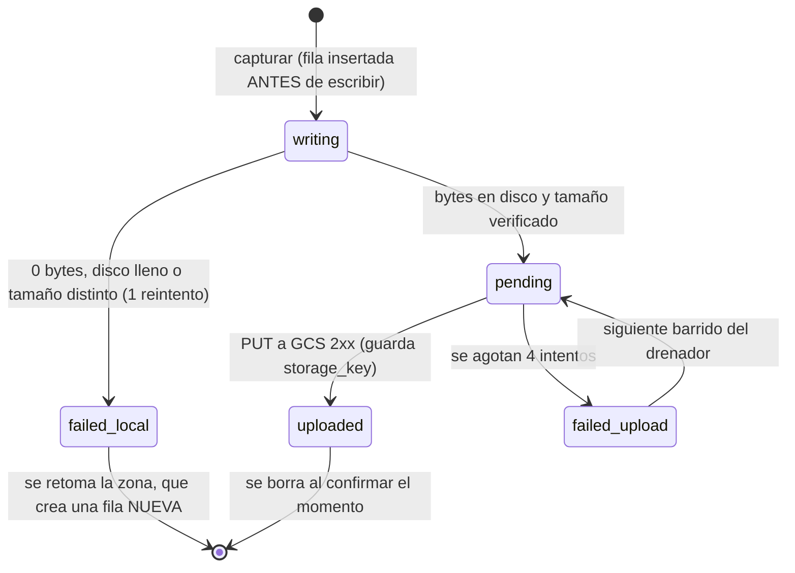
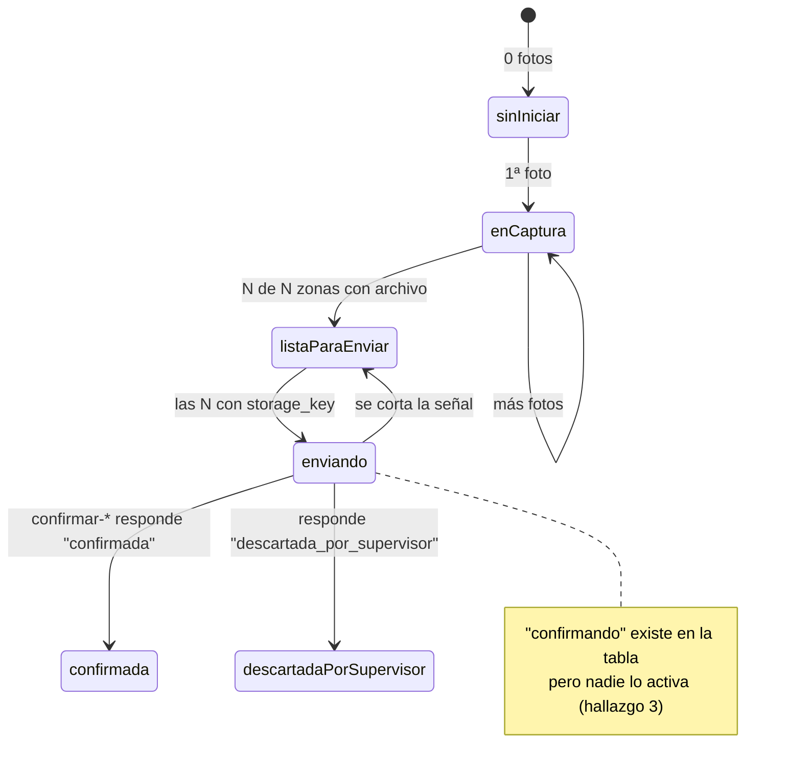
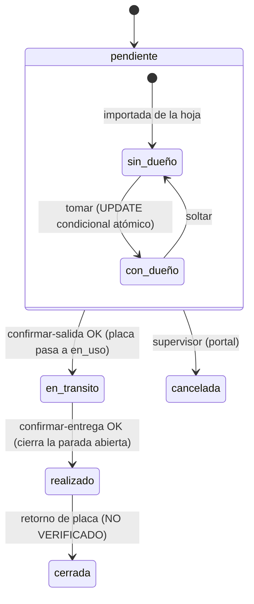
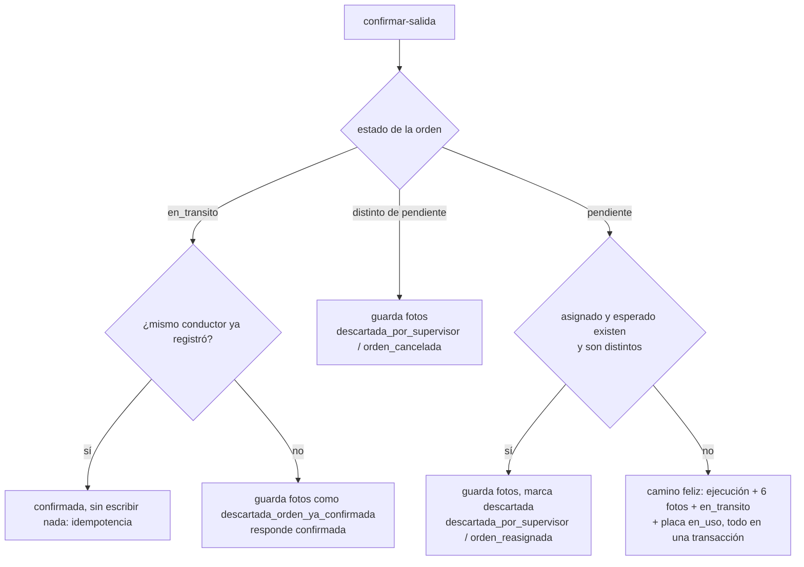
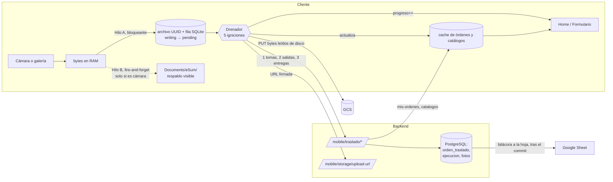
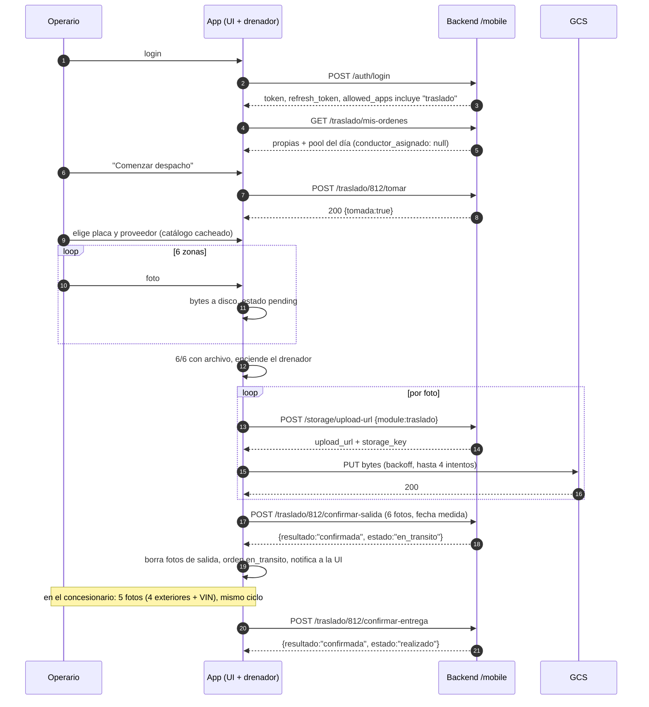
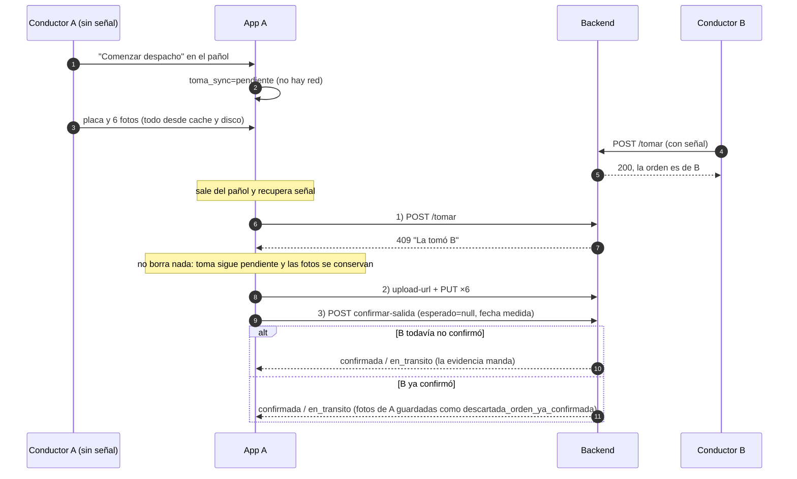
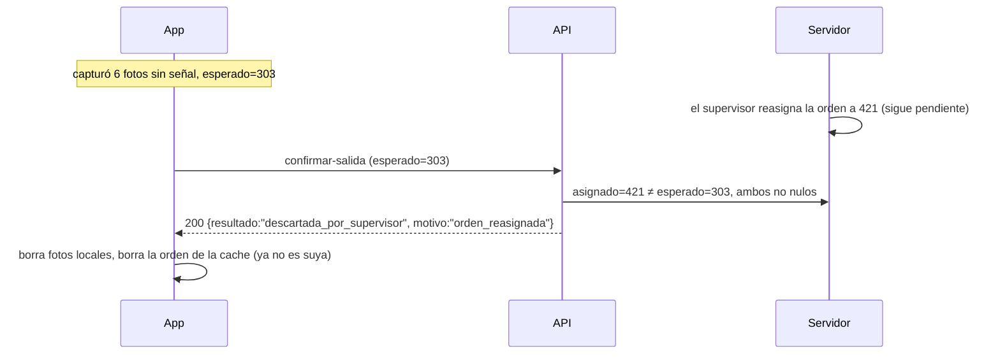

# Traslado: patrón para calcarlo a web

Última actualización: 2026-10-09 (movido a docs/ el 2026-10-13) | Fuente: sum-app y sum-bck-modulos (ramas feature/…) | Estado: vigente como referencia del contrato

> Referencia del contrato del backend y de los estados, leída de las ramas indicadas abajo. Si algo no coincide con el backend desplegado, manda el backend.

**Para quién:** quien construya la versión web del flujo de Traslado en este proyecto, sobre el mismo backend o un contrato equivalente.

**Fecha del análisis:** 2026-10-09.

**Fuentes leídas (solo lectura):**
- `sum-app`, rama `feature/marcacion-qr-rol-utilidad`: `lib/features/traslado/**`, `lib/core/network/api_client.dart`, `lib/core/theme/*`, `documentos/modulos/traslado.md`.
- `sum-bck-modulos`, rama `feature/utilitarios-asistencia-qr`: `app/api/mobile/traslado.py`, `app/api/mobile/storage.py`, `app/api/mobile/auth.py`, `app/services/traslado_service.py`, `app/repositories/traslado_repository.py`, `app/schemas/traslado.py`.
- `sum-portal-front`, rama `feat/puerto-fecha-inspector-informes`: solo `package.json` y `src/index.css`.

**Convención:** lo marcado como *confirmado* sale del código. Lo marcado como *recomendación* es propuesta de diseño, no está en el código.

---

## 0. Hallazgos antes de los diagramas

| # | Hallazgo | Evidencia | Impacto |
|---|---|---|---|
| 1 | **Este directorio (`sum-temp-traslado`) estaba vacío.** No tenía archivos ni era un repo git. | Listado del directorio al momento del análisis. | No hay nada contra qué contrastar. El diseño web nace desde cero, con `sum-app` y el backend como única fuente. |
| 2 | **La doc dice que la foto sigue un flujo de 3 pasos y el código hace 2.** | `traslado.md:131` habla de URL, PUT y confirmar. `traslado_foto_service.dart:180` solo pide URL y hace PUT. `confirmar-foto` no se llama. El enlace a la orden ocurre en `confirmar-salida` o `confirmar-entrega`. | Si se copia el flujo de la doc, la web llamaría a un endpoint que Traslado no usa. |
| 3 | **El estado `confirmando` no se alcanza en producción.** | `confirmandoEnCurso` solo se lee. Ningún llamador pasa `true` (`traslado_orden_service.dart:274`). El drenador corre fuera de la UI y no lo activa. | La tabla de transiciones tiene un nodo que nunca se pinta. Conviene decidir si la web lo implementa o lo elimina. |
| 4 | **El esquema de `mis-ordenes` no incluye `realizado`.** | `schemas/traslado.py:60` define `Literal["pendiente","en_transito","cerrada","cancelada"]`. Pero `confirmar_entrega` escribe `realizado` (`traslado_repository.py:447`). | Hoy no rompe, porque `mis-ordenes` filtra solo `pendiente` y `en_transito`. Si la web lista historial, el contrato tendría que ampliarse. |
| 5 | **Ramas distintas a `main`.** El backend se leyó en `feature/utilitarios-asistencia-qr` y la app en `feature/marcacion-qr-rol-utilidad`. | `git branch --show-current` en ambos repos. | El contrato descrito puede diferir de lo desplegado. `traslado.md` está revisado al 2026-08-14. No se verificó qué corre hoy en producción. |

---

## 1. Contrato de datos (confirmado)

| Método | Ruta | Respuestas relevantes |
|---|---|---|
| POST | `/mobile/auth/login` | `{token, refresh_token, role, area, allowed_apps[]}`. Un 401 significa credenciales inválidas. |
| POST | `/mobile/auth/refresh` | Envía `{refresh_token, device_id}`. Devuelve un par nuevo de tokens. |
| GET | `/mobile/traslado/mis-ordenes` | Las propias (`pendiente`/`en_transito`) más el pool del día. |
| GET | `/mobile/traslado/vin/{vin}` | 404 si el VIN es desconocido. 200 con `ordenes: []` si existe sin orden pendiente. 422 si el VIN es inválido. |
| GET | `/mobile/traslado/buscar?q=` | Candidatos por texto parcial, mínimo 4 caracteres. |
| GET | `/mobile/traslado/catalogos` | Placas (con `estado`) y proveedores. |
| POST | `/mobile/traslado/{id}/tomar` | 200 si es suya (idempotente). 409 con "La tomó {nombre}". |
| POST | `/mobile/traslado/{id}/soltar` | 409 si no es suya o si ya salió. |
| POST | `/mobile/storage/upload-url` | Envía `{module:'traslado', content_type}`. Devuelve `{upload_url, storage_key, expires_in}`. |
| PUT | URL firmada de GCS | Sin token. Un 403 aquí significa URL vencida, no permiso revocado. |
| POST | `/mobile/traslado/{id}/confirmar-salida` | Exactamente 6 fotos y 6 zonas distintas. Devuelve `confirmada` o `descartada_por_supervisor` con `motivo`. |
| POST | `/mobile/traslado/{id}/confirmar-entrega` | Exactamente 5 fotos. 422 si la orden nunca salió. |

Zonas de la salida: `FRONTAL`, `LATERAL_IZQUIERDO`, `LATERAL_DERECHO`, `POSTERIOR`, `PLACA_ESTADO`, `PLACA_INSTALADA`.
Zonas de la entrega: las 4 exteriores más `VIN`.

Cuerpos de las dos confirmaciones:

```json
// confirmar-salida
{ "fotos":[{"zona":"FRONTAL","storage_key":"traslado/…jpg","comentario":null}, "…×6"],
  "id_conductor_asignado_esperado": 303,
  "id_placa": 27, "id_proveedor": 4,
  "fecha_salida_cliente": "2026-10-09T13:13:35Z" }

// confirmar-entrega
{ "fotos":[ "…×5 incluida la zona VIN" ],
  "fecha_entrega_cliente": "2026-10-09T23:13:35Z" }
```

`id_conductor_asignado_esperado`, `id_placa` e `id_proveedor` pueden ir en `null`.

---

## 2. Diagramas de estado

### 2.1 Foto individual (`EstadoFoto`, `traslado_estado.dart:162`)



### 2.2 Orden en el cliente (derivado, nunca guardado)

`derivarEstadoOrden` lo calcula desde el estado del servidor y el conteo de fotos. No hay columna propia.



N es 6 en la salida y 5 en la entrega. El tramo abierto lo decide el estado del servidor: `pendiente` es la salida y `en_transito` es la entrega.

### 2.3 Orden en el servidor



Regla que el diagrama no muestra: `confirmar-*` **siempre guarda las fotos**, incluso cuando la orden está cancelada o reasignada. Solo cambia el `resultado`.

### 2.4 Desenlaces de `confirmar-salida` (`traslado_service.py:249`)



---

## 3. Flujo de datos



Reglas del flujo que definen el patrón (confirmadas):

- **Disco antes que red, siempre.** Completar el formulario no hace ninguna llamada.
- **El drenador es la única salida de datos.** Por eso tiene 5 igniciones: captura completa, abrir o refrescar la home, volver del background, recuperar conexión y cambio de red.
- **El orden de cada barrido es fijo:** tomas, luego salidas, luego entregas. Si el drenador está ocupado, el pedido se anota y dispara otra vuelta al terminar.
- **Las fechas son medidas.** Se envía la última `createdAt` de la tanda, nunca el reloj del momento del envío. El backend hace `COALESCE(fecha, now())`.
- **Las filas no se borran en bloque.** Se borra por `(orden, momento)`, con índice único `(orden, momento, zona)`.
- **El servidor pisa la cache solo cuando trae dato, no cuando trae vacío.** Aplica a placa y proveedor (`traslado_orden_service.dart:99`). Para `id_conductor_asignado` el NULL significa "sin dueño", así que no se conserva.
- **Tomar es un aviso, no un candado.** La autoridad es la evidencia: quien tiene las 6 fotos gana el desempate.
- **Sin señal se puede:** ver la home, tomar, soltar, capturar salida y entrega, y elegir placa y proveedor del catálogo cacheado. **Exige red:** escanear un VIN nuevo y soltar una orden.

---

## 4. Simulaciones de interacción

### 4.1 Camino feliz con señal



### 4.2 Sin señal, con carrera por la orden



### 4.3 Descarte por supervisor



---

## 5. Estilo vigente (confirmado en `app_colors.dart` y `app_theme.dart`)

Material 3 en tema claro, con estos tokens.

| Token | Valor | Uso en Traslado |
|---|---|---|
| `primary` / `primaryDeep` / `primarySoft` | `#1F4F8E` / `#0F2A5E` / `#EAF2FF` | Botones principales, foco de inputs, indicador de navegación |
| `bg` / `surface` / `surface2` | `#F1F5F9` / `#FFFFFF` / `#F8FAFC` | Fondo de página, tarjetas, franja de datos de la orden |
| `border` / `borderStrong` | `#E5E7EB` / `#CBD5E1` | Todas las tarjetas llevan borde, sin sombra |
| `text1` / `text2` / `text3` / `textMuted` | `#0F172A` / `#334155` / `#64748B` / `#94A3B8` | Cuerpo, encabezados de sección, detalle, chevron |
| `success` / `successSoft` / `successInk` | `#16A34A` / `#DCFCE7` / `#15803D` | "Listo para enviar", foto capturada, banner de listo |
| `warning` / `warningSoft` / `warningInk` | `#F59E0B` / `#FEF3C7` / `#B45309` | Banner sin conexión, contador "por enviar" |
| `danger` / `dangerSoft` / `dangerInk` | `#E11D48` / `#FFF1F2` / `#9F1239` | Orden cancelada, foto fallida, snackbar de error |
| `info` / `infoSoft` | `#1E3A8A` / `#EFF6FF` | Orden `en_transito` |

Geometría:

- **Radios:** 12 en tarjetas y fichas de zona, 14 en inputs y botones, 18 en el `CardTheme` global, 30 en chips.
- **Botones:** `FilledButton` con peso 700 y 15 px. Los de tarjeta son compactos, de 30 a 32 px de alto.
- **Encabezado de sección:** MAYÚSCULAS, 12 px, peso 800, con un contador en píldora.
- **Contador de avance:** tres cuadros de alto fijo 92 px. El número va en 28 px y la etiqueta en 11 px.
- **Mapa de color de la tarjeta de orden:** `listaParaEnviar` → success, `cancelada` → danger, `en_transito` → info, el resto → `text3`.
- **Etiquetas de estado:** "Sin empezar", "Cargando fotos (n/6)", "Listo para enviar", "Enviando…", "En tránsito — falta entregar", "Entregando (n/5)", "Entrega lista para enviar", "Entregado", "Descartada por el supervisor".

Patrones de interacción que hacen que se sienta igual:

- **Banner de color arriba, sin modal:** ámbar para "sin conexión", verde para "listo". Nunca se bloquea.
- **Dos secciones que no se fusionan:** "Mis traslados" y "Disponibles hoy". Tocar una tarjeta del pool la toma, no la abre.
- **Filtro local por VIN:** funciona sin red. Escanear llena el filtro, no consulta al servidor.
- **Un solo formulario de captura** parametrizado por `momento`.
- **Selector de placa con filtro por código.** Tiene un techo de altura (224 px) para no tapar el campo, y muestra el estado como texto ("afuera"), no como color.

La app no define `fontFamily` en el tema, así que usa la fuente por defecto de Material. No se verificó `pubspec.yaml`.

Nota: el portal (`sum-portal-front`) usa Tailwind 4 con shadcn, Inter Variable y tokens en tema oscuro (`index.css`). Es una paleta distinta a la de la app. Si la web debe parecerse a la app, hay que portar los tokens de arriba, no reutilizar los del portal.

---

## 6. Qué cambia al pasar a web (recomendación)

| App (confirmado) | Web (propuesta) | Riesgo o decisión |
|---|---|---|
| SQLite + archivo UUID en disco | IndexedDB con `Blob` en la fila. El portal ya usa Dexie (`OperatorView.tsx`). Pedir `navigator.storage.persist()`. | Safari/iOS puede expulsar IndexedDB. Es el mayor riesgo contra "bytes a disco antes de la red". |
| Respaldo visible en `Documents/eSum/` (canal nativo Kotlin) | Sin equivalente directo. | Decidir si se descarta o se ofrece "guardar copia" manual. |
| Las 5 igniciones | `online`/`offline`, `visibilitychange` (equivale a volver del background), apertura de la home y captura completa. | El cambio de wifi a datos móviles queda cubierto por `online`. |
| `_running` como guarda de reentrada | **Web Locks API** (`navigator.locks`). | Riesgo nuevo: varias pestañas drenarían a la vez. En la app hay un solo proceso. |
| Nada anda con la app cerrada (T-14) | Igual en web. Background Sync existe solo en Chromium, no en iOS. | No prometer envío con la pestaña cerrada. |
| Cámara y galería | `<input type=file capture>` o `getUserMedia`. QR con `html5-qrcode` o `@zxing/browser`, que el portal ya trae. | |
| PUT a GCS desde el cliente | **El navegador exige CORS en el bucket.** | No verificado: no se encontró la configuración CORS del bucket. Es bloqueante. |
| `ApiClient`: 401 → refresh, 403 → cierre de sesión | Mantener la distinción: el 403 del backend cierra sesión, el 403 del PUT firmado es URL vencida. | Dónde guardar el refresh token en web es una decisión de seguridad pendiente. |
| `uuid` v4 para nombrar archivos | `crypto.randomUUID()` como `client_id` de cada foto. | Nombrar por zona más índice causó el incidente del 2026-08-04 en Inspección. |

Módulos sugeridos para el proyecto web, espejo de la app:

| Responsabilidad | Equivalente en `sum-app` |
|---|---|
| Máquina de estados y `derivarEstadoOrden` | `traslado_estado.dart` |
| Cliente HTTP con contrato tipado | `traslado_api.dart` / `traslado_api_http.dart` |
| Almacén local de fotos (Blob) | `traslado_foto_service.dart` |
| Cache de órdenes y catálogos | `traslado_orden_service.dart`, `traslado_catalogo_service.dart` |
| Drenador con candado entre pestañas | `traslado_reconnect_sync.dart` |
| Orquestador de captura | `traslado_captura_orchestrator.dart` |
| Pantallas: home, formulario, identificar VIN, escaneo | `presentation/pages/` |

---

## 7. Preguntas abiertas

1. **¿La web consume `/mobile/*` o un contrato nuevo?** `CLAUDE.md` de `sum-app` fija que el operario solo conoce la app. Eso rige para `sum-app`; en otro proyecto sería un cliente nuevo de esos endpoints. Se trata como detalle dentro del invariante, no como reapertura. Confirmar que el proyecto nuevo lo asume así.
2. **¿Quién usa la web: el operario en el patio o el supervisor?** Cambia casi todo. El operario necesita offline y cámara. El supervisor ya tiene el portal.
3. **¿Se acepta que iOS pueda perder fotos pendientes?** Si no, la web de captura debe limitarse a Chromium/Android.
4. **¿Qué corre hoy en producción?** El hallazgo 5 queda abierto hasta que alguien lo confirme.
5. **¿Se implementa o se elimina el estado `confirmando`?** (hallazgo 3).
6. **¿Se amplía el esquema de órdenes para incluir `realizado`?** (hallazgo 4), solo si la web muestra historial.
