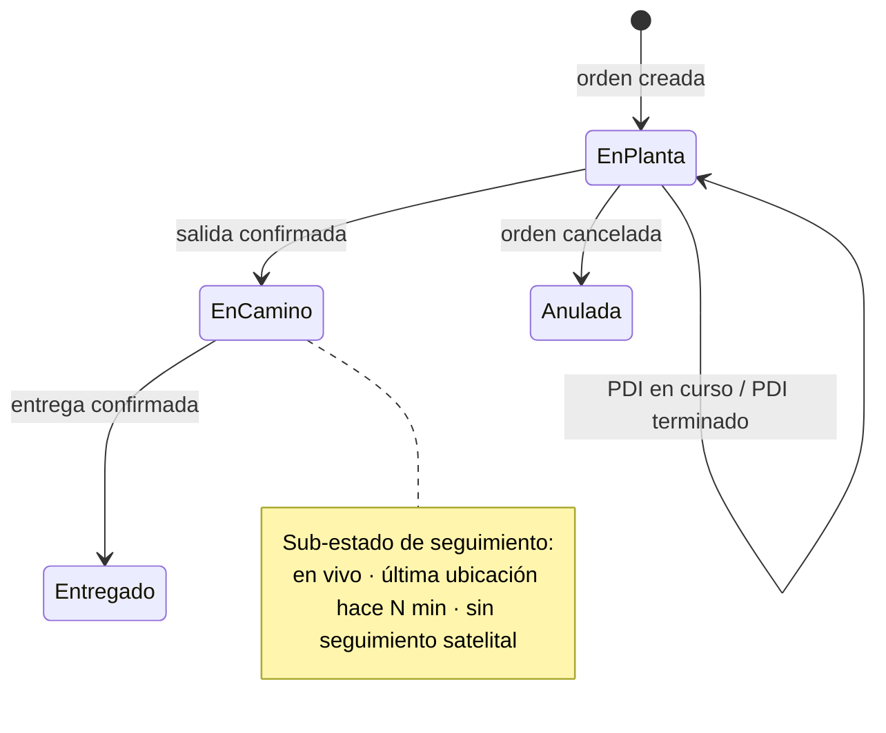
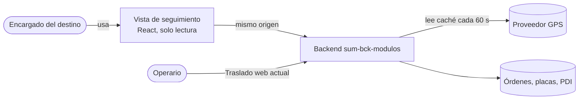

# Propuesta: vista de seguimiento para el cliente

Última actualización: 2026-10-15 (MVP construido en esta web el mismo día; ver el final de este documento) | Fuente: `sum-bck-modulos` (`app/api/v1/telemetria.py`, `app/schemas/telemetria.py`, `app/services/telemetria_service.py`, `app/api/deps.py`, `app/api/v1/traslado.py`, `app/api/v1/procesos.py`, `migrations/020_traslado.sql`, `docs/API.md`), `sum-portal-front/package.json`, este repositorio (`docs/`) | Estado: **borrador para decisión** (nada de esto está construido)

> **Convención:** *Confirmado* = salió del código revisado. *Supuesto* = lo damos por cierto sin haberlo comprobado. *Propuesta* = diseño que se recomienda. `> TODO(verificar)` = queda abierto.
> El backend se leyó en la copia local de `sum-bck-modulos`; **no se verificó que coincida con lo desplegado en producción**.

## 1. Resumen

El **encargado** del lugar al que se llevan los vehículos (concesionario o destino) podría entrar a una página y ver, **solo de los vehículos que le llegan**:

1. si el vehículo **ya salió del PDI** y de la planta,
2. si **está en camino**,
3. si el traslado **lleva GPS**, y
4. **por dónde va**.

Nada más: sin fotos, sin conductor, sin velocidades, sin historial de otros vehículos.

**Lo importante antes de prometer:**

- Casi todo el dato ya existe en el backend, pero **solo se entrega a supervisores**. Hace falta un acceso nuevo, limitado por destino, que hoy no existe.
- **El GPS no va en el vehículo sino en la placa rotativa**, y el backend midió que muy pocos viajes lo llevan (ver §4, hallazgo 1). Si se promete «verás por dónde va tu vehículo», la mayoría de los clientes verá «sin seguimiento satelital». Hay que decidir cómo se ofrece (§8).
- Esto **comparte información interna de SUM con terceros**. Necesita autorización expresa antes de construirlo (§8, decisión 1).

## 2. Qué se ofrece al cliente

### 2.1 Pantallas

Dos pantallas, siguiendo el estilo de la web actual (tarjetas con borde, estado en texto y color, mismos tokens de `src/index.css`):

```
┌ Vista 1 · «Mis vehículos en camino» ─────────────────┐
│ Destino: VW San Miguel               [ Actualizar ]   │
│ Actualizado hace 1 min                                │
│ ┌──────────────────────────────────────────────────┐ │
│ │ Tiggo 7 · Blanco · …X00231                        │ │
│ │ ● En camino · salió hoy 10:57                     │ │
│ │ 📍 Seguimiento en vivo · último punto hace 2 min  │ │
│ └──────────────────────────────────────────────────┘ │
│ ┌──────────────────────────────────────────────────┐ │
│ │ Tiggo 8 · Gris · …D00212                          │ │
│ │ ● En camino · salió hoy 09:40                     │ │
│ │ ○ Sin seguimiento satelital                       │ │
│ └──────────────────────────────────────────────────┘ │
│ ┌──────────────────────────────────────────────────┐ │
│ │ …E55120 · ● Aún en planta (PDI terminado)         │ │
│ └──────────────────────────────────────────────────┘ │
└───────────────────────────────────────────────────────┘

┌ Vista 2 · Detalle de un vehículo ────────────────────┐
│ Tiggo 7 · Blanco · VIN …X00231                        │
│ ✔ PDI terminado         13/10 08:20                   │
│ ✔ Salió de planta       13/10 10:57                   │
│ ● En camino             último punto hace 2 min       │
│ ○ Entregado             —                             │
│ ┌───────────── mapa (posición + estela) ───────────┐ │
│ └───────────────────────────────────────────────────┘ │
└───────────────────────────────────────────────────────┘
```

(Maquetas ilustrativas: los datos son de ejemplo, no reales.)

### 2.2 Estados que ve el cliente

Se traducen del estado interno a un lenguaje que el cliente entienda. Los internos (`sin_placa`, `sin_gps`, `demorado`) **no se muestran con esas palabras**.



| Lo que ve el cliente | De dónde sale (estado actual) | Origen | Estado del dato |
|---|---|---|---|
| **En planta, PDI en curso / terminado** | Proceso PDI del VIN (`finalizado` + `fecha_fin`) | `registro_actividad_proceso`, tipo 3 | Existe por VIN; **no está ligado a la orden ni se expone a clientes** (TODO(verificar) abajo) |
| **Aún en planta** | Orden `pendiente` | `orden_traslado.estado` | Confirmado |
| **En camino** · «salió el {fecha, hora}» | Orden `en_transito` + `fecha_salida` | `orden_traslado` | Confirmado, con la salvedad de §4, hallazgo 3 |
| **Seguimiento en vivo** | Viaje `en_ruta` con posición reciente | `GET /v1/telemetria/viajes-en-curso` | Confirmado (solo supervisores) |
| **Última ubicación hace N min** | Viaje `sin_senal` (con última posición) o `demorado` (ver nota) | idem | Confirmado |
| **Sin seguimiento satelital** | Viaje `sin_placa` o `sin_gps` | idem | Confirmado |
| **Entregado** · «{fecha, hora}» | Orden `realizado` / `cerrada` + `fecha_entrega` | `orden_traslado` | Confirmado, con la salvedad de §4, hallazgo 4 |
| **Anulada, comunícate con SUM** | Orden `cancelada` | `orden_traslado` | Confirmado (¿se muestra? §8) |

> `demorado` es un juicio interno de SUM (umbral de horas afuera). Se propone **no mostrar la palabra**: el cliente ve «En camino» y, si hay posición, la hora del último punto. El umbral solo existe si está configurado (`telemetria_demora_horas` puede ser `null`).
>
> TODO(verificar): si todo vehículo pasa por PDI antes de salir y si el cierre del PDI ocurre de forma fiable antes de crear la orden. Sin eso, «PDI terminado» puede aparecer vacío para vehículos que sí salieron.

## 3. Qué NO se muestra (propuesta de privacidad)

| Dato | Por qué no |
|---|---|
| Nombre o DNI del conductor | Dato personal de un trabajador; la web ya evita mostrarlo en el aviso de «orden ya tomada» (decisión del 2026-10-13). El backend además cae a `username` (el DNI) si no hay nombre. |
| Velocidad, excesos y geocercas (`incidencias`) | Es supervisión interna de la conducción. |
| Fotos de salida y entrega | Evidencia interna; ver decisión 5 si el cliente las pide. |
| Proveedor, placa rotativa, dispositivo GPS | Son datos operativos; la placa rotativa es opcional (ver decisión 4). |
| Recorrido de viajes ya entregados | El cliente necesita saber dónde está hoy, no el historial. |
| Vehículos de otros destinos | El filtro **debe** hacerlo el servidor (§6). |

## 4. Qué hay hoy y qué falta

| # | Hallazgo | Evidencia | Impacto | Recomendación |
|---|---|---|---|---|
| 1 | **Pocos viajes llevan GPS.** El backend midió **5 de 146** viajes con GPS a bordo (≈97 % sin GPS). La fecha de esa medición no está en el código. | Comentario del parámetro `con_gps` en `app/api/v1/traslado.py` | La mayoría de los clientes vería «Sin seguimiento satelital». La pregunta «¿lleva GPS?» se respondería «no» casi siempre. | Decidir antes cómo se ofrece (decisión 2). No prometer mapa en vivo como algo general. |
| 2 | **El GPS está en la placa rotativa, no en el vehículo.** Una placa tiene un dispositivo vigente (`placa_gps_asignacion`) y un viaje «lleva GPS» si su placa lo llevaba durante el viaje. | `app/repositories/telemetria_repository.py` | «Lleva GPS» depende de que el operario elija placa y de que la placa tenga equipo. Un vehículo sin placa elegida figura `sin_placa`, no `sin_gps`. | Mostrar al cliente solo «con / sin seguimiento», no la razón. |
| 3 | **`fecha_salida` es cuándo el operario confirmó las fotos en el pañol, no cuándo cruzó la puerta.** | Comentario en `telemetria_repository.py` (caso placa EEC271: GPS montado 7 min después de la salida) | «Salió a las 10:57» puede adelantarse a la salida real. | Rotularlo «Despachado» o «Salida registrada», no «salió de planta a las…». |
| 4 | **Hay entregas con hora estimada** (salida + 2 h en 6 órdenes cerradas a mano). El contrato no lo distingue. | `docs/07-planificacion/pedido-backend-vin-otras-ordenes.md`, punto abierto 1 | El cliente vería una hora de entrega inventada. | Pedir al backend un indicador de «hora medida o estimada», o mostrar solo la fecha. |
| 5 | **La lectura de GPS y de viajes es solo para supervisores** (Despacho, Puerto, Secado) y admin. | `TRASLADO_LECTOR_PARES` y `require_traslado_lector` en `app/api/deps.py` | Un cliente recibiría 403 en todo. | Endpoint propio para clientes (§7). No ampliar el guard del supervisor. |
| 6 | **No existe el rol «cliente» ni el vínculo usuario → destino.** Roles vistos en `deps.py`: operario, supervisor, admin, jefe, asistente. `destino_traslado` es solo `(id, nombre)`. El catálogo de apps asignables no tiene una app de seguimiento. | `app/api/deps.py`, `migrations/020_traslado.sql`, `app/core/apps_catalogo.py` | Sin esto no hay forma de saber **qué vehículos ve cada encargado**. | Tabla de vínculo y rol nuevos (§7). Es la pieza que hay que decidir primero. |
| 7 | **El proveedor de GPS limita a 360 llamadas por hora.** `viajes-en-curso` no llama al proveedor: lee la caché que un barrido llena cada 60 s. | Docstrings en `telemetria.py` y `telemetria_repository.py` | Si el endpoint del cliente consultara al proveedor, 360/h se agotaría con pocos clientes. | El endpoint del cliente **debe leer la misma caché**. Así el costo no depende de cuántos miren. |
| 8 | **El «último punto» puede estar viejo sin que nada falle:** estacionado, el equipo reporta cada 240–305 s; el umbral de «sin señal» es de 900 s por defecto. | `app/services/telemetria_service.py`, `app/config.py` | Un punto de hace 12 min es normal; mostrarlo como «en vivo» confunde. | Siempre mostrar la **hora del último punto**, nunca «ahora». |

**Ya existe y se puede reutilizar** (confirmado): posición con `lat`, `lng`, `rumbo`, `ultimo_reporte`, `silencio_segundos` y una estela corta de los últimos puntos, incluida en la caché sin costo extra; los cinco estados de viaje; el recorrido completo por orden; y el mapa del portal usa `maplibre-gl` con `react-map-gl`.

## 5. Cómo encaja en este proyecto

Hoy el proyecto es la web del **operario** (cámara, fotos, Dexie). La vista de cliente es otro público con otras necesidades, así que se propone **no mezclarla con la del operario**.



**Propuesta de estructura**, respetando las capas del proyecto ([vision-general.md](../02-arquitectura/vision-general.md)):

| Capa | Contenido nuevo | Notas |
|---|---|---|
| `domain/` | Tipos del vehículo para el cliente y la función que traduce estado interno → estado visible (§2.2), etiquetas y «hace N min». | Puro: sin React ni navegador. Ahí viven las reglas de §2.2 y §3. |
| `api/` | Cliente de los endpoints del cliente (§7) y esquemas `zod` que **descartan** cualquier campo no esperado. | Mismo patrón que `trasladoApi`. |
| `data/` | Un controlador que consulta al abrir y con «Actualizar» (sin renovación automática), como store externo. | **Sin Dexie**: los datos de un cliente no se guardan en el navegador. |
| `components/` | Lista de vehículos, detalle con línea de tiempo y mapa. | El mapa se carga **bajo demanda**, como ya se hace con el escáner. |
| `app/` | Selección de la vista según la identidad. | Hoy `AppShell` exige «traslado» en `allowed_apps`: un cliente vería «Sin acceso». TODO(verificar) en `src/app/AppShell.tsx`. |

**Dónde se publica (recomendación):** una **segunda entrada del mismo repositorio** (por ejemplo, otra página con su propio arranque) que reutilice `core/` (sesión, HTTP, UI) pero **no** cargue cámara, galería ni Dexie. Ventajas: paquete más liviano para el cliente, dirección propia y cabeceras más estrictas. Alternativa: una sola aplicación que elige la vista por rol; es más simple, pero el cliente descargaría código que no usa. Ambas requieren cambios de configuración (`vite.config.ts`, `vercel.json`), que **no se tocan sin autorización**.

Lo ya decidido que sigue valiendo: **solo con internet** ([ADR 0004](../06-decisiones/0004-solo-con-internet.md)), **mismo origen por proxy** ([ADR 0003](../06-decisiones/0003-mismo-origen-por-proxy.md)) y **ninguna prueba toca producción** ([ADR 0008](../06-decisiones/0008-no-tocar-produccion.md)).

## 6. Seguridad y datos personales

- **El filtro por destino lo hace el servidor**, a partir de la identidad del token. Nunca se confía en un parámetro que mande la página.
- Un cliente que pide una orden que no es de su destino recibe **404**, igual que una que no existe, para que no se pueda explorar qué órdenes hay.
- **Los datos se entregan con una lista cerrada de campos** (§7), no reutilizando los modelos del supervisor: así un campo nuevo interno no se filtra por accidente.
- Las credenciales del proveedor de GPS **nunca salen del backend** (ya es regla del backend, D-31).
- La ubicación en vivo de un vehículo de SUM en la carretera es información de la operación, y la del conductor es además un dato personal. **Se recomienda validar con el área legal** el tratamiento (la ley peruana de protección de datos personales es el marco que corresponde; esa referencia es externa y no se ha verificado aquí).
- Limitar la frecuencia de consulta por usuario y **cerrar la sesión por inactividad** más corta que la del operario.
- La ubicación se muestra **solo mientras el viaje está en tránsito**; al entregarse desaparece.

## 7. Lo que habría que pedir al backend (propuesta)

Un pedido en el mismo formato que [pedido-backend-vin-otras-ordenes.md](../07-planificacion/pedido-backend-vin-otras-ordenes.md). Todo es **propuesta**; los nombres no existen todavía.

**a) Identidad y alcance**
- **Actualizado el 2026-10-15:** el rol es `coordinador` y entra **por rol**. La primera versión es **general y sin filtro por destino**: ve todo lo que genera Traslado. La tabla **usuario → destinos** queda para una fase posterior. Ver [mapeo-rol-coordinador.md](../07-planificacion/mapeo-rol-coordinador.md).
- Versión original, para cuando haya filtro: un rol y una tabla que ligue **usuario → uno o varios destinos** (`destino_traslado`).

**b) Dos endpoints de solo lectura** (prefijo propio, no el del supervisor):

| Método y ruta | Devuelve |
|---|---|
| `GET /api/seguimiento/traslados` | Los vehículos: en planta, en camino y entregados en los últimos N días. **Todos**, sin filtro por destino en la primera versión (con filtro más adelante: solo los de sus destinos). |
| `GET /api/seguimiento/traslados/{id_orden}` | Un vehículo: línea de tiempo y posición actual. (Con filtro, 404 si no es de su destino.) |

```json
{
  "actualizado_hace_segundos": 42,
  "traslados": [
    {
      "id_orden": 9001,
      "vin": "LVTDD24B6VDX00231",
      "marca": "Toyota", "modelo": "Corolla", "color": "Blanco",
      "destino": "Sede Norte",
      "etapa": "en_camino",
      "salida_registrada_en": "2026-10-15T12:40:00Z",
      "entregado_en": null,
      "entrega_estimada": false,
      "seguimiento": "sin_seguimiento"
    }
  ]
}
```

> **Actualizado el 2026-10-15:** el contrato de arriba es el del MVP, **sin PDI y sin posición** (decisión del usuario: el PDI no entra en este MVP; el mapa es una fase posterior). `pdi_terminado_en` y `posicion` quedan como campos de esas fases. El contrato vigente y su pedido al backend están en [pedido-backend-seguimiento-coordinador.md](../07-planificacion/pedido-backend-seguimiento-coordinador.md); la web ya está construida contra él.

- `etapa`: `en_planta` · `en_camino` · `entregado` · `anulado`.
- `seguimiento`: `en_vivo` · `ultima_ubicacion` · `sin_seguimiento`. **El servidor ya lo traduce**: el cliente nunca recibe `sin_placa`, `sin_gps` ni `demorado`.
- `posicion` solo si hay seguimiento y la etapa es `en_camino`. Sin velocidad, sin rumbo si no hace falta, sin conductor, sin fotos.
- Debe leer la **caché del barrido**, no llamar al proveedor (hallazgo 7).
- **Reutiliza, no duplica**, la lógica de estados de `TelemetriaService`.

**c)** Un indicador de «entrega medida o estimada» (hallazgo 4) y, si se confirma la decisión 3, **«PDI terminado» ligado al VIN de la orden**.

## 8. Decisiones que necesito de ti

1. **¿Está autorizado compartir esta información con clientes?** Las instrucciones de SUM piden autorización explícita para sacar información interna. Sin un sí, esto no sigue.
2. **El GPS en la oferta:** con ≈3 % de viajes con GPS, ¿se ofrece «seguimiento en vivo» como algo disponible **cuando el viaje lleve equipo**, o se amplía la cantidad de placas con GPS antes de ofrecerlo? *Recomendación:* ofrecerlo como «cuando haya equipo» y decirlo con claridad.
3. **«Salió del PDI»:** ¿es «PDI terminado» (proceso en sistema) o «salió físicamente de planta»? *Recomendación:* mostrar **los dos hitos**, porque son distintos.
4. **Identificación del vehículo:** ¿se muestra la placa rotativa para que el cliente reconozca el vehículo al recibirlo, o solo modelo, color y últimos dígitos del VIN? *Recomendación:* modelo, color y VIN; la placa rotativa, solo si el cliente la pide.
5. **¿El cliente también ve las fotos de entrega?** Hoy se propone que no.
6. **Acceso:** ¿usuario y contraseña por encargado (más seguro, más trabajo de altas) o un enlace con clave por destino (más simple, más riesgo si se comparte)? *Recomendación:* usuario por encargado.
7. **¿Se muestran órdenes anuladas?** *Decidido el 2026-10-15: no.* La recomendación original era mostrarlas con «comunícate con SUM»; el usuario pidió quitarlas. La web las descarta (`esVisible`) aunque el servidor las mande.
8. **¿Quién es el «cliente»?** En el código el destino es un nombre (`destino_traslado`). ¿Un encargado corresponde a un concesionario, a una sede o a ambos? TODO(verificar) cómo se carga hoy ese vínculo en la hoja del supervisor.

## 9. Fases propuestas

Sin fechas ni tamaños: no hay datos para estimarlos con honestidad.

| Fase | Entrega | Necesita |
|---|---|---|
| **0 · Acuerdos** | Decisiones 1 a 8 y pedido al backend. | Tú, legal, quien administra el backend. |
| **1 · Estado sin mapa** | Lista y detalle con línea de tiempo (en planta → en camino → entregado) y «con / sin seguimiento». | Backend: §7 a) y b) sin `posicion`. |
| **2 · Mapa** | Posición y estela en el mapa para viajes con GPS, con «último punto hace N min». | Fase 1 + la caché de posición ya existente. |
| **3 · PDI** | Hito «PDI terminado». | Resolver la decisión 3 y el vínculo PDI ↔ orden. |
| **No incluido** | Avisos por mensaje, llegada automática por geocerca, fotos, historial, métricas de demora. Se anotan solo como ideas; ninguna está evaluada. | — |

## 10. Riesgos

| Riesgo | Efecto | Mitigación |
|---|---|---|
| La oferta promete GPS en general y casi nadie lo tiene | Reclamos y desconfianza | Decisión 2 y texto claro en la pantalla. |
| Se ve un dato interno por error | Fuga de información | Lista cerrada de campos, esquemas que descartan lo no esperado, 404 en lugar de 403. |
| Un cliente ve un vehículo ajeno | Fuga entre clientes | Filtro por destino en el servidor y prueba que lo verifica con dos destinos. |
| El proveedor de GPS no responde | Mapa vacío o viejo | Mostrar la hora del último dato y el estado `ultima_ubicacion`; nunca vaciar en silencio. |
| Salida u hora de entrega distinta de la realidad (hallazgos 3 y 4) | El cliente reclama «a esa hora no llegó» | Rotular «registrada» y marcar las estimadas. |
| Probar contra producción | Escribir o leer datos reales | Cumplir [ADR 0008](../06-decisiones/0008-no-tocar-produccion.md): servidores falsos y base local; datos de clientes de prueba, nunca reales. |

## 11. Qué no se verificó

- Que la copia local del backend coincida con producción.
- La fecha de la medición «5 de 146» y cuántos viajes llevan GPS hoy.
- Que todo vehículo pase por PDI y que ese cierre sea previo a la orden.
- Cómo se carga el destino de cada orden y si un encargado equivale a un destino.
- Cómo se ve el mapa en un teléfono (el mapa no se construyó: es una fase posterior).
- Si el área legal exige algo adicional por mostrar ubicación a terceros.

## 12. Estado del MVP (2026-10-15)

El MVP **sin mapa y sin PDI** está construido en esta web para el rol `coordinador`, sin filtro por destino (primera versión general): una pantalla con buscador, selector de destino (solo con más de uno), pestañas Todos, En camino y Entregados, tabla en escritorio, lista en el teléfono y detalle con hitos y estado de GPS. Se probó con un servidor falso (Vitest y Playwright en Chrome y Edge); **el endpoint no existe todavía en el backend** ([pedido-backend-seguimiento-coordinador.md](../07-planificacion/pedido-backend-seguimiento-coordinador.md)). Cómo funciona: [navegacion-y-sesion.md](../02-arquitectura/navegacion-y-sesion.md) y [mapeo-rol-coordinador.md](../07-planificacion/mapeo-rol-coordinador.md).

Estado general y lo que sigue: [estado-actual.md](../07-planificacion/estado-actual.md) y [TODO.md](../../TODO.md).
