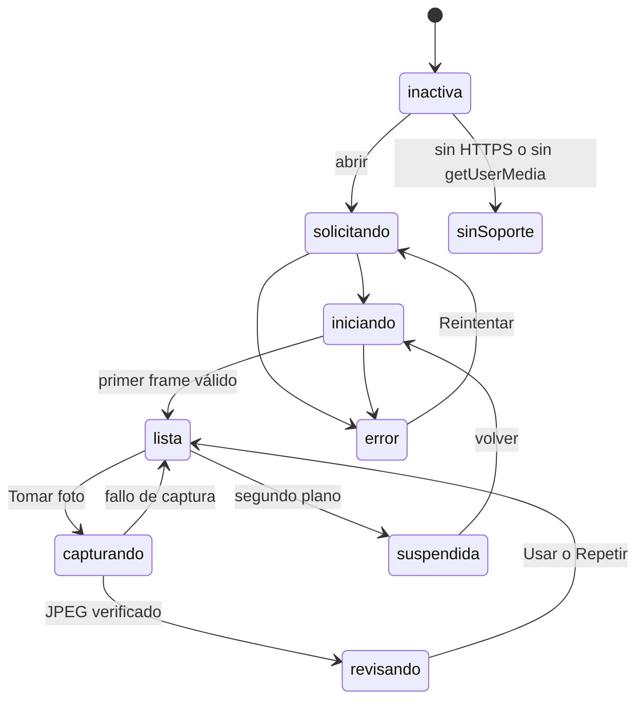
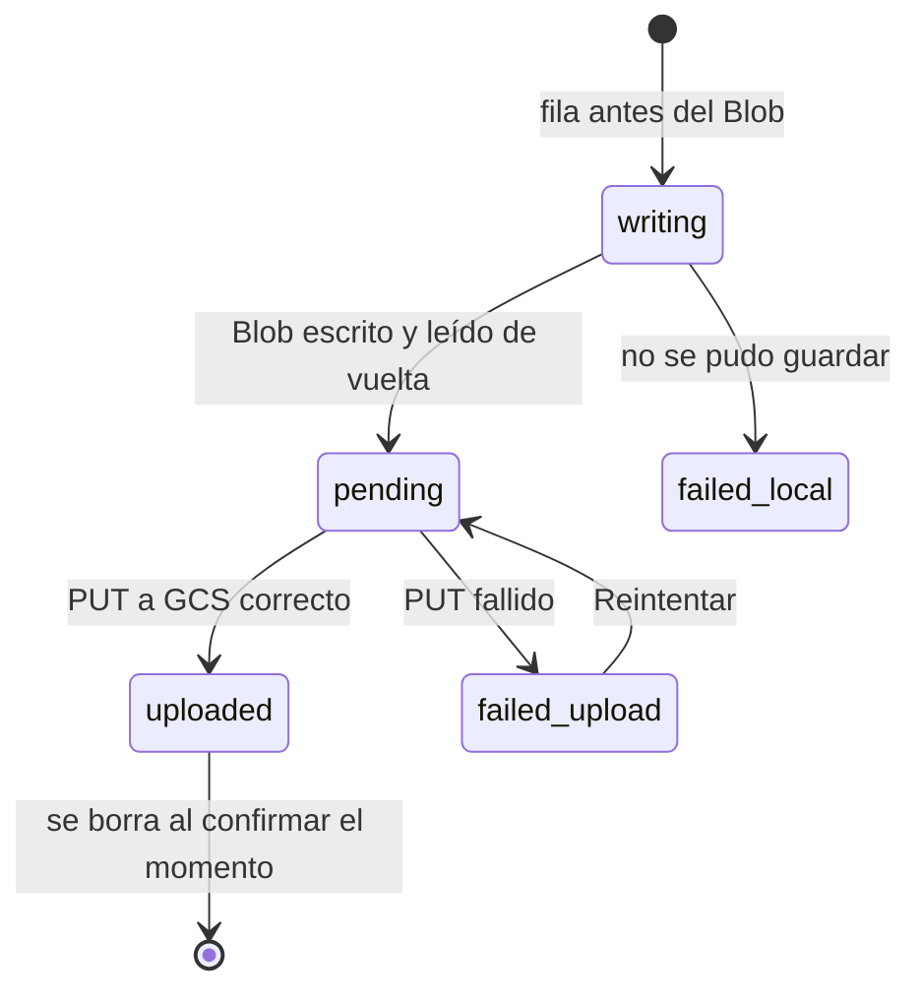

# Cámara y fotos

Última actualización: 2026-10-13 | Fuente: src/features/traslado/camera/, src/features/traslado/data/formularioCaptura.ts, fotoStoreDexie.ts | Estado: vigente

## Sesión de cámara

`CameraSession` es dueña del `MediaStream`: un solo stream por formulario, se suelta al pasar a segundo plano y se reabre al volver. En el iPhone la cámara **vuelve sola** (spike S-01 confirmado en iOS 26.5); si algún navegador exige un toque, queda `suspendida` con «Tocar para reactivar la cámara».

Valores (en `camera/config.ts`): resolución pedida 1920×1080, lado largo máximo 1920 px, JPEG calidad 0,9, espera del primer frame 8 s, tiempo de captura 10 s y **500 ms de protección contra toques accidentales** en «Usar / Repetir».

## Una foto se acepta solo si se comprobó

`capturarFrame` y la galería comparten `codificarJpeg`: dibuja en un lienzo del tamaño final, pide JPEG, comprueba que el Blob exista, no esté vacío y sea `image/jpeg`, y **siempre libera el lienzo**. Nada lanza hacia arriba: todo vuelve como `ResultadoCaptura` con un mensaje para el operario.

## Foto de la galería (T12)

`CameraWidget` con `permitirGaleria` ofrece «Elegir de la galería» (un `<input type="file" accept="image/*">` sin `capture`). `fotoDesdeArchivo` decodifica respetando la orientación EXIF, reduce a 1920 px, **recodifica como JPEG** (acepta HEIC y PNG) y deja la foto sin metadatos, incluida la ubicación. Su fecha es la de modificación del archivo (si falta o es futura, la de ahora). Pasa por la misma revisión «Usar / Descartar» y funciona aunque la cámara esté denegada.

## Escáner de QR y códigos de barras (O-05)

`EscanerVin` abre la cámara y `EscanerCodigos` analiza un cuadro cada 150 ms (lado largo de 1024 px) con `@zxing/browser`, **cargada solo al abrir el escáner**. Lee QR, Code 128, Code 39 y Data Matrix. `extraerVin` toma el VIN completo suelto del texto leído; si no lo hay, deja el texto en mayúsculas y sin espacios, como la app móvil. El resultado solo llena el filtro; no consulta al servidor.

## Formulario de captura

- Seis zonas en la salida y cinco en la entrega (`domain/zonas.ts`): la entrega no lleva las dos de placa y añade `VIN`.
- Una foto se guarda en la zona que estaba activa **cuando se tomó**; las fichas se bloquean mientras hay una foto en captura o revisión.
- `FormularioCaptura` (controlador) sube cada foto en cuanto se guarda, retoma las `pending` al abrirse y ofrece `reintentarSubida(zona)`.

## Estados de una foto

`FotoStoreDexie.guardar` inserta la fila `writing`, escribe el Blob, lo **lee de vuelta** para verificar el tamaño y recién entonces promueve la foto a `fotos`, reemplazando la anterior de esa zona en una transacción. Las fotos **persisten** al cerrar sesión, cerrar la app y recargar (confirmado en iPhone).
