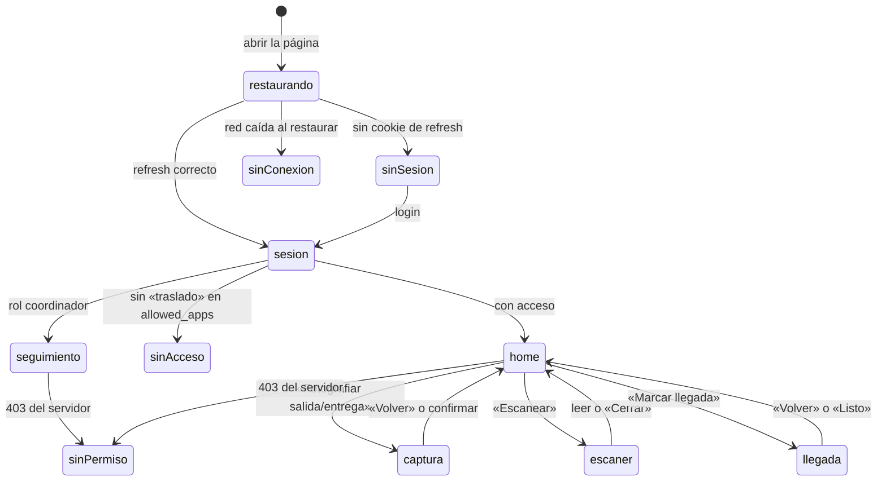

# Navegación y sesión

Última actualización: 2026-10-15 | Fuente: src/app/AppShell.tsx, LlegadaPage.tsx, HomePage.tsx, SeguimientoPage.tsx, CapturaPage.tsx, src/core/auth/ | Estado: vigente

## No hay router

La aplicación **no usa un router**. Qué pantalla se ve lo decide el estado:

- **`AppShell`** elige entre «Comprobando tu sesión…», `SinConexionPage`, `LoginPage`, `SeguimientoPage`, `SinAccesoPage` y la home. Con sesión decide en este orden: (1) si el **rol** es `coordinador` (`esCoordinador`, comparación exacta) va a la vista de seguimiento, **sin mirar `allowed_apps`** y aunque su cuenta tenga `traslado`; si la aplicación no trae la vista, ve «Sin acceso», nunca la home del operario; (2) si no es coordinador y tiene `traslado` en `allowed_apps`, va a la home; (3) si no, «Sin acceso». Mapeo y motivos: [mapeo-rol-coordinador.md](../07-planificacion/mapeo-rol-coordinador.md).
- **`SeguimientoPage`** (rol coordinador): todos los traslados que genera Traslado, de solo lectura. Ocupa todo el ancho (con un margen modesto, máximo 1480 px) bajo un encabezado con el logo de SUM, «Portal de destinos» y «Cerrar sesión». Desde `md` (768 px) es una tabla de tres columnas (Vehículo, Destino, Etapa; sin nada de GPS; cada vehículo ocupa dos filas, la segunda con la fecha y «Ver detalle →»); por debajo, una lista. **«Ver detalle» abre el detalle en un diálogo modal** (`PanelDetalle`): un panel a la derecha en pantalla ancha y a pantalla completa en el teléfono, con el foco atrapado, Escape y «Cerrar» (560 px de ancho en pantalla grande, con el vehículo, destino, etapa y hitos en tamaño grande), y la página de atrás sin desplazarse ni correrse (al bloquearla se compensa el ancho de la barra que desaparece); así se ve siempre, aunque se haya bajado por una lista larga (antes iba debajo de la tabla). Muestra el VIN completo, el logo de la marca si está en `src/assets/marcas/` (si no, la inicial) y la hora de la última actualización («Última actualización: 12:10», hora de Lima). No muestra órdenes anuladas ni datos de PDI. Un botón abre la **consulta masiva de VIN** (otra vista de la misma pantalla, `ConsultaMasiva`): se pegan los VIN y se consultan en el backend; el resultado vive en el estado de la pantalla (no en Dexie) y se descarta al salir. Sus datos viven solo en memoria (`ListaSeguimiento`, sin Dexie): se piden al abrir y **solo se vuelven a pedir con el botón «Actualizar»** (no hay renovación automática), y se vacían al cerrar sesión o al entrar otra persona. Un 403 muestra «Sin permiso para ver el seguimiento» sin cerrar la sesión.
- **`HomePage`** guarda en su estado si se está capturando (`CapturaPage`), escaneando un VIN (`EscanerVin`) o marcando la llegada (`LlegadaPage`, solo si la aplicación la trae: el botón «Marcar llegada» no se ofrece sin ella). Mientras se captura o se marca la llegada, la home no se dibuja; al volver se recalculan los contadores de las tarjetas.
- **`LlegadaPage`** (L-01) lleva al conductor del permiso al resultado con `ControladorLlegada`: explicación → escaneo → (busca la ubicación) → envío → confirmada, o un rechazo con su botón. Los textos son los de la app móvil. Al salir se sueltan la cámara y el GPS. Detalle: [marcacion-llegada-qr.md](../01-vision-y-alcance/marcacion-llegada-qr.md).
- La `key` de la home es la persona: si otra pestaña cambia de usuario, la home se rehace desde cero.
- Las rutas del sitio **no deben empezar por `/api` ni `/mobile`**: están reservadas para el reenvío al backend. En Vercel, el resto de rutas devuelve `index.html`.

## Sesión (opción A: cookie de refresh)

- El **token de acceso vive solo en memoria**. La cookie de refresh, que rota en cada uso, se guarda en el navegador.
- Al abrir la página se intenta `restaurar()` con la cookie; mientras tanto no se muestra el login.
- **Una sola sesión en todas las pestañas (A-03):** un canal (`BroadcastChannel`, con `storage` como respaldo) avisa de login y logout. Las renovaciones llevan una **época**: si cambia la sesión mientras una renovación está en vuelo, su resultado se descarta. La **expiración (401) no se difunde**.
- La identidad (`sub`, `user_id`) se lee del JWT **sin verificar la firma**; es solo para decidir de quién son los datos locales.
- **401:** el cliente HTTP renueva una vez y reintenta. **Sin red** al renovar no se cierra la sesión. **403** en Traslado no cierra la sesión (política `OPCIONES_TRASLADO`): muestra «Sin permiso». Lo mismo en la marcación de llegada (`OPCIONES_LLEGADA`): muestra «No tienes permiso para marcar llegada».
- Al **cerrar sesión** se vacía la caché de órdenes (con una marca de «limpieza pendiente» que sobrevive a una recarga) pero **no** las fotos: son trabajo del operario.

> En local contra el backend de desarrollo (`:8050`) la cookie de refresh no se guarda en Chrome y Edge (`SameSite=None` sin `Secure`). Contra el despliegue de Vercel funciona. Ver [discrepancias.md](../ai/discrepancias.md).
