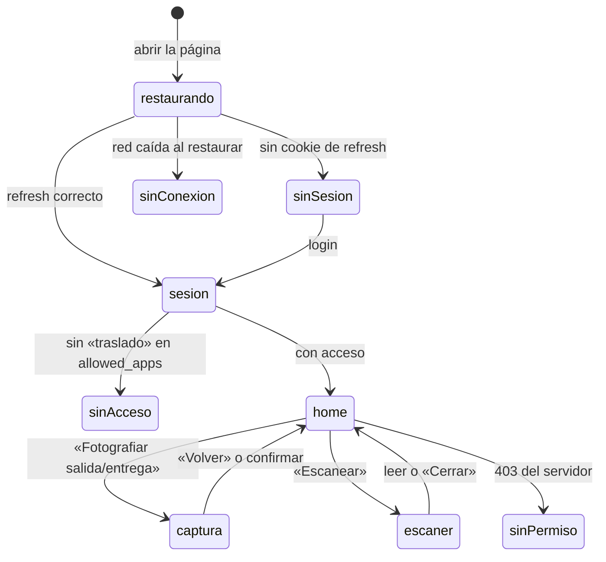

# Navegación y sesión

Última actualización: 2026-10-13 | Fuente: src/app/AppShell.tsx, HomePage.tsx, CapturaPage.tsx, src/core/auth/ | Estado: vigente

## No hay router

La aplicación **no usa un router**. Qué pantalla se ve lo decide el estado:

- **`AppShell`** elige entre «Comprobando tu sesión…», `SinConexionPage`, `LoginPage`, `SinAccesoPage` y la home.
- **`HomePage`** guarda en su estado si se está capturando (`CapturaPage`) o escaneando (`EscanerVin`). Mientras se captura, la home no se dibuja; al volver se recalculan los contadores de las tarjetas.
- La `key` de la home es la persona: si otra pestaña cambia de usuario, la home se rehace desde cero.
- Las rutas del sitio **no deben empezar por `/api` ni `/mobile`**: están reservadas para el reenvío al backend. En Vercel, el resto de rutas devuelve `index.html`.

## Sesión (opción A: cookie de refresh)

- El **token de acceso vive solo en memoria**. La cookie de refresh, que rota en cada uso, se guarda en el navegador.
- Al abrir la página se intenta `restaurar()` con la cookie; mientras tanto no se muestra el login.
- **Una sola sesión en todas las pestañas (A-03):** un canal (`BroadcastChannel`, con `storage` como respaldo) avisa de login y logout. Las renovaciones llevan una **época**: si cambia la sesión mientras una renovación está en vuelo, su resultado se descarta. La **expiración (401) no se difunde**.
- La identidad (`sub`, `user_id`) se lee del JWT **sin verificar la firma**; es solo para decidir de quién son los datos locales.
- **401:** el cliente HTTP renueva una vez y reintenta. **Sin red** al renovar no se cierra la sesión. **403** en Traslado no cierra la sesión (política `OPCIONES_TRASLADO`): muestra «Sin permiso».
- Al **cerrar sesión** se vacía la caché de órdenes (con una marca de «limpieza pendiente» que sobrevive a una recarga) pero **no** las fotos: son trabajo del operario.

> En local contra el backend de desarrollo (`:8050`) la cookie de refresh no se guarda en Chrome y Edge (`SameSite=None` sin `Secure`). Contra el despliegue de Vercel funciona. Ver [discrepancias.md](../ai/discrepancias.md).
