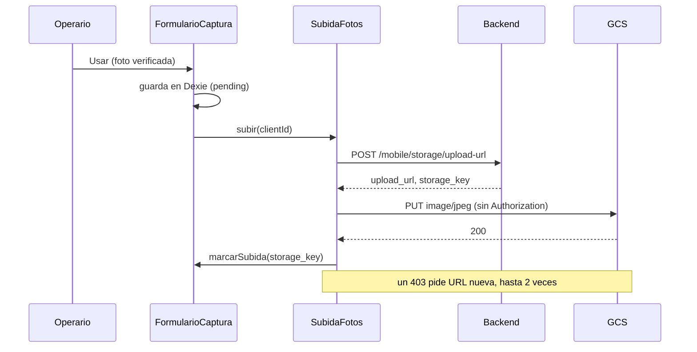

# Subida y confirmación

Última actualización: 2026-10-13 | Fuente: src/features/traslado/api/, data/subidaFotos.ts, data/confirmacionTraslado.ts | Estado: vigente

## Secuencia de una foto

- **Un solo intento** por subida; no hay reintentos automáticos. Si falla, la foto queda `failed_upload` con el motivo y la ficha muestra «Reintentar».
- El archivo se **lee del almacén en cada intento**, no de memoria. Si ya no está, falla sin reintentar.
- El PUT usa el mismo `Content-Type` que se pidió, **sin `Authorization`** y con `credentials: 'omit'`; tiempo máximo de 60 s.
- Una subida por foto a la vez: pedir `subir` dos veces comparte la primera.
- Si se repite una zona mientras la anterior sube, el resultado viejo no marca la foto nueva.

## Confirmar salida o entrega

Las fotos ya están subidas; confirmar **solo registra el despacho**.

`ConfirmacionTraslado.confirmar(idOrden, momento)`:

1. Comprueba que la orden siga en la lista, que no sea una toma perdida y que su paso coincida con el momento.
2. Si la toma se hizo sin señal y sigue pendiente, la registra primero (actualiza la lista); si no puede, no confirma.
3. Valida: exactamente 6 (salida) o 5 (entrega) fotos, de zonas distintas, todas con `storage_key`; en la salida, además, que haya placa. Si falta algo, **no llama al servidor** y dice qué.
4. Envía zona + `storage_key` por foto; en la salida, `id_conductor_asignado_esperado`, `id_placa`, `id_proveedor` (pueden ir `null`) y `fecha_salida_cliente`; en la entrega, `fecha_entrega_cliente`. La fecha es la de la **última captura**, en UTC.

| Respuesta | Qué hace la web |
|---|---|
| `confirmada` (salida) | Borra las fotos de la salida, la elección y la toma; la orden sigue, ahora en tránsito. |
| `confirmada` (entrega) | Borra todo lo de la orden; sale de la lista. |
| `descartada_por_supervisor` | No es un error: orden cancelada o reasignada. Borra lo local y avisa en ámbar, **sin prometer** que las fotos se borraron del servidor (el servidor las guarda siempre). |
| Error (red, 4xx, 5xx, cuerpo raro) | No borra nada; «Reintentar» es seguro (el servidor reconoce al mismo conductor y no duplica). |

Una confirmación por orden a la vez: pedirla dos veces comparte la primera.

## CORS del bucket

El PUT va directo desde el navegador, así que el bucket debe permitir el **origen exacto** de la página con el método `PUT` y el encabezado `Content-Type`. Cada origen nuevo (otro dominio, la IP de un teléfono) requiere una entrada en el CORS del bucket. Ver [vercel.md](../05-despliegue/vercel.md) y [ADR 0006](../06-decisiones/0006-subida-directa-a-gcs.md).

> Regla de seguridad: el backend local firma URLs del bucket `sum-fotos-prod` (producción). Las subidas y confirmaciones reales solo se hacen con autorización explícita ([ADR 0008](../06-decisiones/0008-no-tocar-produccion.md)).
