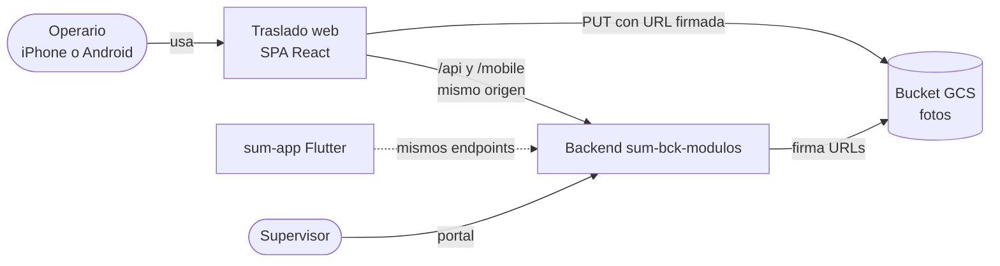
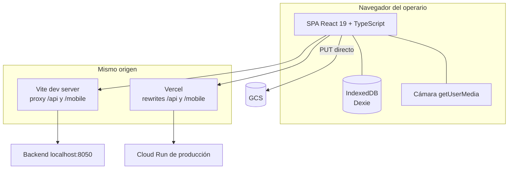
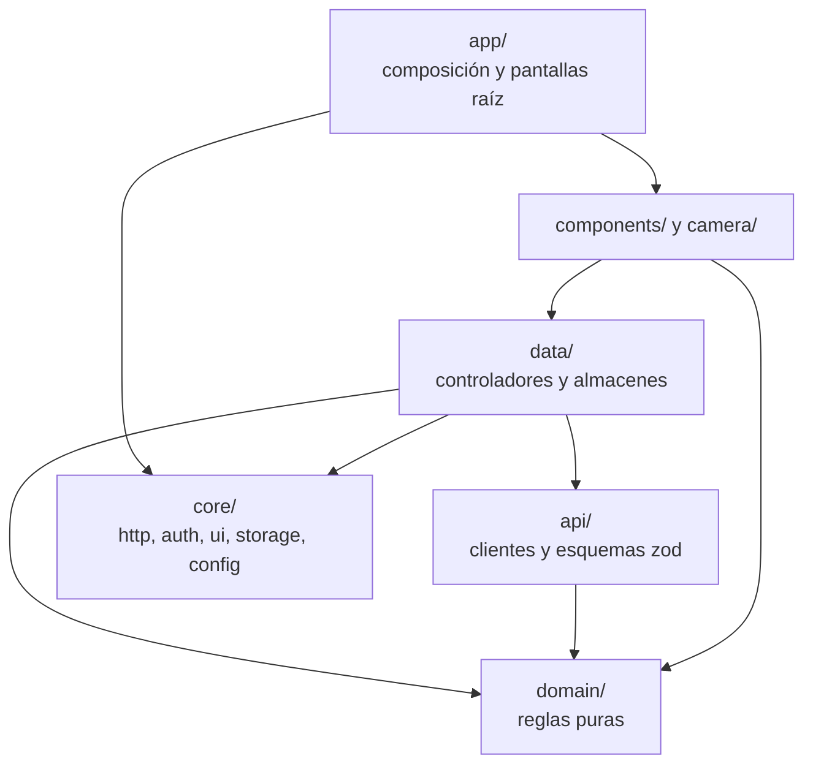

# Visión general de la arquitectura

Última actualización: 2026-10-13 | Fuente: src/, vite.config.ts, vercel.json, docs/02-arquitectura/arquitectura-front.md | Estado: vigente

> El diseño original está en [arquitectura-front.md](arquitectura-front.md) (propuesta del 2026-10-09). **Lo vigente es este documento**; las diferencias están en [discrepancias.md](../ai/discrepancias.md).

## Contexto (C4 nivel 1)

## Contenedores (C4 nivel 2)

- **Mismo origen:** el navegador solo habla con su propio servidor (Vite en desarrollo, Vercel desplegado), que reenvía `/api/*` y `/mobile/*` al backend. Así no hay CORS contra el backend y la cookie de refresh viaja como cookie del mismo sitio ([ADR 0003](../06-decisiones/0003-mismo-origen-por-proxy.md)).
- **La única excepción** es el PUT de cada foto a GCS, que va directo desde el navegador y por eso exige CORS en el bucket ([ADR 0006](../06-decisiones/0006-subida-directa-a-gcs.md)).

## Capas

- **`domain/`** es puro: no importa React, Dexie, el router, capas superiores ni globales del navegador. ESLint lo exige y una prueba lo comprueba ([ADR 0002](../06-decisiones/0002-capas-y-dominio-puro.md)).
- **`data/`** contiene los controladores como **stores externos** (`getSnapshot` + `suscribir`, leídos con `useSyncExternalStore`) y los puertos de almacenamiento con sus implementaciones Dexie y en memoria.
- **`app/composicion.ts`** es el único lugar donde se conectan las piezas reales; las pruebas arman sus propias piezas con dobles.

Detalle por área: [estructura-src.md](estructura-src.md), [navegacion-y-sesion.md](navegacion-y-sesion.md), [estado-y-datos.md](estado-y-datos.md), [camara-y-fotos.md](camara-y-fotos.md), [subida-y-confirmacion.md](subida-y-confirmacion.md).
