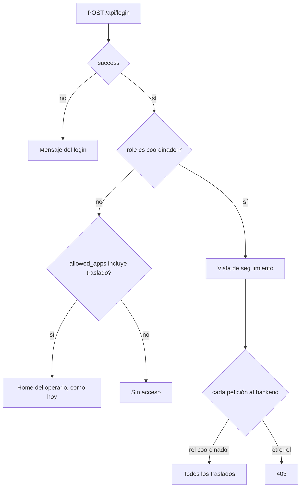

# Mapeo: el rol `coordinador` y su acceso a la vista de seguimiento

Última actualización: 2026-10-15 | Fuente: `sum-bck-modulos` (`app/services/auth_service.py`, `app/schemas/auth.py`, `app/schemas/usuarios.py`, `app/api/deps.py`, `app/api/mobile/traslado.py`, `app/api/v1/telemetria.py`, `app/api/v1/usuarios.py`, `app/api/v1/auth.py`, `app/api/v1/storage.py`, `migrations/020_traslado.sql`, `tests/test_rol_gerencia.py`), `sum-portal-front` (`src/lib/defaultRoute.ts`, `src/constants/users.ts`, `src/App.tsx`, `documents/migraciones/rol-gerencia-reportes-taller2.md`), `sum-app` (`lib/core/auth/auth_service.dart`), este repositorio (`src/app/`, `src/core/auth/`) | Estado: **la web está construida (2026-10-15) y probada con servidores falsos; el backend y el portal siguen pendientes**

> **Convención:** *confirmado* = salió del código revisado. *Propuesta* = diseño que se recomienda. `> TODO(verificar)` = queda abierto. ⬜ = por hacer.
> El backend se leyó en la copia local de `sum-bck-modulos` (rama `feature/utilitarios-asistencia-qr`, con cambios sin commitear en la parte de llegadas). **No se verificó que coincida con producción.**
> Este documento mapea; no toca ningún otro repositorio. Cruza cuatro (`sum-bck-modulos`, `sum-portal-front`, `sum-app` y este), así que se mapea antes de implementar. Detalle funcional de la vista: [propuesta-vista-cliente.md](../01-vision-y-alcance/propuesta-vista-cliente.md).

## 1. Qué se mapea

Un rol nuevo, **`coordinador`**, para ver el seguimiento de los traslados. **Primera versión: un coordinador general**, que ve todo lo que se genera con la app de Traslado, **sin filtro por destino**. Su única puerta de entrada es **esta web** (`sum-temp-traslado`).

| Pieza | Decisión | Fecha |
|---|---|---|
| Rol | `coordinador` (no existe hoy en ningún repositorio: búsqueda hecha en los cuatro). | 2026-10-15 |
| Cómo entra | **Por rol.** La web lleva a la vista cuando `role` es `coordinador`. No se mira `allowed_apps`, ni lo que la cuenta tenga o herede. | 2026-10-15 |
| Qué ve | **Todo** lo que genera la app de Traslado. Sin filtro por destino en esta versión. | 2026-10-15 |
| Dónde existe la vista | Solo en esta web. **La app móvil (Flutter) no cambia.** | 2026-10-15 |

## 2. Estado actual, con rutas reales

| Pieza | Hoy | Dónde |
|---|---|---|
| Roles que el alta acepta | `operario`, `supervisor`, `admin`, `asistente`, `gerencia`, `utilidad`. Sin `coordinador`. Ni `cliente`, aunque exista en otros lados. | `sum-bck-modulos/app/schemas/auth.py` (`ROLES_VALIDOS`) |
| ¿Hay restricción de rol en la base? | **No.** La tupla anterior es la validación. | Comentario en el mismo archivo. |
| Quién da de alta usuarios | Solo `admin`, por `POST /api/users` y por el padrón de usuarios. Los dos validan contra la misma tupla. | `app/api/v1/auth.py`, `app/api/v1/usuarios.py` |
| Login | `POST /api/login` emite token a **cualquier usuario activo**, sin mirar el rol. Devuelve `role` y `allowed_apps`. | `app/services/auth_service.py` |
| `allowed_apps` | Sale de la columna del usuario o del valor por defecto del rol. Un rol sin valor por defecto recibe `[]`. **Esta vista no lo usa**, así que no hay que tocarlo. | `_resolve_allowed_apps` |
| Refresh | `POST /api/refresh` devuelve también `role`, así que la sesión se repara sola al recargar. | `AccessTokenResponse` |
| Traslado del operario | `/mobile/traslado/*` solo admite `admin`, `supervisor` y `operario`. Otro rol recibe 403. | `app/api/mobile/traslado.py` (`_ROLES_MOBILE`) |
| Seguimiento GPS del supervisor | Lectura solo para supervisor de Despacho, Puerto o Secado y para `admin`. | `app/api/deps.py` (`TRASLADO_LECTOR_PARES`) |
| Rol `cliente` | **Existe, pero es otra cosa:** el auditor de inspecciones. Ruta `/cliente` del portal y guards de `proceso/guion` (puede **verificar cualquier inspección**). La cuenta `cliente.revo` se creó fuera de la API. | `sum-portal-front/src/App.tsx`, `app/api/v1/proceso_guion.py` |
| Precedente de rol nuevo en lugar de reutilizar `cliente` | `gerencia`, decidido el 2026-09-27 «para que el nombre no confunda». Cambios en tres sitios y su test. | `sum-portal-front/documents/migraciones/rol-gerencia-reportes-taller2.md`, `tests/test_rol_gerencia.py` |
| Portal | `UserRole` y `getDefaultRoute` no conocen `coordinador`. `getDefaultRoute` devuelve `"/login"` para un rol desconocido. El formulario de alta lista los roles a mano. | `src/constants/users.ts`, `src/lib/defaultRoute.ts`, `src/components/usuarios/UsuarioAltaDrawer.tsx` |
| App móvil | **Confirmado:** `_roleFromApi` devuelve `UserRole.none` para un rol que no conoce, y `isLoggedIn` es `role != none`. Un coordinador **no puede iniciar sesión en la app**, sin mensaje que lo explique. Agregar el rol solo en el backend es seguro para la app. | `sum-app/lib/core/auth/auth_service.dart` |
| Esta web, acceso | `tieneAcceso` exige `traslado` en `allowed_apps`. Sin él, «Sin acceso a Traslado». | [sesion.ts](../../src/core/auth/sesion.ts), [AppShell.tsx:35](../../src/app/AppShell.tsx#L35), [SinAccesoPage.tsx](../../src/app/SinAccesoPage.tsx) |
| Esta web, sesión | Ya guarda y lee `role` de la respuesta del login y del refresh. | [authCookie.ts](../../src/core/auth/authCookie.ts), [AuthPort.ts](../../src/core/auth/AuthPort.ts) |

## 3. Decisiones de diseño

Tomadas por el usuario (2026-10-15):
1. **Rol nuevo `coordinador`, sin reutilizar `cliente`.** `cliente` puede verificar inspecciones de todo el sistema; dárselo a un coordinador sería regalar ese poder. Mismo criterio que `gerencia`.
2. **El acceso es por rol**, no por `allowed_apps`. Ventaja: no hay que tocar el valor por defecto de apps del rol ni el catálogo de apps del backend.
3. **Primera versión sin filtro por destino:** un coordinador general ve todo lo que genera Traslado.
4. **Solo web, sin cambios en Flutter.** La app lo trata como «sin sesión». Costo aceptado: si un coordinador intenta entrar en la app, el login falla sin explicación; hay que avisarle que su acceso es solo por la web. Además, `POST /mobile/auth/login` **sí emite tokens** a un coordinador (el backend no filtra por rol); la app los descarta. No se cambia.

Propuestas que se desprenden:
5. **La web decide la pantalla por rol (comodidad); el backend decide el acceso por rol en cada petición (seguridad).** No se confía en lo que diga la web.
6. **El coordinador va siempre a la vista de seguimiento**, aunque su cuenta tenga `traslado` en `allowed_apps`. Quien no es coordinador sigue como hoy: con `traslado`, la home del operario; sin él, «Sin acceso».
7. **Endpoints propios de lectura, no los del supervisor.** Reutilizar `TRASLADO_LECTOR_PARES` le abriría la telemetría completa (conductores, velocidades, dispositivos). Los propios devuelven una lista cerrada de campos (ver [propuesta-vista-cliente.md](../01-vision-y-alcance/propuesta-vista-cliente.md) §3). El prefijo es `/api/seguimiento/` y no `/v1/`: el backend monta los routers en la raíz y esta web solo reenvía `/api` y `/mobile` al backend (ADR 0003); con `/v1` habría que cambiar el proxy de Vite y los `rewrites` de Vercel. Tampoco `/cliente`, para no chocar con el rol del auditor.
8. **Admin no entra a la vista de coordinador** de forma automática. TODO(verificar): si soporte necesita verla.

> **Sin filtro implica personal de SUM.** Un coordinador general ve los vehículos de **todos** los destinos. Mientras no exista el filtro (§6, «Más adelante»), el rol no debe darse a nadie externo, como un concesionario que vería a los demás.

## 4. Matriz de acceso

| | operario | supervisor | admin | `cliente` (auditor) | **coordinador** |
|---|---|---|---|---|---|
| Web: home de Traslado | ✅ (con `traslado`) | solo con `traslado` | solo con `traslado` | ❌ | ❌ (va a la vista de seguimiento) |
| Web: vista de seguimiento | ❌ | ❌ | ❌ | ❌ | ✅ por rol |
| `/mobile/traslado/*` | ✅ | ✅ | ✅ | ❌ 403 | ❌ 403 |
| `/v1/telemetria/*` (flota GPS) | ❌ | Despacho, Puerto, Secado | ✅ | ❌ | ❌ |
| `/proceso/guion/bandeja` y `verificar` | ❌ | ✅ | ✅ | ✅ | ❌ |
| `GET /api/seguimiento/traslados…` (nuevo) | ❌ | ❌ | ❌ | ❌ | ✅ **todos**, sin filtro |
| Endpoints con solo `require_auth` | ✅ | ✅ | ✅ | ✅ | **✅ (hueco, ver §8)** |

Las columnas de operario, supervisor, admin y `cliente` salen de los guards leídos; no probé cada celda contra un backend.

## 5. Cuándo se accede a la vista

- El coordinador entra a la vista **aunque `allowed_apps` esté vacío o incluya `traslado`**.
- El 403 del servidor en la vista nueva muestra «Sin permiso» y **no cierra la sesión**, como ya hace Traslado (`cerrarSesionEn403: false`).
- El rol viene del login y se reafirma en cada refresh; la web lo guarda en la sesión (`role`).

## 6. Cambios por repositorio

### Backend (`sum-bck-modulos`), ⬜ necesita autorización y su propio equipo
1. ⬜ `app/schemas/auth.py`: `"coordinador"` en `ROLES_VALIDOS`. Sin esto el alta devuelve 422 (por eso `cliente` quedó inalcanzable). **Es el único cambio de roles.** No hay valor por defecto de apps ni tabla nueva en esta versión.
2. ⬜ Endpoints de solo lectura `GET /api/seguimiento/traslados` y `GET /api/seguimiento/traslados/{id_orden}`, con guard `require_role("coordinador")` y **sin filtro por destino**. Contrato en [propuesta-vista-cliente.md](../01-vision-y-alcance/propuesta-vista-cliente.md) §7. Deben leer la caché del barrido de GPS, no al proveedor.
3. ⬜ El servidor traduce los estados internos (`sin_placa`, `sin_gps`, `demorado`) a `en_vivo`, `ultima_ubicacion` o `sin_seguimiento`, y a «se define al salir» cuando el vehículo aún no sale.
4. ⬜ Pruebas, siguiendo a `tests/test_rol_gerencia.py`: el rol está en el catálogo; el alta lo acepta por los dos caminos; un rol inexistente se sigue rechazando; un coordinador **no** entra a `/mobile/traslado`, a telemetría ni a `proceso/guion`; los endpoints nuevos responden 403 a operario, supervisor y `cliente`, y devuelven todo a un coordinador.
5. ⬜ Alta de cuentas: por ahora solo `admin`. La columna `allowed_apps` del coordinador no importa.

### Portal (`sum-portal-front`), ⬜ cambios mínimos de coherencia
6. ⬜ `src/constants/users.ts`: `"coordinador"` en `UserRole`.
7. ⬜ `src/components/usuarios/UsuarioAltaDrawer.tsx`: `coordinador` en `ROLES`, para poder darlo de alta desde el portal.
8. ⬜ `src/lib/defaultRoute.ts`: hoy devuelve `"/login"` para un rol desconocido. TODO(verificar) qué hace el portal si un coordinador inicia sesión ahí: puede quedar en un bucle o en una pantalla en blanco. Propuesta: un aviso «Esta cuenta es para el portal de destinos».

### App móvil (`sum-app`), **sin cambios** (decisión del usuario)
9. No se agrega `coordinador` a `UserRole` ni a `_roleFromApi`. Verificado en el código que un rol desconocido queda en `none` y no inicia sesión (ver §2).

### Esta web (`sum-temp-traslado`), ✅ hecho el 2026-10-15 (con el OK del usuario)
10. ✅ [sesion.ts](../../src/core/auth/sesion.ts): `ROL_COORDINADOR = 'coordinador'` y `esCoordinador(sesion)`. `tieneAcceso` no cambia.
11. ✅ [AppShell.tsx](../../src/app/AppShell.tsx): con sesión, si es coordinador va a la vista de seguimiento; si no, como hoy (home con `traslado`, «Sin acceso» sin él). Sin la vista nueva, un coordinador ve «Sin acceso».
12. ✅ Nueva `src/features/seguimiento/` (`domain/`, `api/`, `data/`, `components/`), con las capas de [vision-general.md](../02-arquitectura/vision-general.md). **Sin Dexie**: los datos del coordinador no se guardan en el navegador.
13. ✅ Dobles de prueba: `features/seguimiento/data/testing/fakes.ts` (API y lista con reloj propio). Para el login del coordinador se reutiliza el servidor falso existente con `servidor.perfil.role = 'coordinador'`, sin cambiarlo.
14. ✅ Pruebas de acceso en `src/app/App.seguimiento.test.tsx`: el coordinador entra con `allowed_apps` vacío y también con `traslado`; un operario con `traslado` va a la home; con `seguimiento` en su cuenta pero sin `traslado`, «Sin acceso»; supervisor y admin no entran por su rol; un rol que solo se parece («Coordinador») no cuenta; sin la vista nueva, «Sin acceso»; cerrar sesión vacía la lista. Además `SeguimientoPage.test.tsx`, las del dominio, la API, el controlador y el hook, y `e2e/seguimiento.spec.ts` (Chrome y Edge, sin backend).
15. ✅ Documentación: [navegacion-y-sesion.md](../02-arquitectura/navegacion-y-sesion.md), [vision-y-alcance.md](../01-vision-y-alcance/vision-y-alcance.md), [TODO.md](../../TODO.md), CHANGELOG y, si se cambia el despliegue, `vercel.json` (entrada aparte).

### Más adelante (fuera de esta versión)
- Filtro por destino: tabla `usuario_destino(id_usuario → usuarios, id_destino → destino_traslado)`, guard por destino y 404 para lo ajeno. Es lo que permitiría dar el rol a externos. TODO(verificar) el número de migración libre (la última de esta copia es la 061).
- Asignación de destinos desde el formulario de usuarios del portal.

### Nada que tocar
- `AuthCookie`: ya guarda y refresca `role`.
- `_ROLE_AREA_DEFAULTS` y `apps_catalogo`: no se usan en esta versión.
- `/mobile/traslado/*` y `TRASLADO_LECTOR_PARES`: no se amplían; el coordinador recibe 403 a propósito.
- Ruta `/cliente` y `ClienteAuditoriaView` del portal: no se tocan.

## 7. Cómo se prueba sin tocar producción

- Vitest con el servidor falso de rol `coordinador` y datos de ejemplo. Ningún dato de vehículo real.
- Contra el backend real **no** se hace nada hasta que exista el rol en la base de desarrollo y se confirme a qué base apunta `localhost:8050` ([ADR 0008](../06-decisiones/0008-no-tocar-produccion.md)).
- Mutación: romper a propósito la decisión por rol (que el coordinador caiga en la home, o que otro rol entre a la vista) y comprobar que una prueba lo detecta.

## 8. Riesgos y huecos conocidos

| Riesgo | Evidencia | Qué hacer |
|---|---|---|
| **Sin filtro por destino, el coordinador ve todos los destinos.** | Decisión de esta versión. | Dar el rol solo a personal de SUM hasta que exista el filtro. |
| **Un coordinador puede llamar cualquier endpoint que solo exija `require_auth`.** Unos 65 usos en 14 archivos, sin auditar uno a uno. Confirmados: `GET /storage/signed-url/{key}`, `/vehiculo/ubicacion/{vin}`, `/vehiculo/{vin}/historial-flujo`, `/proceso/pdi-estado`, `/mobile/clientes/lista`. | Leídos en `app/api/v1/storage.py`, `vehiculos.py`, `procesos.py` y `mobile/inspeccion.py`. Mismo hueco que ya anota `sum-portal-front/documents/migraciones/diagnostico-arquitectura-erp.md` §1.2; ya aplica a `gerencia` y `cliente`. | Antes de dar cuentas reales, pedir al backend que cierre al menos los que devuelven datos de vehículos. No es parte de esta web. |
| Un coordinador que abre el portal | `getDefaultRoute` devuelve `/login` | Punto 8. |
| Un coordinador que prueba la app móvil | `_roleFromApi` lo deja en `none`: el login falla sin explicación | Aceptado al no tocar Flutter. Avisarle que su acceso es solo por esta web. |
| `admin` recibe `["*"]` por defecto y la web busca `traslado` literalmente | `auth_service.py`, `sesion.ts` | Aparte de esta vista: un admin sin apps asignadas vería «Sin acceso». Sin probar. |
| Cookie de refresh en `:8050` | [TODO.md](../../TODO.md), «Pedidos a terceros» | Sigue abierto: en local contra el backend de desarrollo la sesión no sobrevive a una recarga en Chrome y Edge. |
| Datos personales | [propuesta-vista-cliente.md](../01-vision-y-alcance/propuesta-vista-cliente.md) §6 | Validar con legal si la ubicación llegara a mostrarse a terceros. |

## 9. Decisiones y TODO(verificar)

Decididas: rol `coordinador`; acceso por rol; coordinador general sin filtro por destino; solo web, sin cambios en Flutter.

Abiertas:
1. **¿Qué campos ve un coordinador general?** La lista de [propuesta-vista-cliente.md](../01-vision-y-alcance/propuesta-vista-cliente.md) §3 (sin conductor, velocidad ni fotos) se pensó para un cliente. Para personal interno puede ampliarse. Mientras no se diga, se mantiene.
2. **¿Entra `admin` a la vista?** Se propone que no.
3. **Datos de ejemplo para desarrollar:** el backend aún no tiene los endpoints. Se propone un servidor falso solo en las pruebas y un modo de demostración local, a definir.
4. TODO(verificar): rama en la que se implementa el backend y si la cuenta de pruebas del rol existe en la base de desarrollo.
5. TODO(verificar): qué hace el portal con un rol que `getDefaultRoute` no conoce.
6. TODO(verificar): que esta copia del backend sea la de producción.

## 10. Fuera de alcance

- Filtro por destino y roles para externos (ver «Más adelante»).
- Cualquier dato o acción adicional para el coordinador más allá de la vista de seguimiento.
- Cerrar todos los endpoints de `require_auth` (es un roadmap del backend).
- Cambiar el rol `cliente` ni `ClienteAuditoriaView`.
- Cambios en la app móvil.
- Notificaciones al coordinador.

## 11. Relacionado

- [propuesta-vista-cliente.md](../01-vision-y-alcance/propuesta-vista-cliente.md): qué ve el coordinador y el contrato de los endpoints.
- [pedido-backend-vin-otras-ordenes.md](pedido-backend-vin-otras-ordenes.md): el formato del pedido al backend que sirvió de modelo.
- [navegacion-y-sesion.md](../02-arquitectura/navegacion-y-sesion.md): cómo decide hoy la pantalla.
- Precedente: `sum-portal-front/documents/migraciones/rol-gerencia-reportes-taller2.md`.
