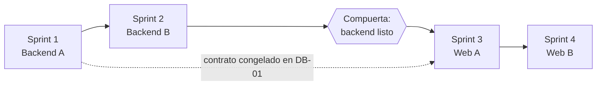

# Plan: dashboard de llegadas por QR (primero el backend, después la web)

Última actualización: 2026-10-15 | Fuente: `sum-app/docs/specs/001-marcacion-qr/dashboard-llegadas-historias.md` (historias HU-1 a HU-7), `sum-bck-modulos` (`app/api/deps.py`, `app/api/v1/seguimiento.py`, `app/api/mobile/llegadas.py`, `tests/`), esta web (`src/app/AppShell.tsx`, `src/features/seguimiento/`), [plan-sprints.md](plan-sprints.md) | Estado: **decisiones D1 a D8 tomadas el 2026-10-16**; backend y web hechos y probados con servidores falsos (ver la sección 12); **falta desplegar el backend y probar con datos reales**. Las estimaciones son mías y no hay velocidad histórica

> **Qué es:** el plan de trabajo para construir el tablero de **solo lectura** que muestra a los supervisores **el orden de llegada y a qué distancia llegó cada conductor**, más los rechazos de código y las reglas de cada punto. Primero se construye lo que falta en el **backend** (hoy no existe ninguna lectura de estos datos); después, la **web**. La vista previa interactiva (con datos de ejemplo) ya se hizo y es la referencia visual.

## 1. Meta, alcance y supuestos

**Meta del conjunto:** que un supervisor de despacho o de secado, un asistente de despacho o un administrador abra la web y vea, para un día de Lima, quién llegó, en qué orden, a qué distancia, qué llegadas entraron con flag y qué códigos se rechazaron y por qué.

**Dentro:** las historias HU-1 a HU-7 del spec (resumen, lista, señales, detalle, rechazados, motivos, ficha de puntos), **solo lectura**.

**Fuera (decidido en el spec):** crear, editar o desactivar puntos; la tablet; la app del conductor; las señales «cerca del borde» y «dos turnos seguidos»; un mapa real (es un esquema).

| # | Supuesto | Quién lo confirma |
|---|---|---|
| S1 | La web es **esta** (`sum-temp-traslado`) y no el portal (el spec decía «otro proyecto»). **Confirmado por el usuario el 2026-10-16.** | ✔ |
| S2 | El backend es `sum-bck-modulos`, en una **rama aparte** (`feat/dashboard-llegada-qr`). **Autorizado por el usuario el 2026-10-16.** | ✔ |
| S3 | Los endpoints cuelgan de `/api/llegada-qr/...`: esta web solo reenvía `/api` y `/mobile` al backend ([ADR 0003](../06-decisiones/0003-mismo-origen-por-proxy.md)); un `/v1/...` no llegaría. | ✔ |
| S4 | Todo se prueba con **servidores falsos** y con una **base local**; **nada contra producción** ([ADR 0008](../06-decisiones/0008-no-tocar-produccion.md)). | Regla del proyecto |
| S5 | Las tablas `llegada_qr`, `intento_codigo_invalido`, `punto_llegada` y `usuarios` ya existen (migración `061_llegada_qr.sql`, aplicada en producción según el documento del módulo). **Verificado el 2026-10-16 en la réplica local (puerto 5434):** las cuatro tablas existen y tienen datos de pruebas manuales (10 llegadas, 1 intento, 2 puntos del 14 y 15 de octubre). | ✔ |

## 2. Decisiones (tomadas el 2026-10-16)

| ID | Decisión | Qué se decidió |
|---|---|---|
| D1 | ¿Dónde se construye la web? | **En este proyecto** (`sum-temp-traslado`), no en el portal. Falta registrarlo en un ADR (en DW-07). |
| D2 | ¿Quién escribe el backend? | **En una rama nueva de `sum-bck-modulos` (`feat/dashboard-llegada-qr`)**, con autorización del usuario para los cambios. |
| D3 | ¿Quién ve el tablero? | **supervisor+despacho, supervisor+secado, asistente+despacho y admin.** Con guard propio (`require_llegada_qr_lector`), porque `require_area_lectura` deja pasar a todos los asistentes. |
| D4 | ¿Entra `secado_fisico`? | **No.** Sumarlo después es agregar su par a `LLEGADA_QR_LECTOR_PARES`. |
| D5 | ¿Cómo llegan los supervisores a la vista? | **Una ruta nueva de la web: `/dashboard`** (la web no tiene router: se lee la ruta del navegador; `vercel.json` y Vite ya devuelven `index.html` para cualquier ruta que no sea `/api` ni `/mobile`). **Quien cumple un par entra directo al tablero y no ve Traslado**, aunque su cuenta tenga `traslado` (pedido del usuario el 2026-10-16; antes se había propuesto un botón entre las dos vistas y se quitó). |
| D6 | Intentos de más de 90 días | **Solo se ocultan** (filtro de 90 días en la consulta). No se borra nada. |
| D7 | Nombres de los endpoints | **`/api/llegada-qr/...`** (singular), con `dia`, `intentos` y `puntos` colgando de él. |
| D8 | Despliegue en Cloud Run | **Lo hace el usuario** en cuanto el backend esté listo y mezclado. La web no se publica para usuarios reales antes. |

**Lo que sigue pendiente de ti:** la capacidad real del equipo (personas, días y duración del sprint) para poner fechas.

## 3. Estrategia: backend primero, con compuerta

- **El orden pedido se respeta:** la web empieza cuando el backend pasa la compuerta (sección 7).
- **Contrato primero:** la historia DB-01 congela el contrato (nombres, campos, errores). Si hay capacidad, la web puede arrancar su capa de datos contra **servidores falsos** desde ahí (DW-01); es una opción, no un cambio del orden.
- **Los cálculos los hace el servidor** (pasos, demora, porcentaje del radio, flag, antigüedad del QR, señales y mediana): una sola fuente de verdad y cifras que no dependen de cuántas filas se descargaron (recomendación del spec). La web solo formatea.
- **Sin renovación automática:** el tablero se pide al abrir y con «Actualizar» (el usuario ya lo pidió así para la vista del coordinador; el spec no pide otra cosa).

## 4. Contrato (congelado en DB-01)

Todas: `GET`, solo lectura, token del usuario, **403** para un par no permitido, **401** sin token y **422** para un `dia` mal formado, futuro o con más de 90 días de antigüedad. El día es **siempre** un día de Lima (`AAAA-MM-DD`); la web nunca calcula con la zona del navegador. **`dia` es opcional** (por defecto, hoy de Lima) y se devuelve en la respuesta.

| Lectura | Ruta | Entrada | Devuelve |
|---|---|---|---|
| Llegadas del día | `GET /api/llegada-qr/dia` | `dia`, `id_punto` (opcional) | `dia`, `id_punto`, `resumen` (`total`, `por_punto[]`, `con_flag`, `rechazados`, `mediana_demora_s`), `senales` (`con_flag`, `qr_vencido_repetido[]` con el conductor y las `veces`), `llegadas[]` (por hora de recepción: `id_llegada`, `turno`, `punto`, `conductor`, `step`, `hora_oficial`, `hora_recepcion`, `demora_s`, `pasos`, `flag`, `flags`, `latitud`, `longitud`, `distancia_m`, `pct_radio`, `precision_m`) y `truncado` (verdadero si se pasó del tope de 500 filas; el resumen y las señales siguen contando todo) |
| Intentos rechazados | `GET /api/llegada-qr/intentos` | `dia`, `id_punto` (opcional) | `intentos[]` más recientes primero: `id_intento`, `hora_recepcion`, `conductor`, `punto` (nulo si no existe), `motivo`, `etiqueta`, `antiguedad_qr_s` (solo `fuera_de_tope`; negativo = QR «del futuro»), `texto_inicio` (20 caracteres como máximo) y `repeticiones_conductor_dia` (solo en las filas de QR vencido); y `truncado` |
| Puntos | `GET /api/llegada-qr/puntos` | `dia` (opcional) | Una ficha por punto: `id_punto`, `nombre`, `activo`, `latitud`, `longitud`, `radio_m`, `precision_max_m`, `peor_caso_m`, `llegadas_dia` y `ultimo_escaneo`. **Nunca el `secreto`.** |

> Las formas exactas están en `app/schemas/llegada_qr_lectura.py` del backend (lista cerrada: un campo se agrega a mano o no sale). El `repeticiones_conductor_dia` y las señales respetan el filtro de punto.

## 5. Historias

**Estimación:** puntos relativos en la escala 1-2-3-5-8-13; son **míos y sin velocidad histórica**: el primer sprint sirve para calibrar. Ninguna supera 5. Referencia: «Puntos» (lectura simple, sin cálculos) = 2.

### Backend (`sum-bck-modulos`)

| ID | Historia | Pts | Depende de |
|---|---|---|---|
| **DB-01** | Contrato, guard por pares y esqueleto de los tres endpoints | 3 | D2, D3, D7, S5 |
| **DB-02** | Lectura «Puntos» (HU-7), sin secreto | 2 | DB-01 |
| **DB-03** | Lectura «Llegadas del día»: lista con campos calculados (HU-2, HU-4) | 5 | DB-01 |
| **DB-04** | Resumen y señales del día (HU-1, HU-3) | 5 | DB-03 |
| **DB-05** | Lectura «Intentos rechazados»: motivos, antigüedad, ×N, 90 días (HU-5, HU-6) | 5 | DB-01 |
| **DB-06** | Datos de prueba locales, cierre y entrega del backend | 3 | DB-02 a DB-05 |

**DB-01 — Contrato, guard y esqueleto.** *Como* equipo de la web, *quiero* el contrato congelado y el acceso cerrado, *para* construir contra algo estable.
- AC1. Given un token de supervisor+despacho, supervisor+secado, asistente+despacho o admin, When pide cualquiera de las tres rutas, Then responde 200.
- AC2. Given cualquier otro par (supervisor de otra área, asistente de otra área, `operario`, `utilidad`, `coordinador`, sin token), Then responde 403 (401 sin token).
- AC3. Given un `dia` mal formado o con más de 90 días de antigüedad, Then 422.
- AC4. El contrato (campos, errores, nombres) queda escrito en un documento del repositorio de la web (como el pedido del coordinador).
- Pruebas: acceso por par (una por cada par permitido y por cada rol que debe fallar).

**DB-02 — Puntos.** AC: una ficha por punto con `peor_caso_m = radio_m + precision_max_m`; llegadas del día y último escaneo (o nulo); **una prueba comprueba que el cuerpo no contiene `secreto`**, ni siquiera como `null`.

**DB-03 — Llegadas del día.**
- AC1. Con el conjunto del apéndice del spec devuelve 19 llegadas ordenadas por hora de recepción.
- AC2. `pasos = piso(segundos(recepción)/30) − step`; `demora_s = recepción − hora oficial`; `flag` si el valor absoluto de `pasos` es mayor que 2 (un QR «del futuro» cuenta por valor absoluto).
- AC3. **Caso límite:** una llegada de 71 s cuyo QR tiene exactamente 2 pasos es **normal**, sin flag.
- AC4. El día es el de Lima (`turno_fecha`); una llegada a las 23:59 y otra a las 00:01 de Lima caen en días distintos.
- AC5. El filtro por punto cambia la lista; con un tope de seguridad se marca `truncado`.
- Pruebas: la base de cada AC, con mutación del cálculo de pasos, el límite 2/3 y el cambio de día.

**DB-04 — Resumen y señales.**
- AC1. Con el apéndice: 19 llegadas (16 y 3), **3 con flag**, **9 rechazados**, **mediana 12 s**; señales **3** y **1** (`op.demo07`).
- AC2. Los números salen de **toda** la consulta, no de la lista recortada por el tope.
- AC3. Con 0 llegadas la mediana es 0 y el desglose está vacío; el desglose omite los puntos sin llegadas.
- AC4. «QR vencido repetido» cuenta conductores con **2 o más** intentos de `fuera_de_tope` en el día (1 intento no cuenta).
- Pruebas: mediana con cantidad par e impar, y con un solo dato.

**DB-05 — Intentos rechazados.**
- AC1. Con el apéndice: 9 intentos, del más reciente al más antiguo; `op.demo07` con 3 de `fuera_de_tope`.
- AC2. La antigüedad solo para `fuera_de_tope`, con `(step_del_servidor − step_del_texto) × 30`; si el texto no tiene la forma `SUM1|id|step|código` o el step no es numérico, la antigüedad es nula (no falla).
- AC3. `texto_inicio` tiene **20 caracteres como máximo**; **el código completo nunca sale**.
- AC4. El conductor o el punto ausentes no rompen la consulta (unión externa; punto nulo se informa como tal).
- AC5. Solo los últimos 90 días (D6).
- AC6. Cada motivo trae su etiqueta; un motivo desconocido no tumba la respuesta.

**DB-06 — Datos de prueba y cierre.**
- AC1. Un script de siembra **solo local y con confirmación del destino** (como los scripts de `crear_punto_llegada.py`) crea los conductores `op.demo01` a `op.demo07`, los tres puntos y las filas del apéndice; **se niega a correr contra una base que no sea la local**.
- AC2. Las tres rutas, contra la base local sembrada, devuelven las cifras del apéndice.
- AC3. Se corre la suite completa en la rama mezclada y en la base y se **comparan los `FAILED`** (hoy hay 45 previos): cero regresiones.
- AC4. Los endpoints quedan en `ENDPOINTS.md` (hoy el del coordinador tampoco está: queda pendiente de la misma tarea).
- AC5. Rama mezclada a `main` del backend, sin borrar la rama.

### Web (`sum-temp-traslado`)

| ID | Historia | Pts | Depende de |
|---|---|---|---|
| **DW-01** | Acceso por rol+área y esqueleto de la vista (datos, API, esquemas, store) | 5 | Compuerta (o contrato congelado, con fakes) |
| **DW-02** | Resumen, señales y filtros de día y punto (HU-1, HU-3) | 5 | DW-01 |
| **DW-03** | Lista de llegadas con filtros, búsqueda, orden y tarjetas en móvil (HU-2) | 5 | DW-01 |
| **DW-04** | Detalle de una llegada con el esquema de la ubicación (HU-4) | 5 | DW-03 |
| **DW-05** | Códigos rechazados y motivos (HU-5, HU-6) | 3 | DW-01 |
| **DW-06** | Ficha de puntos (HU-7) | 2 | DW-01 |
| **DW-07** | Cierre: E2E sin backend, 360 px, accesibilidad y documentación | 3 | DW-02 a DW-06 |

**DW-01 — Acceso y esqueleto.**
- AC1. Given un usuario de los pares permitidos (D3), When inicia sesión, Then **entra directo al tablero en `/dashboard` y no ve Traslado, tenga o no `traslado` en su cuenta** (D5); un `operario`, un `coordinador` o un par no permitido siguen con lo de hoy (home, seguimiento o «Sin acceso»). **La comparación del rol y del área es exacta.**
- AC2. Un 403 muestra «Sin permiso» sin cerrar la sesión (política de 403 con prueba de guarda: toda función nueva de la API la lleva).
- AC3. Los datos viven **solo en memoria**, se piden al abrir y con «Actualizar»; un fallo no vacía lo mostrado; se vacían al cerrar sesión o al entrar otra persona.
- AC4. Los esquemas (zod) dejan pasar solo lo que la pantalla usa; un campo malo se descarta y se cuenta, no vacía la lista.
- Pruebas: dominio (formatos y etiquetas), API con `fetch` simulado (cuerpo y rutas exactas), store, acceso en `App`.

**DW-02 — Resumen y señales.** AC: con los datos del apéndice servidos por un servidor falso, las tarjetas dicen 19 (con el desglose «Patio de llegada: 16 · Puerta norte: 3»), 3, 9 y «12 s»; las señales, 3 y 1 (nombrando a `op.demo07`); tocar «Con flag» abre la lista filtrada y tocar «Códigos rechazados» o la señal del QR vencido abre esa pestaña (con el motivo filtrado); cambiar el día o el punto actualiza las cuatro tarjetas a la vez; el selector de día no permite pasar de 90 días atrás.

**DW-03 — Lista de llegadas.** AC: columnas del spec; el estado «Normal» o «OUT_OF_WINDOW · N pasos» **con texto** (el color no va solo) y la raya ámbar; la demora de más de 60 s se muestra «1 min 11 s»; la barra mide distancia/radio (hasta 100 %); chips «Todas / Con flag», búsqueda sin distinguir mayúsculas, orden con botón; «Ninguna llegada aquí con estos filtros» sin que la altura salte; debajo de 768 px las filas son tarjetas con cada dato rotulado; si `truncado`, un aviso lo dice; no se muestran coordenadas en la lista.

**DW-04 — Detalle.** AC: panel lateral (pantalla completa en móvil) con foco atrapado, Esc, cortina y «Cerrar»; el foco vuelve a la fila de la que se abrió y la fila se abre con el teclado; el resumen en lenguaje llano (con y sin flag), los tiempos y el esquema (centro, círculo del radio, posición con su círculo de precisión, la distancia «27,5 m, 28 % del radio» y la precisión «15,0 m, máx. 100 m»); las coordenadas **solo aquí**; la página de atrás no se corre al abrir (se reutiliza `PanelDetalle`).

**DW-05 — Rechazados.** AC: del más reciente al más antiguo; chips por motivo y búsqueda por conductor; el distintivo **×N** cuando el conductor tiene N≥2 intentos de `fuera_de_tope`; la antigüedad como «hace 18 h 2 min»; el texto leído (20 caracteres como máximo, nunca el código completo); la etiqueta y la ayuda de cada motivo (no el valor crudo); el aviso «al conductor siempre le aparece “El código no es válido”»; sin resultados, «Ningún código rechazado con estos filtros».

**DW-06 — Puntos.** AC: una tarjeta por punto con nombre y estado, centro a 6 decimales, radio, precisión máxima, «peor caso aceptado» resaltado, llegadas del día, último escaneo («—» si no hay) y «Secreto: guardado · no se muestra nunca» (solo ese texto, nunca un dato).

**DW-07 — Cierre.** AC: E2E en Chrome y Edge con respuestas simuladas, **sin backend**; sin desborde horizontal a 360 px; `axe` sin violaciones; controles de 44 px y entradas de 16 px en móvil; ADR de la decisión D1/D5; documentación (`estructura-src`, `navegacion-y-sesion`, `estado-y-datos`, `pruebas-*`, glosario); `TODO.md`, `CHANGELOG.md` y bitácora de la sesión.

## 6. Sprints

> **Capacidad:** no la conozco (personas, días disponibles ni velocidad). Propongo **cuatro sprints** de la duración que el equipo ya use; los puntos siguientes son una carga relativa, y **el Sprint 1 calibra los demás**. Si el equipo es una sola persona, los puntos de cada sprint son una buena referencia de tamaño (10 a 15) y no de duración.

| Sprint | Objetivo | Historias | Pts |
|---|---|---|---|
| **1 · Backend A** | Un usuario autorizado pide al backend las llegadas de un día con sus campos calculados y la ficha de los puntos; los demás reciben 403. | DB-01, DB-02, DB-03 | 10 |
| **2 · Backend B** | El backend entrega todo lo que el tablero muestra (resumen, señales y rechazados), probado con los datos del apéndice, y está mezclado a `main`. | DB-04, DB-05, DB-06 | 13 |
| **Compuerta** | Ver la sección 7. | — | — |
| **3 · Web A** | Un supervisor entra a la web y ve el resumen, las señales y la lista de llegadas con sus filtros. | DW-01, DW-02, DW-03 | 15 |
| **4 · Web B** | El supervisor abre el detalle, revisa los rechazados y los puntos; la vista está probada, accesible a 360 px y documentada. | DW-04, DW-05, DW-06, DW-07 | 13 |

**Opción de paralelo (si hay capacidad):** con DB-01 hecha y el contrato congelado, DW-01 (la capa de datos y el acceso) puede hacerse contra servidores falsos durante el Sprint 2 sin esperar al resto del backend.

## 7. Compuerta «backend listo» (para empezar la web)

Se cumple **todo** esto, y se registra en una bitácora:
1. Las tres rutas, contra la **base local sembrada**, devuelven las cifras del apéndice (19 · 3 · 9 · 12 s · señales 3 y 1 · `op.demo07` ×3 · caso de 71 s normal).
2. Acceso: los pares del D3 reciben 200; los demás, 403 (probado par por par).
3. Ninguna respuesta contiene el `secreto` ni un código de QR completo (prueba que lo comprueba).
4. Suite completa del backend comparada: **sin `FAILED` nuevos** respecto de `main`.
5. `ENDPOINTS.md` actualizado y rama mezclada a `main` del backend.
6. **Despliegue (D8):** la web no se publica para usuarios reales hasta que Cloud Run tenga el backend nuevo. Esto **no** impide desarrollar la web con servidores falsos.

## 8. Definition of Done de este plan

Una historia está terminada cuando:
1. Los criterios de aceptación pasan con pruebas, y **cada comportamiento nuevo se rompió a propósito** (mutación) y la prueba lo detectó; no quedan archivos `.bak`.
2. Backend: `pytest` de lo nuevo en verde y la suite completa sin regresiones frente a `main`. Web: `typecheck`, `lint`, `npm test` (sin las pruebas contra el backend real mientras `:8050` esté encendido) y `build`.
3. **Ninguna prueba toca producción** (base, bucket ni Cloud Run).
4. Sin secretos ni datos reales en pruebas, documentos ni capturas: solo los conductores de ejemplo.
5. Accesibilidad (web): `axe` sin violaciones; el color nunca es la única señal.
6. La documentación y la bitácora de la sesión reflejan lo hecho **y lo que no se verificó**.
7. El Product Owner la acepta en la Review.

**Definition of Ready:** la historia tiene criterios de aceptación, está estimada (≤ 5), sus decisiones previas (sección 2) están tomadas y sus datos de prueba existen.

## 9. Riesgos e impedimentos

| Riesgo o impedimento | Impacto | Respuesta |
|---|---|---|
| La réplica local no tiene las tablas de llegadas o el usuario no puede sembrarlas | Bloquea las pruebas del backend con datos reales | Comprobarlo **primero** (S5); si falta, aplicar `061_llegada_qr.sql` **solo en la base local** y avisarlo |
| Un guard mal armado deja ver datos a quien no debe (el backend ya tiene ~65 endpoints que solo exigen sesión) | Exposición de nombres y ubicaciones de conductores | Guard propio por pares (D3) y prueba por cada rol y área; no reutilizar `require_area_lectura` |
| Datos personales (nombre, usuario y coordenadas del conductor) | Privacidad | Coordenadas solo en el detalle; no registrarlas en logs; datos de ejemplo en las pruebas |
| El día de Lima en el borde de la medianoche (UTC−5) | Cifras de un día que se mezclan con otro | Usar `turno_fecha` y pruebas en el cambio de día; la web trata el día como texto |
| Cálculos distintos entre servidor y web | Cifras que no coinciden | Un solo lugar de cálculo (el servidor); la web no recalcula |
| Cloud Run sin el backend nuevo | La web publicada no funciona | D8; la web se publica solo después |
| 45 fallos previos en la suite del backend | «Hay fallos» se confunde con regresión | Comparar la lista de `FAILED` con `main`, no el conteo |
| Un cambio de par (p. ej. `secado_fisico`) después | Retrabajo menor | Es una línea en la lista de pares; queda anotada en D4 |
| Un backend local conectado a la base de producción ejecuta sus tareas en segundo plano | Duplica avisos y gasta cuota | Solo con las variables `DB_*` de la réplica local ([comandos.md](../ai/comandos.md)) |

## 10. Ceremonias y seguimiento (livianos)

- **Planning** al inicio de cada sprint: confirmar el objetivo, la capacidad real (qué personas y cuántos días) y cargar historias hasta ahí, **no más de lo que dice la velocidad del sprint anterior** (en el primero, lo que cabe con holgura).
- **Revisión** de cada sprint con lo funcionando: en el backend, las tres rutas respondiendo con los datos del apéndice (`curl` a la base local); en la web, la pantalla con servidores falsos. Nada de diapositivas.
- **Retrospectiva** corta al cierre; una mejora concreta por sprint.
- **Métricas:** puntos terminados frente a comprometidos (para calibrar, nunca como evaluación), si se cumplió el objetivo del sprint, mutaciones que sobrevivieron (y se reforzaron) y tiempo que un impedimento queda abierto.

## 11. Qué necesito para cerrar el plan

1. **D1 y D2** (dónde se construye y quién hace el backend) y la autorización para tocar `sum-bck-modulos` en una rama aparte.
2. **D3 y D5** (quién entra y cómo llega).
3. La **capacidad real** (personas, días y duración del sprint) para ajustar la carga y las fechas; hoy no hay fechas porque no las puedo inventar.
4. Confirmar si la **réplica local** tiene las tablas de llegadas, o permiso para sembrarlas en la base local.
5. Quién despliega en Cloud Run y cuándo (D8).

## 12. Avance

### Backend (rama `feat/dashboard-llegada-qr` de `sum-bck-modulos`) — hecho el 2026-10-16, sin commitear

| Historia | Estado |
|---|---|
| DB-01 Contrato, guard por pares y esqueleto | **Hecha.** `require_llegada_qr_lector` y `LLEGADA_QR_LECTOR_PARES` en `app/api/deps.py`; las tres rutas en `app/api/v1/llegada_qr.py`; contrato en `app/schemas/llegada_qr_lectura.py` (lista cerrada). |
| DB-02 Puntos | **Hecha.** Sin `secreto` (probado en el cuerpo, en hexa y en base64). |
| DB-03 Llegadas del día | **Hecha.** Pasos, demora y % del radio calculados en el servidor; el caso de 71 s con 2 pasos es normal; el día es el de Lima (probado en la medianoche). |
| DB-04 Resumen y señales | **Hecha.** Con el apéndice: 19 · 3 · 9 · 12 s; señales 3 y 1; el resumen cuenta todo aunque la lista se recorte por el tope. |
| DB-05 Intentos | **Hecha.** Antigüedad, ×N, texto de 20 caracteres como máximo, 90 días. |
| DB-06 Datos de prueba y cierre | **Casi.** `scripts/sembrar_llegadas_demo.py` (solo base local de prueba) y `ENDPOINTS.md` hechos. **Pendiente:** commit y merge a `main` del backend, y que el usuario despliegue en Cloud Run. |

**Verificaciones ejecutadas (todas contra la réplica local, puerto 5434; nada contra producción):**
- **142 pruebas nuevas** pasan (`test_llegada_qr_lectura.py`, 123; `test_sembrar_llegadas_demo.py`, 19). Cada una corre en una transacción que se revierte.
- **Mutación del tablero: 63 roturas a propósito; 58 se detectaron a la primera, 4 eran pruebas débiles** (el umbral de «2 o más» QR vencidos, las repeticiones con el filtro de punto, las llegadas de otro día en la ficha, y el cambio de día de Lima) **y se reforzaron; 1 es equivalente** (pedir `secreto` en el SQL de puntos no lo expone: el modelo de respuesta no tiene ese campo, y hay pruebas que lo comprueban). **Mutación del script de siembra: 17 roturas, 15 a la primera y 2 reforzadas** (el commit y el punto desactivado).
- **Suite completa del backend, rama frente a una copia limpia de `main` (`3d70ba0`):** 49 fallos en la rama y 48 en la base. Los conjuntos difieren en 9 pruebas que **dependen del reloj** (alertas de hoy, listado de viajes): corridas una tras otra **a la misma hora** dan el **mismo resultado en las dos** (2 fallos de 83). Ningún fallo viene del código nuevo. **Ojo:** la carpeta principal del backend tiene un `.env` local que las copias de trabajo no tienen; en ella la suite da 43 fallos y en las copias 48-49. Para comparar hay que usar siempre copias iguales (ver [comandos.md](../ai/comandos.md)).

**No se hizo:** nada en producción (ni el backend, ni Cloud Run); no se probó con un cliente HTTP real contra `:8050`; no se sembró nada en la base local fuera de las pruebas (que se revierten).

### Web — hecha el 2026-10-16, con servidores falsos

| Historia | Estado |
|---|---|
| DW-01 Acceso y esqueleto | **Hecha.** `puedeVerTablero` (par rol + área), `core/navegacion/ruta.ts` (`/dashboard`), `AppShell`, `tableroApi` con su política de 403 y esquemas zod, y el store `TableroLlegadas` (solo en memoria). **Quien cumple un par entra directo al tablero y no ve Traslado** (D5, pedido del usuario). |
| DW-02 Resumen, señales y filtros | **Hecha.** Con el apéndice: 19 · 3 · 9 · 12 s, desglose por punto, señales 3 y 1; filtro de día (hasta 90 días atrás, botón «Hoy») y de punto. Las cuatro tarjetas con el mismo estilo, sin franjas laterales. |
| DW-03 Lista de llegadas | **Hecha.** Tabla y tarjetas en el teléfono, chips, búsqueda, orden, barra de distancia, estado siempre con texto; avisa si el servidor recortó la lista. |
| DW-04 Detalle | **Hecha.** Panel modal con el resumen en lenguaje llano, los tiempos de Lima y el esquema de dónde escaneó; las coordenadas solo aquí. |
| DW-05 Rechazados | **Hecha.** Motivos con etiqueta y ayuda, ×N desde 2, antigüedad, texto de 20 caracteres, nunca el código completo. |
| DW-06 Puntos | **Hecha.** Ficha de solo consulta, con «peor caso aceptado» y el secreto solo como texto. |
| DW-07 Cierre | **Casi.** E2E sin backend en Chrome y Edge (8 por navegador), 360 px sin desborde, `axe`, documentación y ADR 0013. **Pendiente:** probar con el backend real, en un teléfono y con una cuenta real de cada par. |

**Verificaciones ejecutadas (todo con servidores falsos; nada contra producción):** typecheck, lint y build limpios; **2158 pruebas de Vitest en 91 archivos** (sin las del backend real); **17 de 17 E2E en Chrome y 17 de 17 en Edge** (tablero 8, llegada 4, seguimiento 5). **Mutación: 111 roturas; 98 se detectaron a la primera, 10 eran pruebas débiles que se reforzaron (y ahora se detectan), 3 son equivalentes**; una tanda anterior ya había mostrado otros huecos que se cerraron.

**No se hizo:** probar la web con el backend real (ni el local), en un teléfono, con un lector de pantalla ni con una cuenta real de cada par; desplegar el backend en Cloud Run (lo hace el usuario).

**Consecuencia a tener presente:** hasta que el backend esté desplegado, el tablero muestra un error y **esas personas no tienen Traslado** en esta web.
